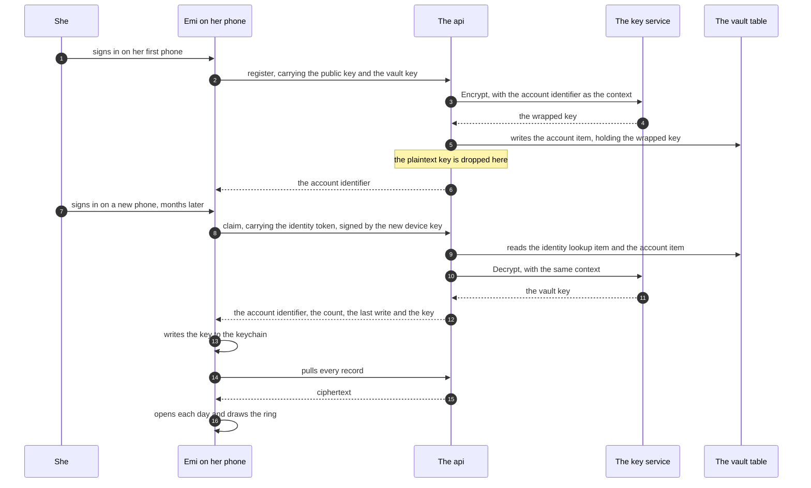
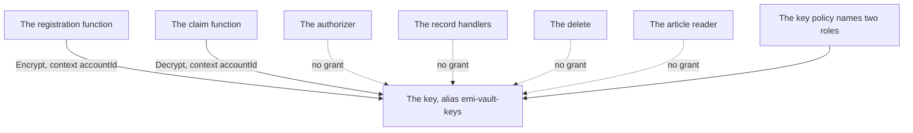
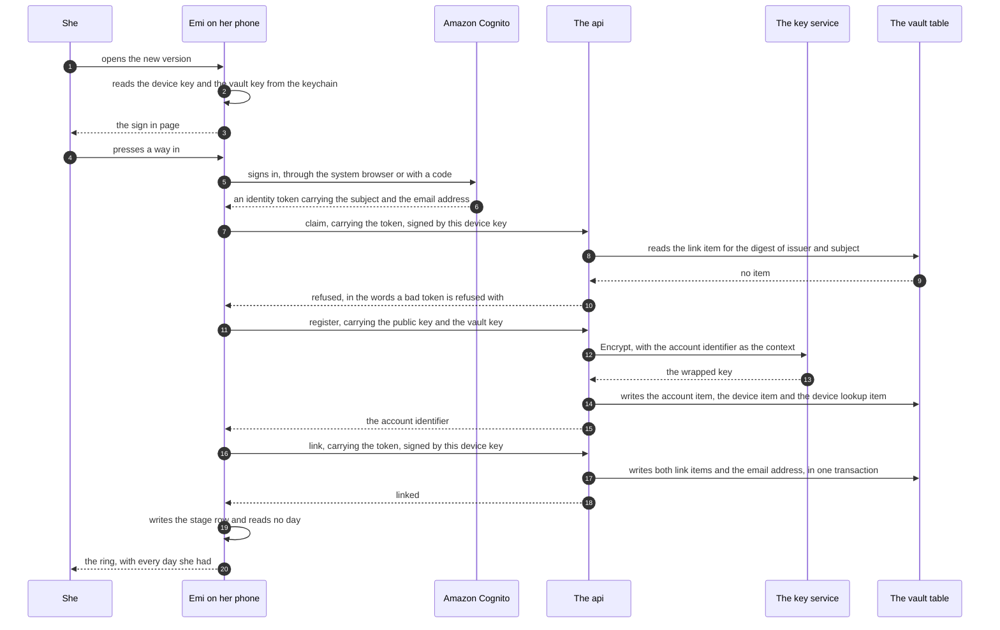
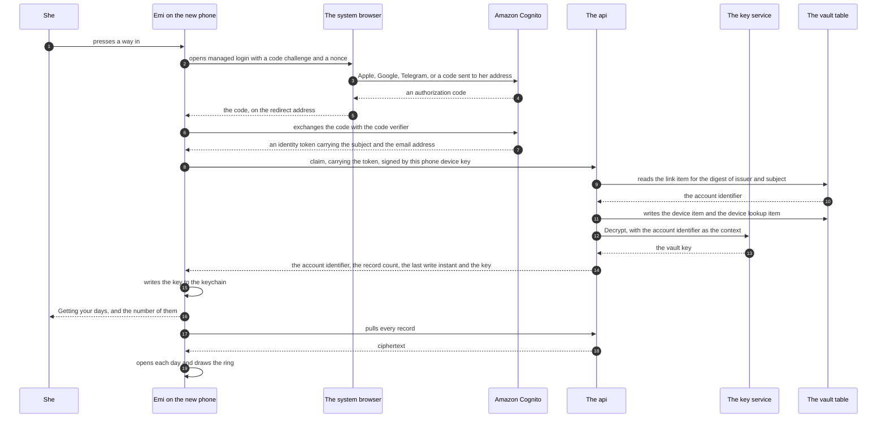
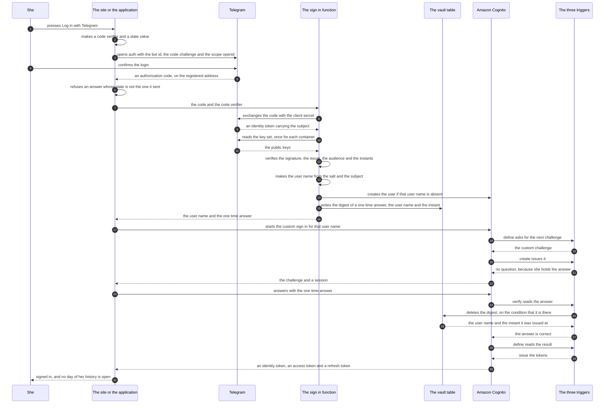

# The account: four ways in, and the key the cloud gives back

Emi has a vault account today, and nobody signs in to it. The phone makes an Ed25519 key pair, the
account identifier falls out of the public key, and every request carries a signature. This document
designs a sign in on top of that, through Amazon Cognito, with Sign in with Apple, Google,
Telegram and a code sent to her email address.

Two sentences hold the whole design up.

A sign in proves who may reach a partition of the vault. Emi keeps her vault key in the cloud,
wrapped by the Amazon key service, and the one call that answers a verified sign in hands it back
to her phone.

So a woman who signs in on a new phone reads her days a minute later. She writes nothing down and
she keeps nothing on paper. The cost sits in the same sentence: Emi holds the key material and the
function that releases it, so Emi can technically open her days. The operator accepted that cost on
13 November 2026, and this document now says so everywhere it used to say the opposite.

The pull request that carried this document built no product code. Step 2 of the path is in the
repository since 2026-11-05, and the section "What is built today" says what that covers.

## How to read this document

Status: designed

Every section carries one status line, the same as `architecture.md` and `privacy.md`. `Status:
built` means the code is in this repository now. `Status: designed` means this document describes it
and nobody wrote it yet.

Three sections say built. They report what the repository and the cloud account hold on 2026-09-19,
with one paragraph added on 2026-11-05.
Everything else is a proposal.

## The decisions this design starts from

Status: designed

The operator settled five things. They are written here as given. This document builds them and does
not argue with them.

Four ways in, and no password. Sign in with Apple, Google, Telegram and a code sent to her email
address, all through one user pool. There is no password anywhere in this feature, so there is no
password to reset and no reset path to design. The section "The four ways in, at field level" holds
what the pool keeps for each one. This replaces the decision of 2026-09-19, which was Google and
Apple alone with no email address.

There is no recovery code, and a sign in alone restores her days on a new phone. Emi keeps each
account's vault key in the cloud, protected by the Amazon Web Services Key Management Service, and
releases it to her phone after a verified sign in. The operator decided this on 13 November 2026. It
replaces the decision that read "Nothing about signing in opens a record. The recovery code stays
the only thing that wraps the vault key." The operator accepts the cost, stated plainly: Emi can
technically open her days, because Emi holds the key that wraps them and the function that unwraps
them. Every claim that Emi cannot read her days, and every claim that the recovery code is the only
thing that opens them, changes with this decision. The section "The vault key in the cloud, at field
level" holds the whole of it.

Emi has an account and it carries an email address, so Emi can write to her. Apple and Google hand
the address over at sign in. A woman who signs in with a code types her address once, to be sent
one. A woman who signs in with Telegram gives no address, because the Telegram login returns none.

The account is required, in the application and on the website, and a woman who uses the iPhone
application today keeps all of her data when she signs in. The sign in sits inside the first run,
and it sits at the launch of a phone whose first run is already done. The sign in merges her
identity with the vault account her days are already filed under, so no day is lost, copied or
orphaned. The operator decided this on 7 November 2026. It replaces the decision that read "She
signs in later, never in the first run. Contract SCREEN-1 stays exactly as it is, and so do its
tests." Contract SCREEN-1 now moves, and the section "The account is required, and a woman who
already has days keeps every one" holds the whole of it.

The account is required as a hard gate: no logging at all without an account. The operator decided
that on 8 November 2026, and question 3 of the section named above holds what it costs and what it
settles.

## What I read

Status: built

Each line names the fact taken from the source.

- `docs/contracts.md`. WIRE-1 registered a public key, a wrapped vault key and a recovery salt.
  AUTH-1 signs the method, the path, an instant and the digest of the body. VAULT-2 made the
  recovery code the one way back. The decision of 13 November 2026 moves WIRE-1 and VAULT-2, and the
  section "Every contract that moves" writes both. SCREEN-1 names an account, an email address or a password asked
  for as an error of the first run. WIRE-5 and PAY-4 keep reading open through a lapse.
- `docs/architecture.md`, the account and the request signature, the vault key on the phone, and the
  vault in Amazon Web Services. The account identifier is the first 16 bytes of the SHA-256 of the
  public key, in Crockford base 32.
- `services/vault`, the whole service. Four handlers, one authorizer, one storage port and one
  DynamoDB implementation. The authorizer reads the account item, verifies the signature against the
  stored public key, and writes the signature down to refuse a replay.
- `apps/mobile/src/services/sync`. `deviceKey.ts` makes the key pair once and keeps it in the
  keychain. `sign.ts` puts four headers on every request. `deleteAccount.ts` takes the server half
  first, because the key that proves the account is about to be destroyed.
- `apps/mobile/src/services/vault` and `packages/crypto/src/recovery.ts`. The recovery code derives
  one key through Argon2id, and that key wraps the vault key. It derives nothing else today, and a
  piece of the path deletes the module, the screens and the dependency together.
- `infra`. One HTTP api, four routes, two functions, one table, four roles. The pipeline validates
  on a pull request and applies on a merge.
- `apps/mobile/tests/integration/6.2.test.ts` and `apps/mobile/tests/integration/2.3.test.tsx`. Two
  cases pin what the product may hold and ask for. The section "What this design moves" names them.

I read these outside the repository on 2026-09-19.

- Apple, App Store Review Guidelines, guideline 4.8 and guideline 5.1.1(v), at
  `https://developer.apple.com/app-store/review/guidelines/`. Quoted in the section on Sign in with
  Apple.
- Apple, "Communicating using the private email relay service", at
  `https://developer.apple.com/documentation/signinwithapple/communicating-using-the-private-email-relay-service`.
  The page body is drawn by a script and I could not read it. I took the requirement from two other
  readings and say so where I use it.
- Amazon Web Services, the Amazon Cognito pricing page, the social identity provider guide, and the
  json web token authorizer guide for an HTTP api. A route takes one authorizer.
- Amazon Web Services, "Request production access" for Amazon Simple Email Service, and the
  reputation alarm guide. The sandbox allows 200 messages in 24 hours, one a second, to verified
  addresses only. The service recommends a bounce rate under 5 percent and a complaint rate under
  0.1 percent, and it may pause an account above 10 percent and 0.5 percent.

I also read the cloud account, read only, on 2026-09-19, with the credentials this machine holds.

- `aws sesv2 get-account --region eu-central-1` answers `ProductionAccessEnabled: true`,
  `SendingEnabled: true`, `EnforcementStatus: HEALTHY`, a quota of 50,000 messages in 24 hours at 14
  a second, and 0 sent in the last 24 hours. So account 230345688874 is already out of the sandbox
  in the region the vault runs in.
- `aws sesv2 list-email-identities --region eu-central-1` answers one identity, `datexpats.com`,
  with `VerificationStatus: FAILED` and sending disabled. So no domain in that account can send
  today, and Emi needs its own.
- `aws sesv2 list-configuration-sets --region eu-central-1` answers an empty list.

## What is built today, and the hole this design lands in

Status: built

The service registers an account, writes a record, reads a page of records and deletes everything.
The phone makes the keys, signs every request, wraps the vault key under the recovery code and sends
the wrapped bytes with the registration. That last clause is what the decision of 13 November 2026
replaces: the phone will send the key itself, and the key service will wrap it.

One gap sits in the middle of it.

A second phone makes its own device key, so it derives a different account identifier. It cannot
name the first account and it cannot sign for it. There is also no endpoint that reads the wrapped
vault key and the salt back: `registerAccount` writes them and no handler returns them. The case at
`services/vault/tests/register.test.ts` line 281 says the bytes are written down "so a second phone
can ask for them back", and nothing asks.

So feature 6 step 7, the restore onto a second phone, cannot run today. The sign in is what names
the old partition. The device binding is what lets the new phone sign for it. The key the claim
returns is what opens the days, and the decision of 13 November 2026 is what put it there. Until
that decision the recovery code held that place.

Step 2 of the path below is in the repository on 2026-11-05: `infra/cognito.tf` holds the user pool,
an app client for the phone and one for the site, and the email one time code as a first factor. It
is in the repository and not in the account, because the pipeline applies it on a merge. No
identity provider is declared yet, and the code cannot be delivered until a sender is verified with
Amazon Simple Email Service, which `infra/README.md` says in full.

## What a sign in does, and what it never does

Status: designed

It does four things.

1. It names her vault partition from a phone that holds neither her device key nor her vault key.
2. It binds a new device key to that partition, so the new phone can sign.
3. It returns her vault key, which the key service unwraps for the one function that answers a
   verified claim.
4. It gives Emi an email address, and it carries her subscription between the two stores.

Point 3 is the change of 13 November 2026, and it is the only thing in this list that opens a day.

It never does these.

No provider wraps or derives a key. Nothing Google, Apple or Telegram returns reaches the key
service, and no key is computed from a token. The identity token is verified and dropped, and no
part of it is written to the table.

The service never opens a record. It holds a vault key for the length of one claim and it reads no
payload with it. The record handlers, the authorizer and the delete hold no grant on the key at
all, so no route that touches a record can reach one.

A person who takes her Google account reaches her days. That sentence used to read the other way
and it has to read this way now, because her Google account is what the claim proves. What stands
between a stolen provider account and her history is the provider's own second factor, and the
transactional message Emi sends her the moment a new phone binds to her account.

## The vault key in the cloud, at field level

Status: designed

The operator decided on 13 November 2026 that a sign in alone restores her days. This section holds
the whole of that decision. Everything below is a field, a grant or a call.

### Where the wrapped vault key is stored

It stays where it is today: in the account item of the vault table, `ACC#<accountId>` and `META`,
in the attribute `wrappedVaultKey`. The table gains no item, no index and no second partition.

`wrappedVaultKey` holds the ciphertext blob that the key service returns. The service writes the
identifier of the key it used into that blob, so the item names no key and the decrypt call needs
no key identifier.

`vaultKeyWrappedAt` is new. It is an instant as text, written beside the blob. It says that this
item was wrapped by the key service, and a reader uses it to tell such an item from one wrapped
under a recovery key.

`recoverySalt` leaves the item. The registration stops sending it, and the step that carries the
migration removes it from every item that holds one.

Nothing else of the account item moves. `publicKey`, `createdAt`, `recordCount`, the email
attributes and the subscription attributes are untouched.

### Which key wraps it

One key, shared by every account. There is not one key for each account. It lives in the Amazon Web
Services Key Management Service, which this document calls the key service. It is in eu-central-1,
in account 230345688874, under the alias `alias/emi-vault-keys`.

The reason is the price, and I read it rather than assumed it. On 13 November 2026 the pricing
programming interface answered one United States dollar for each customer managed key version in EU
Frankfurt, and three United States cents for each 10,000 requests. Emi costs 29.99 pounds a year,
which is about 2.50 pounds a month. So a key for each account would spend a large part of what each
woman pays on the key service alone, before Emi stores one day. One shared key costs one dollar a
month in total, and 10,000 sign ins cost three cents.

The price is for each key version rather than for each key, and rotation makes versions. So a key
that rotates once a year may cost one dollar more each year. I did not measure that, so the step
that makes the key reads the bill before it turns rotation on, and writes down the number it found.

A key for each account would buy separation: a grant to open one account could not open another.
The encryption context buys the same separation for nothing. Every `Encrypt` call and every
`Decrypt` call carries the context `accountId`, with her 26 character account identifier as the
value. The key service refuses a decrypt whose context does not match the context the blob was
sealed under. So a function that reads the wrong account item gets a refusal from the key service,
not a key.

The key rotates once a year. The service keeps each earlier version of the key material, so a blob
written before a rotation still opens afterwards. I read that in no documentation on 13 November
2026 and I rotated no key, and the whole design rests on it. So the step that makes the key proves
it: it wraps bytes, rotates the key on demand, and opens the same blob again. The same step proves
that a decrypt needs no key identifier, because the blob carries the version it was sealed under.

This key is the one resource in this design that bills while nobody uses it, at one dollar a month.
The cost rule of this workspace refuses an idle resource by default, so the operator takes it
knowingly. The alternative is her vault key in the table in the clear, which is worse for one
dollar.

### Which role may call Decrypt

One role, and it belongs to the function that answers a verified claim.

The claim function role holds `kms:Decrypt` on this one key, with a condition that the request
carries the encryption context key `accountId`. It holds no other key service action.

The registration function role holds `kms:Encrypt` on this one key, and no `Decrypt`.

The key policy on the key names those two roles and nothing else. So the grant lives in two places
and both must agree. A role that gains the action in its own policy by accident still cannot call
the key.

Every other role holds neither action: the authorizer, the two record handlers, the delete, the
article reader, the link, the unlink, the sign in functions and the three triggers. The apply role
of the pipeline may make the key and may not use it.

The infrastructure test reads the Terraform text and asserts each line above: one key, the alias,
the rotation, the two actions on two roles, the encryption context condition, the key policy, and
that no third role names the key.

### What the phone sends when it first registers the key

`POST /v1/account`, under contract WIRE-1, signed by the device key under contract AUTH-1.

The body carries two fields and no third. `publicKey` is 32 bytes as base 64. `vaultKey` is 32
bytes as base 64, and it is the key the phone already holds in `emi.vaultKey.v1`. The body carries
no `wrappedVaultKey` and no `recoverySalt`, because the phone wraps nothing now.

The function derives the account identifier from the public key with `accountIdFor`. It calls
`Encrypt` with that identifier as the encryption context. It writes `wrappedVaultKey`,
`vaultKeyWrappedAt` and the rest of the account item in one write, with the condition that the
partition does not exist. Then it drops the plaintext.

The plaintext vault key is in one request body and in the memory of one function, for the length of
one call. That is the new exposure and this document does not soften it. Amazon terminates the
Transport Layer Security at the api gateway, so Amazon can see the key at the edge as well.

Three rules hold what is left. The access log writes the route template, a request identifier and a
duration, and never a body or a header. The function writes no log line that carries a field of the
body, which contract KEEP-1 already says. The handler refuses a body that is not exactly those two
fields, so no third field can ride in beside the key.

One alternative was considered and set aside, and the operator may still want it. An asymmetric key
in the key service would let the phone encrypt the vault key to a public half, so no plaintext ever
crosses the wire. It costs a second key, a public half the phone must fetch and trust, and a
request the pricing programming interface prices at 15 United States cents for each 10,000 rather
than three. It defends the edge and nothing else, because the claim still returns the plaintext key
to a phone. The step that builds the registration is the place to ask.

### What the claim on a new phone returns

`POST /v1/account/claim`, carrying the identity token, signed by the new device key.

The function verifies the token against the key set the pool publishes. It reads the identity
lookup item and takes the account identifier from it. It writes the device item and the device
lookup item. It reads the account item. It calls `Decrypt` with the encryption context of that
account identifier. It answers with four values.

`accountId` is the 26 characters. `recordCount` is a number. `lastWriteAt` is an instant as text.
`vaultKey` is 32 bytes as base 64.

This is the one call in the whole product that answers with a key. No other handler holds the
grant, and no other answer carries a key. Both halves are rules a test can fail.

A claim for an identity that names no account is refused in the words a bad token is refused with.
The refusal carries no key, no count and no account identifier.

The phone writes the key to `emi.vaultKey.v1` and then pulls. The order is the same order the old
design used, and for the same reason: no unreadable row ever reaches her database.

### The key path, from the first registration to a new phone

### Who may reach the key, drawn once

### What this costs her, written plainly

Emi can open her days. The key service holds the material, two functions of Emi hold the grants,
and the operator holds the account. A court order, a mistake in a policy, or a person inside Amazon
with enough rights, each one reaches a vault key that used to be on paper in her drawer.

What stays true. No day is readable in the table, because the payload is sealed and the key is not
beside it. The key never leaves the key service except into the two functions that hold a grant.
The phone still seals every day before it sends one, so a reader of the table alone learns nothing.

What she gets for it. She signs in on a new phone and her days arrive. She writes nothing down. She
loses nothing when she loses a piece of paper, which is how most women lost their history under the
old design.

Every word in the product that said the opposite changes in the same release. Question 5 of the
section below writes each one, in three languages.

## A woman who already has a recovery code

Status: designed

Nobody holds one today, and I read that in the repository on 13 November 2026 rather than assuming
it. `apps/mobile/src/services/sync/deleteAccount.ts` holds the only `fetch` call under
`apps/mobile/src`, and `/v1/account` is the only path it names, so no build ever registered an
account. `apps/mobile/src/features/recovery/RecoveryFlow.tsx` holds the three recovery screens, and
no file under `apps/mobile/src/app` names it, so no route ever drew them.

So the cheapest migration is the one that stays empty, and the path keeps it empty with an order.

**No build registers an account under the old model after this decision.** The step that wraps the
vault key in the cloud merges before the step that wires the registration into the application. The
path below is ordered that way. While that order holds, no woman is ever shown a recovery code, and
there is nothing to migrate.

The rest of this section is what it costs if that order breaks.

### Her phone holds the key

This is the case that matters, and it asks her nothing.

Her vault key is in `emi.vaultKey.v1` on the phone that registered, whatever the server holds. So
the phone needs no code to read its own days, and it needs no code to hand the key to the key
service.

At the first launch of the new build, the application calls `PUT /v1/account/vault-key` once. The
body carries one field, `vaultKey`, 32 bytes as base 64, signed by the device key. The function
calls `Encrypt` with the account identifier as the context, writes `wrappedVaultKey` and
`vaultKeyWrappedAt`, and removes `recoverySalt` in the same write. Then it drops the plaintext.

No day is read and no day is written. The revision and the write instant of every row of `day_log`
are the same afterwards, which is a rule a test can fail.

The call is safe twice, because the second one overwrites a blob with an equivalent blob. The phone
writes one row in the `setting` table, `vaultKeyWrapped`, holding the instant the call answered, so
a launch after that one calls nothing.

### Her phone is gone and the paper is all she has

This case cannot happen while the order above holds, because she was never shown a code.

If a build breaks the order, it carries the answer with it. The recovery material endpoint and the
three recovery screens stay for exactly one release, as a second way to open the old wrapped bytes.
The moment the phone opens them, it calls `PUT /v1/account/vault-key` with the key it just
recovered, and that account is on the new model from then on. The release after that deletes the
endpoint and the screens.

Nobody should have to build that, and the path is ordered so that nobody does. It is written here
so that the cost of breaking the order is a known number rather than a surprise.

### What happens to recoverySetup, recoveryCode and recoveryConfirm

They leave the first run.

Those three screens are on the operator's canvas, in the row "First run, the promise and the key".
This pull request does not edit the canvas, because the canvas is the operator's. The design says
they leave the first run, and the operator moves them when they choose to.

In the repository they already draw nowhere. `RecoveryFlow.tsx` holds them and no route opens it.
So removing them changes no screen a woman can reach today, and the step that removes them is a
deletion with no behaviour under it.

The step deletes `apps/mobile/src/features/recovery/`, and it empties
`packages/crypto/src/recovery.ts` down to one function. `recoveryKeyFrom` stays, because the
partner sharing design of `docs/design/data-model.md` derives a link secret with it.
`docs/reference/crypto.md` is generated from the source comments, so it loses its recovery entries
in the same step rather than in this one.

Contract SCREEN-1 loses the three screens from its count in the same step. The section "What
SCREEN-1 becomes" holds the new number.

## Question 1: the identity beside the account identifier

Status: designed

Both run, and the signature stays the proof on every request. The identity authorizes two calls
only: link an identity to the account, and claim an account from a new phone.

The account identifier is derived and not chosen. `accountIdFor` cuts it from the public key, so two
women cannot land on one and the service never trusts a caller to name herself. A Cognito subject as
the partition key would give that property away and rewrite WIRE-1, AUTH-1, the table and every
test.

An identity token is a bearer token. Whoever holds it can act while it lives. The signature is a
proof of possession, bound to the method, the path, the instant and the digest of the body, and it
is refused the second time it arrives. Moving every request onto a bearer token would weaken every
request for the sake of two calls.

A route takes one authorizer, so the signature authorizer cannot share a route with a json web token
authorizer. The two new calls verify the token inside the handler, against the key set the pool
publishes.

## The account is required, and a woman who already has days keeps every one

Status: designed

The operator decided this on 7 November 2026. This section answers five questions about that
decision, and it corrects every section the earlier decision wrote. Each correction says what it
corrects.

### What the repository holds today, which decides how small the merge is

Status: built

I read each fact below in the repository on 7 November 2026.

The service registers an account. `services/vault/src/handlers/register.ts` reads a public key, a
wrapped vault key and a recovery salt, derives the account identifier with `accountIdFor`, and
writes the account item through `services/vault/src/store/dynamo.ts`. The port it writes through is
`services/vault/src/store/accounts.ts`, and the item holds `publicKey`, `wrappedVaultKey`,
`recoverySalt`, `createdAt` and `recordCount`.

The application calls one route of the four. `apps/mobile/src/services/sync/deleteAccount.ts` holds
the only `fetch` call in `apps/mobile/src`, and `/v1/account` is the only path it names. No module
under `apps/mobile/src` calls the registration, puts a record or pulls one.

The recovery code flow is built, and no route reaches it.
`apps/mobile/src/features/recovery/RecoveryFlow.tsx` holds the three screens, and no file under
`apps/mobile/src/app` names it.

Every deployed function answers from its placeholder until a merge uploads a bundle to it. The
packaging is built: `infra/README.md` says that the `functions` job of
`.github/workflows/deploy.yml` builds one bundle for each of the seven functions and uploads them
on a merge into `main`.

So a woman on the current build holds her days in SQLite on her phone, sealed under the vault key in
her keychain. She holds no recovery code. The vault holds no account for her and no copy of a day.

That makes the merge for a current user additive, and it is the reason no day can be lost. The merge
wraps the key she already holds. It registers the account her device key already names. It links her
identity to that account. It reads no day and it writes no day.

One case is larger, and this design carries it already: a woman whose identity names a vault account
somewhere else, from another phone or from the website. That case is the restore, and the sections
"Getting her days, after the sign in" and "The days she wrote before she signed in" hold it.

### Question 1, the woman who already has days

Status: designed

#### Where the application asks her

One redirect, in the place two redirects already sit. `apps/mobile/src/app/(tabs)/index.tsx` sends
her to the welcome while the first run is not done, and to the tour while the tour is not seen. A
third redirect sends her to the account gate while the stage row is not `linked`.

That one redirect serves both women. A woman with days has a finished first run, so she meets the
gate at her next launch. A new woman reaches the home route from the hold, so she meets the same gate
in the same place. The redirect reads the stage row every time the route draws, so a woman who closes
the application lands back on the gate at the stage she left.

#### What she sees

The plain sign in page, which the section "The screens of the sign in" writes out in three
languages. It carries four ways in, a field for her address, and nothing else.

The decision of 8 November 2026 gives it no control that reaches the ring. The decision of 13
November 2026 takes two more things off it: there is no recovery code to show her, and there is no
delete before she signs in. So the gate went from a paragraph and six controls to one line and five.

The earlier design wrote five sentences here, including a count of the days on her phone and a
promise that Emi could not open one of them. The count went because a screen carries one line, and
the promise went because it is no longer true.

#### The merge, in order

1. She presses a way in. The sign in module opens the managed login in the authentication session
   the operating system owns, or it asks for a code sent to the address she types. Amazon Cognito
   answers with an identity token. The module writes the refresh token to the keychain as
   `emi.identityRefresh.v1`. Nothing else of hers changes yet, and the stage row reads
   `identity-held`.
2. The application calls the claim, carrying the token, signed by this device key. The claim is the
   one call that answers whether this identity already names an account.
3. The claim is refused. That is every current user, because her identity names no account. The
   branch is drawn on the phone: the service refuses a claim with no link in the words it refuses a
   bad token with, and the phone knows its own token is good, so the refusal means no link. The
   service tells a caller nothing it did not know, and rule 11 stays exactly as it is.
4. The application registers: the public key, and the vault key this phone already holds, under
   contract WIRE-1. The account identifier is the one `accountIdFor` cuts from her device public
   key, so the account this registration makes is the account her phone has named since its first
   launch. The service wraps the key under the key service and writes the account item. The stage
   row reads `registered`.
5. The application links the identity to that account, signed by the device key. The link writes
   both link items and the email address in one transaction. The stage row reads `linked`.
6. The gate closes and the ring draws. Every day is where it was, under the key it was already
   under.

Three screens left this list on 13 November 2026. The old step 4 showed her 26 characters, asked
her to write them down, and asked her to type them back. The merge now asks her for nothing after
she presses a way in, and `emi.recoveryConfirmed.v1` is gone from the design with them.

A phone that registered already reads the 409 of a second registration as registered, so the merge
is the claim and the link alone. That is the shape every phone has once the registration is wired
into the application, and the merge covers both shapes with one branch.

Step 3 is the one branch. When the claim answers instead of refusing, her identity already names an
account and she is on the restore path: Getting your days, the second sealing of the days this
phone holds, and the pull. That path is the only path in the product that replaces a vault key, and
the section "The days she wrote before she signed in" holds its order.

#### No day is lost, copied or orphaned

Lost: the merge writes nothing to `day_log`. A case reads `revision` and `updated_at` of every row
before the merge and after it, and both are unchanged.

Copied: the registration body carries two fields, a public key and a vault key, and neither one is
a day. The account item
starts with a `recordCount` of 0, and nothing in the merge puts a record.

Orphaned: the account identifier falls out of the device public key, so the merge cannot make a
second account for this phone. A link is refused when the identity names another account. The
restore path deletes an account this phone registered before it claims another, which the section
"The days she wrote before she signed in" designs.

#### A woman who already has days, signing in and keeping them

Read the writes at the api. One carries her vault key, which the key service wraps before anything
is written down. One carries an email address. Neither one carries a day, and no day leaves the
phone in this whole sequence.

Read the fourth line from the end. The phone writes a row of plain text and nothing else, because
the vault key it holds is the key it already had.

#### She closes the application halfway

The stage row carries the resume. It is one row in the `setting` table, under the key
`accountStage`, and it holds one of four values in this order: `asked`, `identity-held`,
`registered`, `linked`. Each value is written after the work it names succeeds, so the row is never
ahead of the work.

Every step runs twice safely, and the decision of 13 November 2026 made that easier rather than
harder.

The device key is made once. `deviceKey` returns the key the keychain holds rather than making a
second one.

The vault key is never replaced on this path, so the registration sends bytes the phone already
holds.

The registration answers 409 for a public key that is registered already, and the phone reads 409 as
registered. The handler refuses the second write with a condition, so no item is overwritten and no
second call reaches the key service.

The link needs one change to be safe twice, and the path carries it as a piece of its own. The
condition on the lookup item becomes this: no item exists, or the item already names this account. A
second link of the same pair then answers as linked. Without that change a woman who closes the
application between the write and the answer meets a refusal that tells her her own identity is in
use.

Nothing asks her for anything twice now. The old design had one stop that asked her to type the 26
characters again, from the paper she had just written them on, because a phone that confirmed a code
and never reached the registration held no wrapped key. That stop is gone with the code.

#### She has no network

Nothing of hers changes. The stage row stays where it was, and the gate says what the network costs
her. The gate is hard, so the two women see two different screens: one cannot start, and one cannot
log again until she signs in once.

The section "The screens of the sign in" writes both screens out, in three languages, with one line
each. Neither one carries a delete. The earlier design put "Delete everything on this phone" on the
screen for a woman who already has days, and the decision of 13 November 2026 takes it off: a woman
who is waiting for a signal is not a woman being offered a way to destroy her history.

The delete is still hers whenever she wants it. It sits in Settings, where it already is, and it
works with no network, which `apps/mobile/src/services/sync/deleteAccount.ts` already does.

#### She signs in with an identity that another account holds

The claim answers, so it returns that account's record count, its last write instant and its vault
key. She goes to Getting your days.

Almost always it is her own older account, from a phone she replaced. The days this phone holds are
sealed again under the key the claim returned, each revision rises by one, and the pull follows.
She keeps both histories and she types nothing. The section "The days she wrote before she signed
in" holds the order.

The other case is the one the old design handled with a screen, and this design handles with a
refusal. An identity names one account, and a link is refused when the identity already names
another account, so she can reach no account her own identity does not name. A woman holding
somebody else's provider account is the case that is left, and two things stand against it: the
provider's own second factor, which Emi does not own, and the transactional message Emi sends the
moment a new device binds to an account. That message is the one that matters, and the section on
the email address already names it as such.

Two screens leave the product here. The locked screen said her days were here and locked, and the
screen headed "Without the code, these days cannot be opened" offered her a way to start again or
to delete the account. Neither state exists now. A claim that answers returns a key, so there is no
locked state to draw, and no woman arrives at a vault she cannot open.

One piece of the path goes with them. "Start again keeps the days this phone holds" existed because
a woman could reach her own ciphertext and fail to open it. Nothing reaches that state now, so the
piece is withdrawn rather than built.

### Question 2, the new users

Status: designed

#### Where the sign in sits in the first run

After the hold, and before the home screen. The hold is the last screen that asks her anything, and
it writes every answer in one transaction. The gate draws next, on the home route, through the same
redirect that serves a woman with days.

Three reasons for that place.

She has a reason by then. She has read what Emi is, she has given her last three periods, and her
first forecast is on the other side of the gate. A sign in asked at the second screen is a sign in
asked of a woman who does not yet know what she would be signing in for.

The first run keeps its promise that nothing is written before the hold. The gate writes after it,
and what it writes is an account and never an answer about her body.

The gate is one place and not two. A woman with days and a woman with none meet the same screen,
through the same redirect, so one set of cases covers both.

The screens of the gate live under a route of their own, `apps/mobile/src/app/account/`, and not
under `apps/mobile/src/app/onboarding/`. The eleven questions of the first run stay eleven, the step
counter and the progress bar keep their arithmetic, and `firstRunScreens` does not grow. The gate is
a screen between the welcome and the home screen, which is what contract SCREEN-1 counts, so
SCREEN-1 moves even though the question list does not.

#### What SCREEN-1 becomes

Output: at most eleven questions and seven other screens between the welcome and the home screen.
The five it counts today, the sign in page, and the screen for the code sent to her address. Every
question can be passed. It ends with her answers written in one transaction at the hold. Every
answer it takes is readable afterwards from the Privacy screen. An answer she gave is changeable
afterwards, through the control she gave it with.

Errors: a question whose answer nothing in the product reads, except the year of birth. A question
with no Skip. An answer written to the database or the server in plain text. A password asked for. A
field for anything other than her name, and the address of a woman who asks for a code. Anything
written before the hold. The sign in page drawn before the hold. A control on the sign in page that
reaches the ring. A delete offered before she signs in. A day logged while the stage row is not
`linked`.

The count was nine on 7 November 2026, when it held the account gate and the three screens of the
recovery code. The decision of 13 November 2026 takes those three out and puts the code screen in,
so it is seven.

One screen is reached only when her identity already names an account: Getting your days. It is
named apart, the way the every symptom screen is named apart today, because no first run reaches
it.

The question list keeps its Skip rule, and the sign in page is not one of the questions. The page
itself cannot be passed, which the decision of 8 November 2026 settles, so the error line above is
written and no longer waits.

#### Every contract that moves

`SCREEN-1`, as above. The error line that reads "An account, an email address or a password asked
for" is now the opposite of the product, and the output count rises by two.

`SCREEN-5, the account gate` is new. It declares the sign in page, the four ways in, the stage row,
the resume after a close, the refusal to write a day, the absence of a delete before a sign in, and
the error of a day read or written by the merge.

`VAULT-2` moves, and the decision of 13 November 2026 is what moves it. It reads "the recovery
code" today, with Argon2id and a one second unlock as its measured ceiling. It becomes the vault
key wrapped in the cloud. Input: the vault key as 32 bytes, and the account identifier as the
encryption context. Output: the blob the key service returns, written to the account item, and the
same 32 bytes handed back to a phone that passes a verified claim. Errors: the plaintext key in any
log, any access log entry or any table attribute. A decrypt by any role but the one the claim
function runs as. A decrypt whose encryption context does not name the account the caller proved.

`WIRE-1` moves with it. Input becomes a public key and a vault key, signed by the key being
registered. The recovery salt leaves the body. Its errors gain a vault key that is not 32 bytes.

`VAULT-1` does not move. The phone still makes the key once and never replaces it, and the merge
creates none, so its refusal stands as strict as it is. The restore is the one path that writes the
item, and this design gives that path its own call.

The key leak rule gains one allowed reach. `emi.vaultKey.v1` is named under
`src/services/vault` today. The registration sender under `src/services/sync` must read it to send
it, so `tools/pipeline/keyLeak.ts` names that one call as the single allowed reach, the way the
merge already names one. Everything else stays refused.

`AUTH-1` and `KEEP-3` do not move.

`docs/features.md` carries two lines that move. Under Feature 2 it reads "`SCREEN-1` the first run,
with no account and no email address, ending at the hold that writes every answer at once." The
clause about no account goes. Under Feature 6 it reads "`VAULT-2` the recovery code, the salt and
the wrapped vault key, with the unlock time measured." That line takes the new VAULT-2.

`tools/pipeline/documentation.test.ts` holds two counts by hand. The case named "declares fifty
three contracts across thirteen groups" becomes fifty four, and the case asserting "53 contract(s)
mapped to a feature" becomes 54.

#### Every test that moves

`apps/mobile/tests/integration/2.3.test.tsx`, the case "asks her for no account, no email address
and no password". The first run now asks for an account, so the case is rewritten. It keeps the two
halves that stay true: no password, and one field for her name. It gains the address field of the
code way, which is on the gate and not in the first run.

`apps/mobile/tests/integration/2.3.test.tsx`, the case "has one screen for each question, the hold
and the tour beside them, and one layout". It reads the files of `app/onboarding` and counts them
against `firstRunScreens`. The gate adds no file there, so the case stays green, and that is the
reason the gate sits under its own route. A case is added that reads `app/account` the same way.

`apps/mobile/tests/integration/2.3.test.tsx`, the case that walks every path of the first run and
ends with `expect(app.pathname()).toBe('/')`. The gate now stands between the hold and the home
screen, so every case that reaches the home screen through the first run passes the gate. The
fixture `apps/mobile/tests/fixtures/theFirstRun.ts` carries that, so the fixture changes once and
the twenty two test files that use it do not.

`apps/mobile/tests/integration/6.2.test.ts`, the case "leaves the server holding her public key and
nothing else about her", which asserts `expect(JSON.stringify(held)).not.toContain('@')`. An account
that has signed in holds an email address, so the assertion moves to the registration path, where it
stays true and says more: an account that has only registered holds nothing about her.

`apps/mobile/tests/integration/6.2.test.ts`, the case "asks her for no email address and no password
to get there". Its name moves, because the product does now ask for an address. Its body moves as
well, because the decision of 13 November 2026 takes the registration body from three fields to
two: the wrapped key and the salt leave, and the vault key arrives.

`apps/mobile/tests/integration/22.10.test.tsx`, the case "asks eleven questions in order, her last
three periods as one, and then the reminder". It asserts `firstRunScreens` word for word. The gate
is not in that list, so the case stays green, and a mutation that puts the gate in the list is
watched failing.

The copy test that reads every string of the application. Each string in question 5 moves, in three
languages, and the test reads them.

### Question 3, what required means when she refuses or cannot sign in

Status: designed.

The operator decided this on 8 November 2026. It is a hard gate: no logging at all without an
account. The gate carries no control that passes it.

So the gate stands in front of the product, and three things stand in front of the gate. The first
run runs to the hold, so she answers every question and her answers are written. The lock draws,
because a phone that asks for Face ID asks before any screen of Emi. The delete works, because a
woman who wants her days gone may always have them gone, and it sits in Settings where it already
is. The gate itself carries no delete, which the decision of 13 November 2026 settles.

Reading her own days sits behind the gate as well, because the gate sits on the home route. The
decision names logging, and this design puts the gate in front of the whole product, because a ring
she may look at and never add a day to reads as broken in a different way.

What it costs, written here because it is the design working and not a fault. A woman with no
network cannot start Emi at all. A woman who will not sign in leaves at the gate, after she gave Emi
her last three periods. A woman who already has days cannot log one more until she signs in once,
and the section "She has no network" says what each of the two sees.

Read guideline 5.1.1 of the App Store review rules before this ships. I read no guideline on 7 or 8
November 2026, so an application that asks for an account before it draws a ring is a review risk
measured in no way. It stays an open item for the operator, and the section "What this design does
not answer" names it.

The three alternatives considered, and what each one would have cost instead.

**A gate she may pass, which returns.** She presses Not now, and the application records as it does
today. It keeps every day a radio would cost her, and it leaves two shapes of user in the product
for ever.

**Required for the vault and the money, never for a day.** The account gates the sync, the restore
and the payment, and the phone records without one. It changes nothing in the first run, and it does
not deliver the decision.

**A grace that ends.** The application records from the first launch and stops when a stated number
of days passes with no account. A plane and a holiday both work, and an application that stops
recording reads to her as an application that lost her days.

### Question 4, what signing in now opens, and what holds the rest

Status: designed

This question used to read "signing in opens no record, and the merge keeps that true". The decision
of 13 November 2026 reverses the first half of it, so the section is rewritten rather than edited.

A verified claim opens her records. It returns her vault key, and the phone that holds that key
reads every day she wrote. That is the product the operator chose, and five facts hold everything
around it. Each one is a rule a test can fail.

The merge performs no key operation at all. It sends the key the phone already holds and it derives
nothing. Argon2id leaves the product with the recovery code, and the merge is three calls and a row
of plain text.

The merge derives nothing from anything a provider returns. The identity token is verified and
dropped. The token reader returns a digest and an email address, and never the subject. No field of
the token is written to the table.

The merge never replaces the vault key. For a woman with days the key stays the key her days are
sealed under, so the merge cannot read a day and cannot write one. The one path that replaces a
vault key is the restore, and it replaces it with the key the claim returned for her own account.

One function may decrypt, and it is the one that answers a verified claim. The registration may
encrypt and nothing else. Every other role in the account holds neither action, and the key policy
on the key names the two roles rather than trusting their own policies alone.

The service never opens a day with the key it holds for one call. It hands the bytes to the phone
and forgets them. A case drives the claim and asserts the answer carries no payload, and a second
case walks the service from its entry point and asserts it imports no function that could open an
envelope. That second case exists today and it keeps working.

So the honest summary is one sentence. Emi can open her days, and the design makes sure that only
one function, holding one grant, against one encryption context, can start.

### Question 5, the words that promised an optional account and a code

Status: designed

Two decisions move these words. The decision of 7 November 2026 makes the account required, and the
decision of 13 November 2026 takes the recovery code out and puts Emi's reach in. Each key is
written out below in English, Spanish and Russian. The piece that lands them is named in the path,
and it merges after the gate, so the product never says an account is needed while it is not.

Two keys are named after the promise rather than after the fact, so the piece renames them.
`signInNoAccountNeeded` becomes `signInIsNeeded`. In the application
`onboarding.welcome.line.noAccount` becomes `onboarding.welcome.line.signIn`.

**`signInIsNeeded`, on the sign in page.**

English: Emi needs an account. The account lets you pay, manage your subscription, and find your
days again on a new phone.

Spanish: Emi necesita una cuenta. La cuenta te permite pagar, gestionar tu suscripción y volver a
encontrar tus días en un teléfono nuevo.

Russian: Emi нужен аккаунт. С ним вы оплачиваете, управляете подпиской и находите свои дни на новом
телефоне.

**`signInWhatTheAccountHolds`, on the sign in page.** The account holds an email address and a
wrapped key, so the line says both.

English: The account holds an identifier, an email address, how you sign in, and what you paid for.
It also holds your key, wrapped by Amazon, so a new phone can read your days once you sign in.
Apple, Google and the code sent to your address each give Emi the address. Telegram gives none.

Spanish: La cuenta guarda un identificador, un correo electrónico, cómo entras y lo que has pagado.
También guarda tu clave, cifrada por Amazon, para que un teléfono nuevo pueda leer tus días cuando
entres. Apple, Google y el código que te enviamos dan ese correo a Emi. Telegram no da ninguno.

Russian: Аккаунт хранит идентификатор, адрес электронной почты, способ входа и то, что вы оплатили.
Он также хранит ваш ключ, зашифрованный Amazon, чтобы новый телефон мог читать ваши дни после
входа. Apple, Google и код на вашу почту дают Emi этот адрес. Telegram не даёт адреса.

**`policyAccountOptional`, a heading on the privacy policy page.** It reads "Account is optional"
today, and it is one of three headings at the top of the page.

English: Your account holds the key to your days.

Spanish: Tu cuenta guarda la clave de tus días.

Russian: Ваш аккаунт хранит ключ к вашим дням.

**`policyAccountLine`, on the privacy policy page.** This is the line that ends "It is optional: Emi
works without it."

English: Your account holds a hashed identifier, your email address, how you sign in, what you paid
for, and your key, wrapped by Amazon Web Services. It lets you pay on the web or with Telegram
Stars. It lets you find your days and your purchases again on a new phone. It never holds a day.
Emi can unwrap your key, which is what makes a new phone work with nothing for you to type, and Emi
says so here rather than claiming otherwise.

Spanish: Tu cuenta guarda un identificador con hash, tu correo electrónico, cómo inicias sesión, lo
que has pagado y tu clave, cifrada por Amazon Web Services. Con ella puedes pagar en la web o con
Telegram Stars. Con ella puedes volver a encontrar tus días y tus compras en un teléfono nuevo.
Nunca guarda un día. Emi puede descifrar tu clave, y eso es lo que hace que un teléfono nuevo
funcione sin que escribas nada. Emi lo dice aquí en vez de afirmar lo contrario.

Russian: Ваш аккаунт хранит хешированный идентификатор, ваш адрес электронной почты, способ входа,
то, за что вы заплатили, и ваш ключ, зашифрованный Amazon Web Services. С ним вы можете заплатить
на сайте или через Telegram Stars. С ним вы можете снова найти свои дни и покупки на новом
телефоне. Он никогда не хранит день. Emi может расшифровать ваш ключ, и это то, что позволяет
новому телефону работать без ввода чего либо. Emi говорит об этом здесь, а не утверждает обратное.

**`policyCollectLine`, on the privacy policy page.**

English: Emi stores your days as ciphertext and holds the key to them in Amazon Web Services. Your
account holds your email address and what you paid for. Anonymous usage reports stay optional.

Spanish: Emi guarda tus días cifrados y guarda la clave en Amazon Web Services. Tu cuenta guarda tu
correo electrónico y lo que has pagado. Los informes de uso anónimos siguen siendo opcionales.

Russian: Emi хранит ваши дни в зашифрованном виде и хранит ключ к ним в Amazon Web Services. Ваш
аккаунт хранит ваш адрес электронной почты и то, за что вы заплатили. Анонимная статистика
остаётся необязательной.

**`protectionAlsoBefore`, on the privacy page.** The sentence ends in the middle, because a link
follows it.

English: Emi has an account, takes payments, and sends anonymous crash and usage reports only if you
switch them on. Read

Spanish: Emi tiene una cuenta, acepta pagos y envía informes anónimos de errores y de uso solo si tú
los activas. Lee

Russian: У Emi есть аккаунт, она принимает платежи и отправляет анонимные отчёты о сбоях и об
использовании, только если вы это включите. Прочитайте

**`onboarding.welcome.line.signIn`, the third line of the welcome screen.** It reads "There is no
account. Emi never asks for your email address or a password." today.

English: Emi asks you to sign in once, so your days can reach a new phone. Emi never asks for a
password.

Spanish: Emi te pide iniciar sesión una vez, para que tus días lleguen a un teléfono nuevo. Emi
nunca te pide una contraseña.

Russian: Emi просит вас войти один раз, чтобы ваши дни попали на новый телефон. Emi никогда не
просит пароль.

**`settings.whoCanSee.kept.line`, on the Privacy screen.** It reads "Kept encrypted on this phone.
Emi has no account for you, and sends your records nowhere." today.

English: Kept encrypted on this phone. Your account holds your key, so a new phone can read your
days once you sign in.

Spanish: Se guardan cifrados en este teléfono. Tu cuenta guarda tu clave, para que un teléfono nuevo
pueda leer tus días cuando entres.

Russian: Хранятся в зашифрованном виде на этом телефоне. Ваш аккаунт хранит ваш ключ, чтобы новый
телефон мог читать ваши дни после входа.

Every string of the sign in itself is in the section "The screens of the sign in", in the same three
languages, and the piece that builds each screen takes them from there.

One rule covers the whole set and it is rule 47 of the list below. No string of either surface says
the account is optional, and no string says that Emi cannot read her days or that a code is the only
way back. The copy test reads every string of the application, and the website test reads all three
languages of every key above.

### The data model of the merge, at field level

Status: designed

Everything the merge reads or writes is below. Nothing else is touched.

#### On the phone, in the keychain

`emi.deviceKey.v1` holds the private key as base 64. The merge reads it. It writes it only on a
phone that has never made one, through the call that makes a key once.

`emi.accountId.v1` holds the 26 character identifier. The merge reads it and writes nothing to it,
because the identifier does not change.

`emi.vaultKey.v1` holds 32 bytes as base 64. The merge reads it and sends it with the registration,
and it writes nothing. The restore path is the one path that writes it, with the bytes the claim
returned.

`emi.identityRefresh.v1` holds the refresh token of the pool. The sign in module writes it. No other
directory may name it, which the key leak gate holds.

`emi.recoveryConfirmed.v1` is gone. It held the instant she confirmed a code, and there is no code.
The step that removes the recovery screens removes the item with them.

#### On the phone, in the `setting` table

That table is plain text and local, which `apps/mobile/src/data/settingRepository.ts` says in its
first comment. So it holds no address, no subject, no token and no key.

`accountStage` is one key, and its value is one of `asked`, `identity-held`, `registered` and
`linked`. Both halves of `settingRepository.ts` take the new key: the `SettingKey` union and the
`settingKeys` list. A key added to one and not the other compiles and then fails at run time.

`accountProvider` is one key, and its value is one of `apple`, `google`, `telegram` and `code`. The
sign in page and the account screen read it to name the way she came in. It carries no address.

`vaultKeyWrapped` is one key, and it holds an instant as text. Only a phone that registered under
the old model ever writes it, and the section "A woman who already has a recovery code" says when.

Nothing else is written locally. `day_log` is not read and not written. `cycle` is not rebuilt.
`profile` is not touched.

#### On the phone, in `day_log`, on the restore path only

`payload` is written with the day sealed again under the key the claim returned. `revision` rises by
one, so the trigger `day_log_revision_rises` accepts the write. `updated_at` takes the instant of
the sealing. `synced_revision` is left as it was, so a row sealed again reads as unsent and the sync
sends it. `id`, `day`, `created_at` and `deleted_at` are not touched.

#### In the vault table, written by the registration

The account item, `pk` of `ACC#<accountId>` and `sk` of `META`. `publicKey` is 32 bytes.
`wrappedVaultKey` is the blob the key service returns. `vaultKeyWrappedAt` is an instant as text.
`createdAt` is an instant as text. `recordCount` is 0. The write carries a condition on `pk` not
existing, so a second registration is refused and nothing is overwritten.

`recoverySalt` is gone from this item. The registration stops sending one, and the step that
carries the migration removes it from every item that holds one.

The device lookup item, `pk` of `DEV#<deviceId>` and `sk` of `META`. `publicKey` is 32 bytes,
`accountId` is 26 characters, `addedBy` is `registration`, and `addedAt` is an instant as text. The
device identifier equals `accountIdFor(publicKey)`, so for this phone it equals the account
identifier.

The device item on the account side, `pk` of `ACC#<accountId>` and `sk` of `DEV#<deviceId>`, holding
`addedBy` and `addedAt`. It exists for the delete.

The remembered signature, `pk` of `ACC#<accountId>` and `sk` of `SIG#<signature>`, holding `ttl` as
a number of seconds. The authorizer writes it on every signed request, so the merge writes three of
them.

#### In the vault table, written by the link

The identity lookup item, `pk` of `IDY#<identityDigest>` and `sk` of `META`. `accountId` is 26
characters. `provider` is one of `google`, `apple`, `telegram` and `code`. `linkedAt` is an instant
as text.

`provider` takes a fourth value with this decision. `docs/design/data-model.md` says of that field
"There is no third value, because there is no third provider and no local user". The Telegram
section of this document already adds `telegram`, and the code sent to her address adds `code`. The
piece that writes the link corrects that sentence to name four values.

The identity item on the account side, `pk` of `ACC#<accountId>` and `sk` of
`IDY#<identityDigest>`, holding `provider` and `linkedAt`. It exists for the delete.

Both items are written in one transaction. The condition on each one changes with this decision: no
item exists, or the item already names this account. That is what makes a resumed merge answer as
linked rather than as refused, and a link to an account other than this one stays refused.

The account item gains the address in the same transaction. `email` is the address the provider
handed over. `emailProvider` is the provider name. `emailIsRelay` is true when the address ends in
`privaterelay.appleid.com`. `emailStatus` is `deliverable`. `emailUpdatedAt` is an instant as text.
`identityCount` rises by one, and the transaction refuses a third identity. A woman who signed in
with Telegram gets no `email` and no `emailProvider`, because the Telegram login returns no address.

#### In the vault table, read by the claim

The claim reads the identity lookup item for the digest of the issuer and the subject, and it reads
`accountId` from it. It then reads the account item for `recordCount`, the instant of the last write
and `wrappedVaultKey`. It reads no record, and a case asserts the answer carries no record.

It passes `wrappedVaultKey` to the key service, with the account identifier as the encryption
context, and puts the 32 bytes that come back into the answer. The section "The vault key in the
cloud, at field level" holds the grant that lets it.

#### In the key service

One customer managed key, under the alias `alias/emi-vault-keys`, in eu-central-1, in the
account 230345688874. It holds no attribute of hers. The encryption context names her account
identifier and nothing else, and a context is not stored: it is carried on each call and checked
against the blob.

#### In the user pool

One user, as the section "The four ways in, at field level" describes it. The merge writes no custom
attribute, because the pool has none, so the pool holds no account identifier and no count of her
days.

## The screens of the sign in

Status: designed

The operator drew these on the design canvas, in the row "Sign in in the app, proposed, issue 517".
This section writes them out in the three languages the product ships.

One rule holds every screen below. A screen carries a title, its actions, and at most one line. The
explanations in this document stay in this document, because a paragraph on a screen reads as a
warning rather than as a product.

A second rule replaces something the earlier design had. **No screen before a sign in offers a
delete.** The gate used to carry "Delete everything on this phone", and the screen for no network
carried it too. Both lose it. A woman who has not signed in yet has nothing in an account to
delete, and a delete beside a sign in reads as a threat. The delete lives on the account screen,
behind the sign in, and in Settings where it already is.

### The sign in page

It is the account gate. Every woman meets it, after the hold on a new phone, and at the next launch
on a phone whose first run is done.

**English.** Title: Sign in to Emi.

Line: Your days stay on this phone, and an account lets a new phone find them.

Actions: Sign in with Apple, Sign in with Google, Log in with Telegram, a field for your email
address, and Send code.

**Spanish.** Title: Entra en Emi.

Line: Tus días se quedan en este teléfono, y una cuenta permite que un teléfono nuevo los encuentre.

Actions: Entrar con Apple, Entrar con Google, Entrar con Telegram, un campo para tu correo
electrónico, y Enviar código.

**Russian.** Title: Войдите в Emi.

Line: Ваши дни остаются на этом телефоне, а аккаунт позволяет новому телефону их найти.

Actions: Войти через Apple, Войти через Google, Войти через Telegram, поле для адреса электронной
почты, и Отправить код.

Five controls and no sixth. There is no Skip, no Not now, and no delete. The gate is hard, which
the operator decided on 8 November 2026, so a control that passes it would be a control that lies.

The Telegram button on the website carries the words Telegram's own widget draws. In the
application the button is Emi's own, so it takes the words above.

### The email code screen

She reaches it from Send code, and from nowhere else.

**English.** Title: Check your email.

Line: Emi sent a code to ana@example.com.

Actions: a field for the code, Continue, and Send it again.

**Spanish.** Title: Mira tu correo.

Line: Emi envió un código a ana@example.com.

Actions: un campo para el código, Continuar, y Enviar otro.

**Russian.** Title: Проверьте почту.

Line: Emi отправила код на ana@example.com.

Actions: поле для кода, Продолжить, и Отправить ещё раз.

The address on the line is the address she typed, drawn back to her. The screen names no length for
the code, because the pool decides that and a screen that names a wrong length is a screen that
refuses a right code.

### No network, on a phone with no days

She answered every question and the hold wrote her answers, so nothing of hers is lost. The sign in
needs the network, and there is no way past the gate.

**English.** Title: Emi needs the network once.

Line: Emi cannot make your account without it, and your answers are safe on this phone.

Actions: Try again.

**Spanish.** Title: Emi necesita la red una vez.

Line: Sin ella Emi no puede crear tu cuenta, y tus respuestas están seguras en este teléfono.

Actions: Intentar de nuevo.

**Russian.** Title: Emi нужна сеть один раз.

Line: Без неё Emi не может создать ваш аккаунт, а ваши ответы в безопасности на этом телефоне.

Actions: Попробовать снова.

### No network, on a phone that already holds days

Her days stay where they are, and she cannot log another until she signs in once.

**English.** Title: Sign in once to log again.

Line: Emi holds your days on this phone, and nothing is lost while you wait.

Actions: Try again.

**Spanish.** Title: Entra una vez para volver a registrar.

Line: Emi guarda tus días en este teléfono, y no se pierde nada mientras esperas.

Actions: Intentar de nuevo.

**Russian.** Title: Войдите один раз, чтобы снова записывать.

Line: Emi хранит ваши дни на этом телефоне, и пока вы ждёте ничего не теряется.

Actions: Попробовать снова.

### Getting your days, on a new phone

She reaches it when the claim answers with an account that holds records. The claim already
returned her vault key, so this screen is work and not a question.

**English.** Title: Getting your days.

Line: Emi is opening 1,284 days.

Actions: none, until it stops.

**Spanish.** Title: Recuperando tus días.

Line: Emi está abriendo 1.284 días.

Actions: ninguna, hasta que termine.

**Russian.** Title: Получаем ваши дни.

Line: Emi открывает 1 284 дня.

Actions: нет, пока не закончится.

The count is the one the claim answered with, written as a number. When the pull finishes, the ring
is on the screen and the words are Your cycle is back.

A pull that stops leaves her on this screen with one action, Try again, and the line becomes the
line of the screen above. No day is lost while it waits, because the server holds every record she
has not pulled yet.

An account that holds no record never draws this screen. The phone goes to the ring, because there
is nothing to open and a screen about nothing frightens her.

### Emi on another phone, in Settings

One row in Settings, named after what it does.

**English.** Emi on another phone.

**Spanish.** Emi en otro teléfono.

**Russian.** Emi на другом телефоне.

It opens the account screen. A woman who is signed in already reads her account there. A woman on a
new phone reaches the sign in page from it.

### The account screen

**English.** Title: Your account.

Line: You signed in with Apple, as ana@example.com.

Actions: Add another way in, Email me about Emi, and Delete everything.

**Spanish.** Title: Tu cuenta.

Line: Entraste con Apple, como ana@example.com.

Actions: Añadir otra forma de entrar, Escríbeme sobre Emi, y Borrar todo.

**Russian.** Title: Ваш аккаунт.

Line: Вы вошли через Apple, как ana@example.com.

Actions: Добавить другой способ входа, Писать мне про Emi, и Удалить всё.

Email me about Emi is the marketing consent, and it is empty until she presses it. Delete everything
is the delete that exists, and it stands here because she is signed in by now.

A woman who signed in with Telegram gave Emi no address, so her line names the provider alone. An
address that bounced adds one line and no second screen, which the section on bounces holds.

## Where the sign in is offered

Status: designed

The first run changed. The decision of 7 November 2026 puts the sign in page between the hold and
the home screen, and contract SCREEN-1 moves with it. The section "The account is required, and a
woman who already has days keeps every one" holds the gate and its proof, and the section "The
screens of the sign in" holds its words.

The sign in is offered in three places, and she is doing something related in each.

The first is the gate, and every woman meets it. It draws after the hold on a new phone, and at the
next launch on a phone whose first run is already done.

The second is Settings, under a row that says what it does rather than what it is called: Emi on
another phone. That row is where she goes on the day the question becomes real. A woman on a new
phone finds the sign in page through it, and a woman who is signed in already finds her account
screen there.

A third place arrives with feature 7, because a subscription that follows her needs an identity to
follow. That is out of this design and named in the path as a dependency.

The words of the row and of the account screen behind it are in the section "The screens of the
sign in". The earlier version of this section wrote its own words, and they promised that her days
stayed locked to her recovery code either way. Both halves of that sentence are gone.

## What works before she ever signs in

Status: designed

Two decisions changed this section, the one of 7 November 2026 and the one of 8 November 2026. Its
first word used to be "Everything".

Nothing. The gate is hard, so she reaches no screen of the product before she signs in. She cannot
log a day, draw the ring, read her history or export a file.

Three things run in front of the gate, because each one has to. The first run runs to the hold, so
she answers every question and her answers are written. The lock draws, because a phone that asks
for Face ID asks before any screen of Emi. The delete works, from Settings, and the gate carries no
way to it.

Each of those three runs with no network. The delete reaches for the api and finishes without it,
which `apps/mobile/src/services/sync/deleteAccount.ts` already does and says why.

A woman who signs in still has one vault account and never two. It is made by her device key when the phone
first registers, under contract WIRE-1, with no email address and no sign in of any kind. Her
account identifier is the 26 characters derived from her public key, and every record she has is
already filed under it.

So a sign in adds an identity to an account that exists. It never makes a second one. The words in
the product keep the two apart: the vault account is what her records are filed under, and the sign
in is the thing that finds it again.

## The sign in path, on a second phone

Status: designed

She installs Emi on a new phone. She answers the first run, because nothing here changes it. She
meets the sign in page at the end of it, and this happens.

Read the answer at the claim. It carries a count, an instant and a key, and it carries no day.

Read what is not in this diagram any more. There is no second request for a wrapped key and a salt.
There is no screen holding 26 characters. There is no woman who reaches her own ciphertext and
cannot open it, because that state no longer exists.

## Getting her days, after the sign in

Status: designed

This used to be the moment the product felt broken, and it is now the moment the product works. It
is still designed at field level, because the order of two calls decides whether she ever sees an
unreadable row.

### Whether the pull happens before the key, or after it

Status: designed

After. The claim answers with the key, so the order costs nothing to keep.

A record pulled before the key is ciphertext the phone cannot open, sitting in a local database
whose every reader expects a row to open. The history screen, the export and the ring would each
need a second state for unreadable rows, and that is the state that looks like loss.

A day she wrote on this phone before signing in is sealed under this phone's key, and the pulled
days are sealed under the key the claim returned. One of the two has to be sealed again, and the
phone cannot start until the claim answers.

So the rule stands as it stood: no record is pulled before the vault key is in the keychain. The
difference is that nothing waits on a woman now, so the gap between the claim and the first
readable day is a network call rather than a search for a piece of paper.

### What she sees while it runs

Status: designed

The screen is Getting your days, and the section "The screens of the sign in" writes it out. It
names the count the claim answered with, as a number. When the pull finishes, the ring is on the
screen and the words are Your cycle is back.

Three rules make that screen impossible to misread, and each one is a case.

The word lost never appears, and neither does missing, gone, empty or error, because none of them is
true. The screen is held to that list by the copy test that already reads every string in the
application.

An account that holds no record never draws the screen. The phone goes to the ring, because there is
nothing to open, and a screen about nothing frightens her for no reason.

The history screen may never show its empty state while the pull is still running and the account
holds records. It shows the count and says the days are coming. A woman who presses past and goes
looking for her history finds the same answer there.

### What leaves this section

Status: designed

Two screens and one endpoint.

The locked screen is gone. It said "Your days are here. They are locked." and asked for 26
characters. Nothing is locked from her once the claim answers.

The screen for a woman with no code is gone. It said "Without the code, these days cannot be
opened." and offered her a way to start again or to delete the account. No woman reaches that state
now.

The recovery material endpoint is gone. `GET /v1/account/recovery` answered a bound device with a
wrapped key and a salt, and the claim answers with the key itself. The path removes the step that
would have built it.

## The days she wrote before she signed in

Status: designed

They are all hers, they stay under one account, and the sign in never makes a second one.

Two cases, and the second is the one with an order that matters.

She signed in before the phone ever registered. The phone holds days sealed under the vault key it
made at first run, and the server holds nothing for this device key. The claim binds the device key
to her account and returns the vault key of that account. The phone takes that key, seals every
local row again under it and raises each revision, and then pulls. Her new days and her old days are
one history under one account.

She registered first and signed in afterwards. Now two accounts exist: the one her identity names,
and the one this phone registered for itself. The phone deletes its own account first, while its
device key still names it, and only then claims hers. The order is the same one the delete already
uses, and for the same reason: a device key names one account, so after the claim this phone can
never sign for the account it left behind.

The second sealing is the part a test has to watch. Every local row is opened with the key in the
keychain, sealed again under the key the claim returned, and written back with its revision raised
by one. The keychain item is replaced last. A phone that stops halfway holds rows under two keys, so
the step writes a marker first and finishes the sealing on the next launch before it draws anything.

Contract VAULT-1 refuses a second creation of the vault key. Replacing it with the key a verified
claim returned is not a creation, and this design gives that path its own call, so the refusal stays
exactly as strict for every other caller.

Nothing in this section changed on 13 November 2026 except where the key comes from. It used to be
derived on the phone from 26 characters. It now arrives in the answer to the claim. The sealing, the
revisions, the marker and the order are the same.

## One sign in, one account, and what a person may hold

Status: designed

An identity belongs to one vault account. A vault account holds at most one identity for each
provider, and at most two.

A link is refused when that identity already names another account. The refusal says the identity is
already in use and never which account, because an answer that named one would let anybody test who
uses Emi.

She may link both providers to one account, and that is the recommended state: two ways back rather
than one. The account screen shows which providers are linked and offers the other.

Unlinking is hers to do. It removes the link and the address it carried, and it never touches a
record.

## What Google and Apple learn

Status: designed

Both learn that she uses Emi. Google records the grant, and she can read it and withdraw it under
the third party access page of her Google account. Apple lists Emi under Settings, her name, Sign in
with Apple, where she can stop it. Neither company sees a day, a symptom or a date, because neither
one ever receives a payload.

She is told this on the screen where she chooses, above the two buttons, in her words.

Google tells Google that you use Emi. Apple tells Apple that you use Emi, and Apple can hide your
email address from us.

Emi gets your email address from whichever you choose, so there is nothing to type. Emi writes to
you about your account. Emi writes to you about anything else only if you ask for it.

The same cost goes in `privacy.md`, beside the one already there about the store knowing she bought
a subscription.

## Sign in with Apple, and the review rule

Status: designed

I read guideline 4.8 on 2026-09-19 at `https://developer.apple.com/app-store/review/guidelines/`. It
says that an app which uses a third party or social login service, and it names Google Sign-In among
them, to set up or authenticate the user's primary account must also offer as an equivalent option
another login service with three features: the service limits data collection to the user's name and
email address, it allows users to keep their email address private as part of setting up their
account, and it does not collect interactions with the app for advertising purposes without consent.

Offering both providers satisfies it. Sign in with Apple has all three features, and it sits beside
Google on the same screen, in the same release.

The same page carries guideline 5.1.1(v). An app that supports account creation must also offer
account deletion inside the app. Emi deletes everything in one action already, and the path extends
that action to remove the identity and the Cognito user.

One risk, stated because I did not test it. A Cognito user pool federates with Apple through its
managed login pages, which the phone opens in an authentication session owned by the operating
system. That is the system browser and not a web view, and the Apple page inside it is Apple's own
page rather than the native sheet. The guide describes an address carrying
`identity_provider=SignInWithApple` that goes straight to the provider, which is what the path uses.
If review asks for the native sheet, the way to give it is a custom authentication flow in the pool
that accepts a token from Apple's own framework, which is three more functions and a bigger change.
I have not put a build through review.

## The email address

Status: designed

### What Emi sends, and under what permission

Status: designed

Two kinds, kept apart because the permission, the wording and the way to stop them are different.

Transactional mail goes to her because she has an account. There are three messages and no more in
version 1. A new phone was bound to your account, which is the one that matters if somebody else
signs in as her. Your subscription renewed, or it did not. Your account and everything in it was
deleted, sent as the last act of a delete.

There were four until 13 November 2026. The fourth said that her recovery code was the only way
back, and it went with the code. The first message carries more weight now: a new phone bound to
her account is a phone that holds her vault key, so that message is the one thing that tells her a
stranger reached her days.

Each transactional message carries no day, no symptom, no date from her records and no count of
them. A message says that something happened to the account and never what is in it. That rule is a
case: the sender is handed a record identifier by no code path at all.

Marketing mail goes to her only if she asked for it. She is asked once, on the account screen, with
the box clear and empty. One press stops it forever, from a link in the mail and from the account
screen, and stopping it never affects the transactional mail.

### The service that sends them

Status: designed

Amazon Simple Email Service, in eu-central-1, in the account the vault already uses.

The reason is the account state I measured rather than a preference. Production access is granted in
that region already, sending is enabled, the enforcement status is healthy, and the quota is 50,000
messages in 24 hours at 14 a second. So Emi does not have to leave the sandbox, which is the part of
a new sender that takes days and can fail.

It costs nothing while nobody is sent anything. The Essentials plan carries no monthly fee, and mail
is 0.10 United States dollars for each 1,000 messages. The plans above it carry a fixed monthly
charge, so the cost rule refuses them until a measurement asks for one.

One cost to state. Sender reputation belongs to the account and the region, not to the product, and
that account sends for another product. A complaint rate earned anywhere in it pauses Emi as well.
Emi gets its own configuration set so its own bounce and complaint rates are visible on their own,
and the alarm on each rate names Emi. If the two products ever pull in different directions, the
answer is an account of its own, and this document says so now rather than after the pause.

### The sender domain, and what a relay address needs

Status: designed

Emi has no domain yet, and that is an open decision. This section says what the domain must carry
whenever it is chosen.

It is verified as an identity in the region, with DomainKeys Identified Mail signing turned on and
its own mail from subdomain, so the envelope sender and the visible sender are both Emi. It
publishes a Sender Policy Framework record and a Domain based Message Authentication record.

Apple needs one more thing, and it is the step that is easy to miss. A private relay address only
receives mail from a sender Apple knows. The sending domain and each sending address are registered
in the Apple developer account, under Certificates, Identifiers and Profiles, in the Sign in with
Apple configuration, and Apple matches the mail against them by Sender Policy Framework on the
visible sender domain and by the DomainKeys signature. Mail from a source Apple does not hold is
rejected. I could not read Apple's own page, because it is drawn by a script, so I took this from
Apple's documentation title, a deliverability guide that describes the same registration, and a
developer forum thread about mail to relay addresses bouncing. Treat it as read and not as measured,
and prove it by sending to a relay address before the feature ships.

That gives a rule worth a case: the sender refuses to send to an address at
`privaterelay.appleid.com` unless the sending address it is configured with is one of the registered
ones. A silent bounce to every Apple user is the failure this prevents.

### Bounces and complaints

Status: designed

A configuration set named for Emi carries an event destination to a notification topic, and a small
function writes the outcome onto the account item. A hard bounce sets the address to undeliverable.
A complaint sets it to complained and stops every marketing message immediately.

The account level suppression list is already on for bounces and complaints in that region, which I
measured, so a suppressed address is refused by the service before Emi spends anything on it.

An undeliverable address is shown to her in the account screen, in one line, with the way to fix it:
sign in again with the other provider, or turn the relay forwarding back on in her Apple account. A
relay address that she switches off looks exactly like a hard bounce, so the line says both causes.

Two alarms, one on the bounce rate at 5 percent and one on the complaint rate at 0.1 percent, which
are the rates the service recommends staying under. The service may pause an account above 10
percent and 0.5 percent, so the alarms are set at half the rate that matters and not at the rate
that hurts.

### What the server then holds, and for how long

Status: designed

This is the honest change, and it is a real one.

Before this feature, the vault table held no personal datum at all. A person reading it saw an
account identifier derived from a public key, ciphertext, revisions and write times. After it, an
account that has signed in also holds an email address. So a person reading the table learns that a
named inbox has a period tracker, and how many days it holds, and when the last one was written.
They still learn nothing about a single day.

That is stated in `privacy.md` as a cost, in these terms. What is stored: the email address the
provider handed over, which provider it came from, whether it is an Apple relay address, and whether
it is deliverable. What it is used for: the three transactional messages, and marketing only with her
consent. How long it is kept: as long as the link. Unlinking removes the address. Deleting the
account removes it with everything else, in the same press, with no retention period.

What a relay address changes. Apple's relay hides her real address from Emi, so the table holds an
address that identifies her to Apple and to nobody else. It still ties an inbox to a partition. She
can switch the forwarding off at any time and Emi stops being able to reach her, which the account
screen explains rather than treating as an error.

A woman who wants no company to learn that she uses Emi does not sign in. Everything except the
second phone works without it, and this document says that on the screen where she chooses.

## The money

Status: designed

The store owns the purchase. The identity carries it between the two stores. The vault account holds
the answer the write gate reads.

Contract PAY-3 already has the server check the receipt with Apple or with Google, and the date the
subscription runs to lands on the account item. Contract PAY-2 reads the store on launch and keeps
the last known answer when the store cannot be reached. Neither changes.

The identity makes it portable. A receipt is filed against the vault account that presented it, and
the identity names that vault account from any phone in either store. So a woman who buys on one
platform and moves to the other keeps her year, as long as she signs in.

Three rules for a disagreement, each one a case.

The store says subscribed and the account item says lapsed. The phone shows the subscribed state and
sends the receipt again. Writes stay refused until the server has checked it. She sees no paywall
she already paid for.

The account item says subscribed and the store cannot be reached. The phone keeps the last known
answer and writes keep working until the date passes.

The receipt is already filed against another vault. The write is refused and the screen says the
subscription belongs to another Emi account. One receipt pays for one vault, and a lock item keyed
by a digest of the original transaction identifier makes that a conditional write rather than a
search.

Contracts WIRE-5 and PAY-4 are untouched. A pull, an export and a delete work whatever any of this
says.

## The four ways in, at field level

Status: designed

The operator settled the method set again on 4 November 2026. Version 1 signs in with Sign in with
Apple, Google, Telegram and a code sent to her email address. All four go through one Amazon
Cognito user pool, and Cognito issues the tokens every time.

Telegram cannot be an OpenID Connect provider of the pool. Its configuration at
`https://oauth.telegram.org/.well-known/openid-configuration` names no userinfo endpoint, and the
Cognito flow calls one. So Telegram goes through the custom sign in of the pool, with the Lambda
triggers of step 3 of the path below.

### What the pool holds for each way

The pool holds a sign in. It holds no vault key, no day and no account identifier, and no custom
attribute of any kind, so there is nowhere in it to write a count of her days.

Five attribute names carry everything, and four of them are the pool's own: `sub`, `username`,
`email`, `email_verified` and `identities`.

The code sent to her address makes a local user. The application writes a random identifier as the
`username`, carrying nothing about her, because the account identifier of the vault may not appear
here. Her address is held in `email` and it is the alias she types. Cognito marks `email_verified`
true the first time she answers a code. No password is set, and `identities` is empty.

Sign in with Apple makes a user Cognito names itself, `SignInWithApple_` followed by the subject
Apple returns. `email` holds whatever Apple hands over, which may be a relay address at
`privaterelay.appleid.com`. `identities` holds the provider name and the provider subject. No
password is set.

Google makes the same shape, named `Google_` followed by the subject.

Telegram makes a local user named `tg_` followed by a salted hash of her Telegram identifier, so
the pool never holds the raw one. `email` is absent, because the Telegram login returns no address.
No password is set, and the verify trigger is what authenticates her.

### Why the word PASSWORD is in the configuration

Cognito refuses a list of first factors that leaves `PASSWORD` out, so the pool names it and
nothing uses it. No screen of Emi asks for a password. Neither app client allows a password flow,
so no client can present one. Account recovery is set to `admin_only`, so nobody can ask for a
password by saying they lost one. The factor has nothing to accept.

### One person who signs in two ways is two users, and one vault account

Each way she signs in makes its own user in the pool, so two ways are two users and two subjects.
The pool is not where they meet.

They meet in the vault. The identity lookup item names one account for each identity, a link is
refused when that identity already names another account, and an account holds at most one identity
for each provider.

One consequence has to be designed around, because it fails quietly. `email` is an alias, and an
alias is verified on one user at a time. If she answers a code on an address and later signs in
with Apple on the same address, the alias moves to whichever user verified it last, and the address
stops signing in the first user. So nothing in Emi looks her up by her address, outside the moment
she types it to ask for a code, and every lookup in the vault keys on the identity digest.

Making it one user instead is possible: a federated identity can be linked to the local user at
the first federated sign in. That is a decision for the step that adds Apple and Google, named
there rather than taken here.

### What this supersedes

The sections below were written for Google and Apple alone and are now narrower than the decision:
"Where the sign in is offered" and its words on the screen, "One sign in, one account, and what a
person may hold", "What Google and Apple learn", and the first paragraph of "What this design moves,
and what it may not touch". Each one is corrected by the step that builds its screen, and this
section is the method set until then.

## Sign in with Telegram, through the custom sign in

Status: designed

The section above says that Telegram cannot be an identity provider of the pool. This section builds
the way in that replaces it.

It is the only way in that never opens the managed login pages of the pool. Amazon Cognito says:
"you can't process custom authentication within managed login." So this way in needs no pool
domain, and it works before `auth.myemi.app` exists. Sign in with Apple and Google both wait for
that domain.

### What I read for this section

Status: designed

I read each source on 7 November 2026. Each line names the fact I took from it.

- Telegram, "Log In With Telegram", at `https://core.telegram.org/bots/telegram-login`. It describes
  the login library, the native kits for iOS and Android, and the OpenID Connect flow. The
  authorization request writes `client_id=<YOUR_BOT_ID>`, and the validation step says to check
  that "`aud` matches your Bot ID". So the client identifier of the newer login is the bot
  identifier Emi already holds. The token call takes the client secret as basic authorization. The
  page says: "Note that Telegram does not currently provide a separate UserInfo endpoint."
- Telegram, the archived widget page, at `https://core.telegram.org/widgets/login-legacy`. The
  current page calls the iframe widget legacy and links there. It gives the seven fields the widget
  answers with, and the check `if (hex(HMAC_SHA256(data_check_string, secret_key)) == hash)`, where
  `secret_key = SHA256(<bot_token>)`.
- The discovery document at `https://oauth.telegram.org/.well-known/openid-configuration`, read with
  `curl`. It names the issuer `https://oauth.telegram.org`, the authorization endpoint, the token
  endpoint and the key set. It names `code` as the only response type, `S256` as a code challenge
  method, and `RS256` first among four signing algorithms. It names no userinfo endpoint, and it
  names no nonce among its claims. The absent userinfo endpoint is the measurement the decision
  above rests on.
- Amazon Web Services, the custom authentication challenge triggers, the define trigger, and the
  Lambda trigger page. A trigger "must respond within 5 seconds", and "You can't change this
  five-second timeout value". The app client "must permit a custom-authentication flow. Activate
  `ALLOW_CUSTOM_AUTH` (or, for choice-based sign-in, `ALLOW_USER_AUTH`)". "Federated sign-in does
  not invoke any Custom authentication challenge Lambda triggers."
- Amazon Web Services, `AdminCreateUser` and `AdminSetUserPassword`. A user who has a password stays
  in `FORCE_CHANGE_PASSWORD` "until they sign in and set their password". A permanent password makes
  the status confirmed. A user with no password needs an email address or a telephone number, which
  a Telegram account does not give Emi.

I read `infra/cognito.tf`, `infra/README.md`, `apps/website/lib/theSignIn.ts`,
`apps/website/lib/contentSecurityPolicy.ts` and `apps/website/app/[lang]/sign-in/page.tsx` in the
repository.

I measured nothing against Telegram and nothing against the live pool. Every claim here comes from a
document, except the discovery document, which I read with `curl`.

### Which Telegram login Emi takes

Status: designed

Telegram offers two. Emi takes the newer one.

The login widget is the older one, and Emi refuses it. A script from Telegram draws a button in a
page. It answers with seven fields: `id`, `first_name`, `last_name`, `username`, `photo_url`,
`auth_date` and `hash`. A server checks the answer with a keyed hash, which is the hash based
message authentication code with SHA-256. The key is the SHA-256 of the bot token, and the value is
every other field, sorted by name, written as `name=value`, and joined with a line feed. Emi holds
the bot token today, so this choice needs nothing new.

It costs four things, and the second one decides it.

Telegram calls that page legacy and archived it. A new product that starts on an archived mechanism
starts with a migration in front of it.

The check needs the bot token inside the function that verifies a sign in. The bot token is the one
credential that can act as the bot, and feature 7 pays with Telegram Stars through that same bot. So
this choice puts the payment credential on the sign in path, where nothing else needs it.

The widget is a script in a browser, so the application needs a page of Emi in the middle to run it.
That is one more surface than the newer login needs.

The answer carries her first name, her last name, her user name and the address of her photograph.
Emi refuses to receive them, and the widget sends them whether Emi wants them or not.

The newer login at `oauth.telegram.org` is the one Emi takes. It is the standard authorization code
flow with a code verifier. The surface opens the authorization endpoint, Telegram answers with a
code, and a function of Emi exchanges that code for an identity token. The identity token is a
signed json web token, and the function verifies it against the key set Telegram publishes.

It needs one value Emi does not hold: the client secret. Telegram says it is displayed in the
BotFather mini app, under the bot, under Login Widget, beside the client identifier. The same screen
registers the allowed addresses. The section below names what the operator does there.

It also needs the bot identifier, which Emi holds at `/emi/accounts/telegram/bot-id` as the string
`9068004348`. The bot identifier is the client identifier, and it is also the audience the token
carries. Three places in the Telegram documentation say so, and only BotFather shows the value, so
the piece that builds the function reads both off that screen before it trusts either.

The newer login gains three things. The signature verifies against a public key, so the one secret
the verification needs is held by Telegram and not by Emi. The scope decides what arrives, so Emi
can ask for a subject and nothing else. And the flow is the flow Sign in with Apple and Google
already use, so the surfaces hold one shape rather than two.

### What the operator makes, and where it comes from

Status: designed

Two things, and nothing in this repository can make either.

The client secret. It is in the BotFather mini app, under the bot `@EmiAppBot`, under Login Widget,
beside the client identifier. The operator copies it into the parameter store of account
230345688874, in eu-central-1, at `/emi/accounts/telegram/client-secret`, as a secure string. The
pipeline reads the name and never the value, the same as the four Apple parameters.

The allowed addresses. Telegram says it processes a login, and redirects a person, only for an
address that is registered in advance. The same Login Widget screen takes them. Two entries cover
every surface and every language:

- `https://myemi.app`, which is the origin of the site.
- `https://myemi.app/en/sign-in/telegram/`, which is the one address Telegram ever redirects to.

The second entry carries `en` because every route of the site sits under a language, and Telegram
matches the address and not the page. She never reads that address. The page it names is a relay,
and it sends her on in her own language, which it reads from the state value. One address serves the
site and the application, so a new language costs nothing in BotFather.

The bot token stays where it is. Nothing in this sign in reads it.

### What Emi asks Telegram for, and what it refuses to receive

Status: designed

Emi asks for the scope `openid` and for nothing else. Telegram says that scope "Returns the user's
unique identifier and auth timestamp", as the claims `sub`, `iss`, `iat` and `exp`.

Three other scopes exist and Emi asks for none of them. The scope `profile` returns her Telegram
identifier, her name, her user name and the address of her photograph. The scope `phone` returns
her verified telephone number. The scope `telegram:bot_access` lets the bot write to her. A fourth
scope, `ton:wallet`, is in the discovery document and Emi has no use for it.

So the whole answer Emi reads is one subject and three instants. That subject is what a person signs
in with, and the pool holds a keyed hash of it rather than the subject itself.

A Telegram account gives Emi no email address. So the three transactional messages of the section
above do not reach a woman who signs in this way, and the account screen says so in one line. She
signs in with a code sent to her address as well if she wants Emi to be able to write to her.

### How the site starts it

Status: designed

The sign in page holds the press today and does not draw it. `theWaysToSignIn` in
`apps/website/app/[lang]/sign-in/page.tsx` carries `signInTelegram` with `waitsForItsKeys` true, and
`theWaysInSheIsOffered` filters it out. The press comes back by taking that one line off it.

The press, and the page Telegram brings her back to, do four things in the browser.

It makes a code verifier of 32 random bytes, a state value of 16 random bytes and a nonce. It keeps
the three in session storage, under the language she is reading in.

It navigates the window to `https://oauth.telegram.org/auth`, carrying `client_id` as the bot
identifier, `redirect_uri` as the one registered address, `response_type=code`, `scope=openid`, the
state value, the code challenge and `code_challenge_method=S256`.

Telegram brings her back to `https://myemi.app/en/sign-in/telegram/`, which is a page this piece
adds. That page reads the code and the state. It refuses an answer whose state is not the one in
session storage. Then it calls the sign in function of the api with the code and the code verifier,
and it finishes the two calls to the pool.

It then sends her to the sign in page of her own language, signed in.

The policy of the site decides one thing here. `policyAllowing` names `connect-src 'self'` and the
one pool host, and `apps/website/test/theProxy.test.ts` asserts that the directive splits into
exactly three words, which are its own name and those two sources. The browser calls the sign in
function of the api, which is a third source, so this piece names it in the directive and that count
goes from three to four. A piece that forgets it ships a page that draws a button and a browser that
refuses the call.

Telegram also publishes a script, `telegram-login.js`, which draws the button and hands the identity
token straight to the browser. Emi refuses it for two reasons. Telegram says the script "relies on
communicating with a popup window", and that a site serving `Cross-Origin-Opener-Policy:
same-origin` blocks it, so the script asks the site to loosen a header it sets on purpose. And it
hands the identity token to the browser, where the subject of a woman using a period tracker has no
reason to be.

### How the application starts it

Status: designed

The application opens the same authorization address in the authentication session the operating
system owns, through `expo-auth-session`. That is the component `expo-web-browser` wraps. The path
above already opens managed login in it, in the step that builds the sign in on the phone. So the
Telegram press and the Apple press differ in one value, which is the address they open.

Telegram also publishes a native Swift package for iOS. Emi refuses it in version 1. It is a native
dependency, so it needs a development build and a second code path, and the sheet it replaces works
today. The cost of refusing it is real and worth writing down: the web sheet shows the login page of
Telegram, with a telephone number and a code, rather than switching into the Telegram application
she is already signed in to. A later piece can add the native package, and the function it calls
does not change, because the identity token is the same token either way.

The redirect needs one hop, because the authentication session of the operating system ends on a
private scheme and Telegram registers addresses that begin with `https`. So the relay page at
`https://myemi.app/en/sign-in/telegram/` reads the state value, sees that the application started
the flow, and navigates to `emi://sign-in/telegram` carrying the code and the state. The session
ends there and hands the code to the application. The application then calls the sign in function
and the pool, the same as the browser does.

One thing is unmeasured. Telegram may accept a private scheme among the allowed addresses, and its
own examples are all `https`. If it accepts one, the hop goes away and the application registers
`emi://sign-in/telegram` instead. The piece that builds the press tries the private scheme first,
and it keeps the hop if BotFather refuses one.

### The custom sign in on the pool

Status: designed

Nothing in a user pool issues a token for a user that the pool did not authenticate itself. Emi
authenticates her against Telegram, outside the pool. The custom sign in is the one mechanism that
turns that into tokens of the pool, which is why this way in has triggers and the other three do
not.

One function and three triggers carry it. The function holds every secret. The three triggers hold
none, and each one is small enough to read in a minute.

The function is `POST /v1/sign-in/telegram`, on the api the vault already answers, with no
authorizer, because a woman signing in holds no device key for that account yet. It takes the code
and the code verifier. It does seven things, in this order.

It reads the client secret, the bot identifier and the salt. It exchanges the code at
`https://oauth.telegram.org/token`, with the client secret as basic authorization and the redirect
address it holds itself rather than one the caller sends. It verifies the identity token against the
key set. It makes the user name from the salt and the subject. It creates the user in the pool if
that user name is absent. It writes the digest of a one time answer, with the user name and the
instant. It answers the caller with the user name and the one time answer, and with nothing from the
identity token.

The identity token stops there. It never reaches a browser, a phone or the table, and no part of it
is written down. The caller learns the user name of its own pool user and a value that is good for
one answer in the next two minutes.

The three triggers then run inside the pool.

The define trigger is the state machine. On an empty session it asks for `CUSTOM_CHALLENGE`. On a
session of one custom challenge that the verify trigger accepted, it sets `issueTokens` true. On a
session of one custom challenge that the verify trigger refused, it sets `failAuthentication` true.
On anything else it returns the event unmodified, and Amazon Cognito says that "An event returned
unmodified notifies your user pool to proceed with the default action for the event". That last rule
is what keeps the email code sign in working, and it is a case of its own.

The create trigger issues the challenge and asks her nothing. She holds the answer already, so
each parameter map carries one constant, `challenge: TELEGRAM`, and `challengeMetadata` reads
`TELEGRAM`. Amazon Cognito refuses a challenge it reads as empty, and the pool then answers the
caller that the user name or the password is wrong, so two empty maps sign nobody in. The same pair
goes to every caller, so neither map says whether the pool holds that user name.

The verify trigger reads the answer. It digests what arrived, deletes the item that digest names on
the condition that the item is there, and reads the deleted item back in the same call. It accepts
the answer when the item existed, when its user name is the same pool user as the user name of the
session, and when its instant is inside 120 seconds. The pool holds a user name without case and
hands the trigger the name it stored, so the two names are read without case. Otherwise
`answerCorrect` is false. The trigger reaches the table and reaches nothing else, so it finishes
well inside the five seconds the pool allows it.

Each trigger refuses the same way when `userNotFound` is true, which the pool sets because
`prevent_user_existence_errors` is enabled on both clients. A caller who presents a user name that
does not exist is given the challenge and then refused, exactly as a caller with a wrong answer is.
So nobody can ask the pool whether a Telegram account has an Emi account. That is the same rule the
request authorizer already follows with its decoy public key.

The custom flow and the choice based flow live on the same client. They are two entries in one list:
`explicit_auth_flows` gains `ALLOW_CUSTOM_AUTH` beside the `ALLOW_USER_AUTH` and
`ALLOW_REFRESH_TOKEN_AUTH` each client lists today. The application starts this flow with
`InitiateAuth`, an `AuthFlow` of `CUSTOM_AUTH` and `CHALLENGE_NAME: CUSTOM_CHALLENGE` in the
parameters, and answers with `RespondToAuthChallenge`, a `ChallengeName` of `CUSTOM_CHALLENGE` and
the answer under `ANSWER`. The email code sign in keeps its own flow and its own factor, and
`sign_in_policy` does not change: a custom challenge is not a first factor of choice based sign in.

Sign in with Apple and Google are untouched, and that is measured in the documentation rather than
assumed. Amazon Cognito says: "Federated sign-in does not invoke any Custom authentication challenge
Lambda triggers". So the three triggers cannot change what a federated sign in does.

A first time user is created by the function, with `AdminCreateUser`, `MessageAction` of `SUPPRESS`,
the user name, and no attribute at all. No email address, no telephone number and no custom
attribute are written, because the pool holds none of them for this way in.

The password is the one part of this the documentation does not settle, so the function asks the
pool rather than this document guessing. `AdminCreateUser` says that a user with no password needs
an email address or a telephone number, and a Telegram account gives Emi neither. It also says that
a user who has a password stays in `FORCE_CHANGE_PASSWORD` until they set their own. So the function
takes two paths in one order.

It creates the user with no password. The pool carries the email one time code as a first factor, so
a user with no password is a shape it supports, and that is the shape Emi wants.

If the pool refuses that, the function sends a generated password, then calls
`AdminSetUserPassword` with `Permanent` true, which the service says makes the status confirmed. The
generated value is made inside one invocation, it satisfies the default policy of the pool, and it
is written nowhere. Nothing can present it: neither client lists a password flow, and account
recovery is `admin_only`. The cost is that the service then refuses to take that password away
again, and it says so: "You can't remove the password for a user who already has a password".

Each path is a case against a pool double, so neither one waits for a live measurement. The count of
sign ins that took the second path is worth reading once the sign in runs, because it says which
shape the pool actually accepts, and `infra/README.md` asks for it.

A user who signs in again is found rather than created. `AdminCreateUser` answers
`UsernameExistsException`, which the function reads as the ordinary case and not as a failure, the
same as `makeHerUserIfSheHasNone` reads it on the site today.

### One sign in, from the press to the tokens

Status: designed

Read the last line. This sign in names her account and opens nothing by itself, the same as every
other way in. The claim is the call that opens her days, and it is the same claim for all four ways
in.

### The salt

Status: designed

The salt makes the user name of the pool a value nobody can work back to a Telegram account. The
user name is `tg_` and a keyed hash of the subject, so a reader who holds the pool, and who knows
which Telegram account to test for, learns nothing without the salt.

It is 32 bytes. It lives in the parameter store of account 230345688874, in eu-central-1, at
`/emi/accounts/telegram/salt`, as a secure string.

The sign in function makes it, on the first sign in that finds it absent. It takes 32 bytes from the
random source of the platform and writes them with `PutParameter` and no overwrite. A function that
loses that race reads the parameter again and uses the value that won. Nothing else makes it, and
nothing ever replaces it.

That is why no person sees it. Terraform never holds it, so it is not in the state at
`s3://abs-terraform/emi/terraform.tfstate`. The operator never types it, so it is in no message and
no password manager. No response carries it and no log line prints it. Reading it takes a deliberate
call with the decryption key, which the role of the sign in function holds and nothing else does.

Two rules follow, and both are cases. The write names no overwrite, so the function cannot replace a
salt that exists. The role carries no delete, so nothing in the account can remove it through the
pipeline.

The salt is permanent, and that is the whole risk in it. A salt that changes gives every woman a new
user name, so every Telegram account becomes a new pool user, and the identity link in the vault
names an account she can no longer reach. The piece that grants it says that in `infra/README.md`,
beside the bootstrap it already names.

The one time answer uses no salt. It is 32 random bytes, and the table holds its digest, so the
value itself exists only in the answer of the function and in the call that spends it.

### The refusals, and what each one reads

Status: designed

Five refusals, and each one becomes a case in "The rules a test can fail" below.

A stale answer, on two clocks. The function refuses an identity token whose `exp` has passed, and
one whose `iat` is more than 300 seconds old, which is the window the request authorizer already
allows an instant. The verify trigger refuses a one time answer whose instant is more than 120
seconds old. It reads that instant and never trusts the time to live of the item, because the table
deletes an expired item some time after it expires rather than at the instant.

The wrong bot. The function refuses a token whose `aud` is not the bot identifier it read from the
parameter store. Telegram says to check "that `iss` is `https://oauth.telegram.org`, `aud` matches
your Bot ID, and the token has not expired". A token minted for another bot is a valid token, signed
by the same key set, so the audience is the only thing that tells the two apart.

A bad signature. The function verifies against a key of the set at
`https://oauth.telegram.org/.well-known/jwks.json`, chosen by the key identifier of the token. It
refuses a token whose header names no key in the set, whose algorithm is not one the discovery
document lists, and whose algorithm is `none`. The key set is read once for each container and held
in memory, so a sign in pays one request and not two.

A replay. Telegram refuses a second exchange of one code, which I read and did not measure, so Emi
refuses it as well on its own side. The one time answer is spent by a conditional delete, so the
second answer finds no item and is refused. A replay of the whole press therefore costs the attacker
a fresh code from Telegram, which needs her.

An unknown user. The pool sets `userNotFound`, and every trigger treats it as a wrong answer rather
than as a different outcome. So the refusal for a user name nobody holds reads exactly like the
refusal for a bad answer.

The nonce is the one check that is not in that list, and this is why. The surface sends one, and the
function refuses a token that carries a different one, which catches a crossed pairing inside one
surface. It is not a proof against a caller that lies, because the same caller sends both halves.
And the discovery document names no nonce among its claims, so Telegram may return none at all. The
check that does the work is the code verifier, which Telegram holds the challenge for and Emi never
sends twice.

### The data model of the sign in, at field level

Status: designed

One item is new. The pool holds one user. Three parameters hold the values the function reads. No
field of the identity token is written anywhere.

The one time answer item, in the table `emi-vault`:

- `pk` is a string, `ANS#` and the answer digest. The answer digest is 26 characters of Crockford
  base 32, cut from the first 16 bytes of the SHA-256 of the answer. The helper that makes an
  account identifier makes this one, the same as the identity digest and the transaction digest, so
  one implementation makes all four.
- `sk` is the string `META`.
- `userName` is a string, the `tg_` name the answer belongs to.
- `issuedAt` is a string, an instant.
- `ttl` is a number, the seconds of `issuedAt` plus 120. It is the same field the remembered
  signature carries, and it cleans up rather than refuses.

The item holds no subject, no token, no address and no account identifier. A reader who holds the
table reads a digest, so nothing in it answers a challenge.

The sign in function writes that item and reads nothing from the table. The verify trigger deletes
it and reads the two fields the delete returns. The define and create triggers read and write
nothing outside the event.

The pool user, which the function creates:

- `username` is `tg_` and 26 characters of Crockford base 32, cut from the first 16 bytes of the
  keyed hash of the subject, which is the hash based message authentication code with SHA-256, keyed
  by the salt. That is 29 characters, and the pool allows 128.
- `sub` is the value the pool makes, and the pool alone writes it.
- `email` is absent, and so is `email_verified`, because the Telegram login returns no address.
- `identities` is empty, because this is a local user and not a federated one.
- No custom attribute exists, so the pool carries no account identifier and no device identifier.

The three parameters, in eu-central-1:

- `/emi/accounts/telegram/bot-id`, a string, read as the client identifier and as the audience.
  Exists today.
- `/emi/accounts/telegram/client-secret`, a secure string, read for the token call. The operator
  writes it.
- `/emi/accounts/telegram/salt`, a secure string of 32 bytes, read for the user name. The function
  writes it once.

`/emi/accounts/telegram/bot-token` is read by nothing here.

One field of the sections above grows a value. The identity lookup item of
`docs/design/data-model.md` says that `provider` is `google` or `apple`, and that "There is no
third value". A Telegram user needs a third, so `provider` takes `telegram` as well, and the sign in
with a code will need a fourth. The identity digest for a Telegram user is the digest of the issuer
and the subject of the pool, the same as for every other user, because the link reads a token of the
pool and never a token of Telegram. The step that writes the link corrects that sentence. Nothing in
this section writes a link item.

## The data model, at field level

Status: designed

The model moved to `docs/design/data-model.md`. That document holds every item of the table, every
attribute of every item, and the query that reads it. It carries the sign in items designed here,
and it carries two more things the product needs.

The rest of this document is unchanged.

## What the authorizer reads on a request

Status: designed

The four headers do not change: `emi-account`, `emi-instant`, `emi-body-sha256` and `emi-signature`.
The first three stay the identity sources of the api.

`emi-account` carries the device identifier. For a phone that registered, the device identifier and
the account identifier are the same 26 characters, so nothing a phone sends changes on the day this
lands.

The authorizer reads the headers and refuses an instant more than 300 seconds from now. It reads one
item, `DEV#<emi-account>` and `META`, with a consistent read. It verifies the signature against
`publicKey`, or against the decoy public key when the item is absent, so an unknown device costs the
same time as a bad signature. It writes the signature item under `ACC#<accountId>` with the
condition that it does not exist. It hands the function `accountId` and `deviceId`.

One trap, named because it fails at run time and not at compile time. `authorizedAccountIn` compares
the account identifier in the context against the account identifier in the header today. Those two
values differ the moment a second device exists. The handler must compare the device identifier
against the header and read the account identifier from the context alone. A step that changes the
authorizer and forgets this refuses every authorized request.

## The rules a test can fail

Status: designed

1. The first run asks for no password, and it asks for no field but her name and the address of a
   woman who asks for a code. The sign in page draws after the hold and never before it, and the
   cases of contract SCREEN-1 read it as a screen and not as a question.
2. A device lookup item whose device identifier is not `accountIdFor(publicKey)` is refused at the
   write.
3. A request naming a device with no lookup item is refused, and it costs the same time as a bad
   signature, measured the way the existing timing case measures it.
4. An identity token is refused when the issuer is not the pool, when the audience is not the app
   client, when it is expired, when the nonce does not equal the digest of the device public key,
   when the signature does not verify, or when the use is not identity.
5. The token reader returns a digest and the email address. It never returns the subject.
6. A link is written only for the account in the authorizer context. The handler cannot create an
   account.
7. An identity already linked to another account is refused, and the refusal names no account.
8. An account holds at most one identity for each provider and at most two in total.
9. The two link items are written in one transaction, so neither can exist without the other.
10. A claim answers with the account identifier, the record count, the last write instant and the
    vault key, and with no record.
11. A claim for an identity with no link is refused in the words a bad token is refused with, and
    the refusal carries no key.
12. The claim is the one route of the api that answers with a key. A case reads the answer shape of
    every handler and finds exactly one that carries one.
13. A decrypt whose encryption context does not name the account the caller proved is refused. A
    case hands the handler a blob sealed under another account identifier and asserts the refusal.
14. No record is pulled before the vault key is in the keychain. A case drives the claim and asserts
    the local database is still empty when the key is written.
15. The Getting your days screen shows the count and never the words lost, missing, gone, empty or
    error. The copy test reads the strings.
16. An account with no record never shows the Getting your days screen.
17. The history screen says the days are coming, and never shows its empty state, while the pull is
    running and the count is above zero.
18. Every local row is sealed again under the key the claim returned, and its revision rises by one.
    A case writes a day before the sign in and reads it back after the restore.
19. A phone that registered its own account deletes that account before it claims another, and a
    case reads the table and finds no item under the abandoned one.
20. A transactional message carries no day, no symptom, no date from her records and no count of
    them.
21. Marketing mail is sent only when the consent instant exists, the stop instant is absent and the
    address is deliverable. A case sets each of the three the wrong way and asserts nothing is sent.
22. A message to an address at `privaterelay.appleid.com` is refused unless the configured sender
    address is one registered with Apple.
23. A hard bounce sets the address to undeliverable, and the account screen says so in one line.
24. The delete removes every item under the account partition, every device lookup item, every
    identity lookup item, the receipt lock, the email address and the Cognito user. A case reads the
    table and the pool double afterwards.
25. No log line carries an email address, a subject, an identity token, a device identifier, a
    transaction identifier or a vault key. The existing logging case drives the new endpoints as
    well.
26. No module under the account directory of the application names a keychain item that belongs to
    the vault, and the key leak gate fails the pipeline on one.

Ten more rules carry the Telegram sign in. They are numbered on from the list above so the path can
name them.

27. The sign in function refuses a Telegram identity token whose `exp` has passed, and one whose
    `iat` is more than 300 seconds old.
28. It refuses a token whose `aud` is not the bot identifier, and one whose `iss` is not
    `https://oauth.telegram.org`. A case signs a token with the real key set double and the wrong
    audience.
29. It refuses a token whose signature does not verify, whose header names a key the set does not
    hold, and whose algorithm is `none` or one the discovery document does not list.
30. It sends the client secret to the token endpoint and the redirect address it holds itself. A
    case sends a different redirect address in the request body and asserts the function ignores it.
31. It answers with a user name and a one time answer, and with no field of the identity token. A
    case reads the whole response body and finds no subject.
32. The user name is `tg_` and the keyed hash of the subject under the salt. Two different subjects
    give two user names, one subject gives the same user name twice, and a changed salt changes
    both.
33. The salt is written once, with no overwrite. A case runs the function twice against a parameter
    store double and asserts one write and one read.
34. The verify trigger spends a one time answer exactly once. A case answers twice and asserts the
    second answer is refused.
35. The verify trigger refuses an answer whose issue instant is more than 120 seconds old, with the
    item still in the table, so the refusal comes from the instant and not from the time to live.
36. The define trigger returns an event it does not recognise unmodified. A case hands it a session
    carrying `EMAIL_OTP` and asserts the response is untouched, so the sign in with a code keeps
    working.

Eleven more rules carry the required account and the merge. They are numbered on from the list
above so the path can name them.

37. The home route sends her to the sign in page while the stage row is not `linked`, and it sends
    her there no more once it is. A case drives the route with each value the row takes.
38. The merge writes no row of `day_log`. A case reads the revision and the write instant of every
    row before the merge and after it, and both are unchanged.
39. A second registration of the same public key answers 409, and the phone reads 409 as
    registered. A case runs the merge twice and reads one account item from the table.
40. A second link of the same identity to the same account answers as linked. A case runs the link
    twice and reads one lookup item and no refusal.
41. A link of that identity to another account is still refused, and the refusal names no account.
42. The merge sends the vault key the phone already holds, and it derives nothing. A case asserts
    the bytes in the request body equal the bytes in the keychain, and that the keychain item is not
    written.
43. A merge stopped at any stage resumes at that stage. A case stops the merge at each value of the
    row and drives the next launch from there.
44. No plaintext vault key reaches a log line, an access log entry or a table attribute. A case
    drives the registration and the claim and reads all three.
45. A phone that registered under the old model wraps its key in the cloud once, reads no day while
    it does, and calls nothing on the launch after that. A case runs two launches and counts one
    call.
46. The sign in page carries a title, one line and five controls, and the copy test reads all three
    languages of each.
47. No string of the product says the account is optional, that Emi cannot read her days, or that a
    code is the only way back. The copy test reads every string of the application, and the website
    test reads all three languages of each key the section on the words names.
48. No route that writes a day draws while the stage row is not `linked`. A case opens the log
    sheet and a day by its address and reads the sign in page instead of either one.
49. The sign in page carries four ways in, a field for her address and Send code, and no delete and
    no control that reaches the ring. A case reads every control on the page and finds those five.

Eight more rules carry the vault key in the cloud. They are numbered on from the list above so the
path can name them.

50. One customer managed key exists, under the alias, with rotation on. The infrastructure test
    reads the Terraform text for the alias, the rotation and the key policy.
51. The claim function role holds `kms:Decrypt` on that key alone, with the encryption context
    condition. The registration function role holds `kms:Encrypt` and no decrypt. No third role in
    the account names the key. A mutation that adds the action to the authorizer role is watched
    failing.
52. The registration body carries exactly two fields, a public key and a vault key. A third field is
    refused, and a vault key that is not 32 bytes is refused.
53. The account item holds the blob and never the bytes. A case registers a key whose bytes carry a
    rare pattern, then reads every attribute of the item and finds the pattern nowhere.
54. A blob written before a key rotation opens after it. A case wraps, rotates the key, and opens
    the same blob.
55. The service opens no payload with the key it holds for one call. The case that walks the service
    from its entry point and asserts it imports no function that can open an envelope keeps running,
    and it now covers the claim.
56. The claim writes the device items before it decrypts, so a refusal from the key service leaves a
    bound device and no key. A case fails the key service double and asserts the device items exist.
57. The recovery code reaches nothing. After the step that removes it, no screen draws a code, no
    string names one, and the only function left of that module is the derivation the partner
    sharing design uses.

## The path

Status: designed

Twenty two numbered steps, and one item at the end whose pieces carry names rather than numbers.
Each piece is one intention, one pull request, and it reverts on its own. Each names what it depends
on, the files it touches, the behaviour it changes, what proves it, and why the promise still holds
after it.

Each step ships its behaviour test in the repository shape, in the file named for the step. The
feature number is the one the operator gives these steps, so the file names take that number.

### 1. The contracts for the sign in

Depends on: the other session's feature list, which is in flight now. No code step waits for this
one, because the pipeline reads the two documents against each other and never against the code.
Files: `docs/contracts.md`, `docs/features.md`.
Behaviour: declares the contracts for the link, the claim proof, the locked state, the email address
and its consent, and the delete of all of it, each with its errors, mapped under one feature.
Proof: `npm run check:documents`, which fails on a contract that one document names and the other
does not.
The promise: a document holds no key.
Changed on 7 November 2026: the account gate is one more contract this piece declares, and the
piece named "The contract for the account gate, and the first run count that moves" carries contract
SCREEN-1 and the two counts.

### 2. The user pool, in Terraform

Depends on: nothing.
Files: `infra/cognito.tf`, `infra/variables.tf`, `tools/pipeline/infrastructure.test.ts`,
`infra/README.md`.
Behaviour: one user pool on the Lite tier, a managed login prefix domain, and one public app client
with the authorization code grant and no client secret. The app client lists no identity provider
yet and never lists the pool itself.
Proof: the infrastructure test reads the Terraform text and asserts the tier, the absent client
secret, the grant, the absent custom attribute, and that the pool itself is not a provider of the
app client, so no password can exist.
The promise: a pool holds an email address and a subject. It holds no vault key and no record.

### 3. The identity token reader

Depends on: nothing.
Files: `services/vault/src/identity/token.ts`, `services/vault/tests/identity.test.ts`.
Behaviour: verifies a token against the key set and checks the issuer, the audience, the use, the
expiry and the nonce. It returns the digest and the email address. It is a module with no route.
Proof: rules 4 and 5, one case for each refusal, by name. A mutation that drops the nonce check is
watched failing and then passing again.
The promise: the reader returns a digest and an address. It returns no subject and holds no key.

### 4. The link endpoint

Depends on: 3.
Files: `services/vault/src/handlers/linkIdentity.ts`, `services/vault/src/store/identities.ts`,
`services/vault/src/store/dynamo.ts`, `infra/api.tf`, `services/vault/tests/link.test.ts`.
Behaviour: `POST /v1/account/identity` writes both link items and the email attributes in one
transaction, behind the signature authorizer that exists.
Proof: rules 6 to 9. The table double refuses the transaction when either condition fails.
The promise: the handler writes an account identifier, a digest and an address. It holds no key.
Changed on 7 November 2026: the condition on each link item becomes "no item exists, or the item
already names this account", so a resumed merge answers as linked. If this piece has merged by then,
the piece named "The link answers as linked for the pair it already holds" carries it.

### 5. The unlink endpoint

Depends on: 4.
Files: `services/vault/src/handlers/unlinkIdentity.ts`, `infra/api.tf`,
`services/vault/tests/link.test.ts`.
Behaviour: `DELETE /v1/account/identity/{provider}` removes both items and the email attributes,
signed by a device key of that account.
Proof: a case unlinks and then links the same identity to another account and expects it to work. A
case asserts that an unlink with no link answers 404 and removes nothing. A case asserts the address
is gone from the item.
The promise: an unlink moves no key and touches no record.

### 6. The delete takes the identity and the address

Depends on: 4.
Files: `services/vault/src/store/dynamo.ts`, `services/vault/src/handlers/deleteAccount.ts`,
`services/vault/src/identity/pool.ts`, `infra/lambda.tf`, `services/vault/tests/delete.test.ts`.
Behaviour: the partition read carries the identity digest, the delete removes each lookup item
before its account side item, and the service deletes the Cognito user. The role gains the one
Cognito action on that pool alone.
Proof: rule 24. A mutation that narrows the projection again is watched failing.
The promise: a delete removes bytes and reads none of them.

### 7. The sign in on the phone

Depends on: 2.
Files: `apps/mobile/src/services/account/signIn.ts`,
`apps/mobile/src/services/account/identityStore.ts`, and the integration test for this step.
Behaviour: opens managed login in the authentication session the operating system owns, with a code
challenge and a nonce equal to the digest of the device public key, exchanges the code, and keeps
the refresh token in the keychain as `emi.identityRefresh.v1`.
Proof: a case drives the real module against a stub token endpoint and asserts the nonce. A case
asserts a mismatched state value is refused.
The promise: this module never reads the vault key, and step 9 makes that a rule the pipeline holds.

### 8. Where the sign in is offered

Depends on: 7, 4.
Files: `apps/mobile/src/features/account/`, and the integration test for this step.
Behaviour: the screen that names what each provider learns, before she presses one of them.
Proof: a case reads the screen and finds a line for each provider. The copy test reads the new
strings.
The promise: the screen shows a provider, an address and an instant. It shows no key.
Changed on 7 November 2026: the offer after the recovery code is the account gate, which the piece
named "The stage row, and the gate drawn at a route of its own" builds. Its proof loses the case
that asserts the first run is untouched, because the first run moves.
Changed on 13 November 2026: there is no offer after a recovery code, because there is no recovery
code. The row in Settings and the account screen move to the item named "The sign in in the
application, issue 517", which also holds the sign in page itself.

### 9. The key leak rule for the account directory

Depends on: 7.
Files: `tools/pipeline/keyLeak.ts`, `tools/pipeline/keyLeak.test.ts`.
Behaviour: `emi.identityRefresh.v1` may be named only under `src/services/account`, and that
directory may not name the vault key item or import the vault key module.
Proof: rule 26, watched going red on a deliberate import and green again once it is removed.
Changed on 13 November 2026: the registration sender under `src/services/sync` must read
`emi.vaultKey.v1` to send it, so the rule names that one call as the single allowed reach outside
`src/services/vault`. Everything else stays refused, and the account directory gains nothing.
The promise: this step is the promise, written as a gate nobody can forget.

### 10. The device item, read by the authorizer

Depends on: nothing, and it is the first step of the second phone half.
Files: `services/vault/src/store/devices.ts`, `services/vault/src/store/dynamo.ts`,
`services/vault/src/auth/authorizer.ts`, `services/vault/src/handlers/register.ts`,
`services/vault/tests/auth.test.ts`, `services/vault/tests/register.test.ts`.
Behaviour: registration writes a device item and a device lookup item beside the account item, and
the authorizer reads the lookup item instead of the account item.
Proof: rules 2 and 3, and a phone that registered writes and pulls with no change to what it sends.
A mutation that reads the account item again is watched failing.
The promise: the authorizer verifies a signature and reads a public key. A public key opens nothing.

### 11. The claim endpoint

Depends on: 10, 4.
Files: `services/vault/src/handlers/claimAccount.ts`, `infra/api.tf`,
`services/vault/tests/claim.test.ts`.
Behaviour: `POST /v1/account/claim` takes an identity token and a self signed new device key, reads
the lookup item, writes the device items, and answers with the account identifier, the record count
and the last write instant.
Proof: rules 10 and 11. A case asserts the answer carries no record.
The promise: the claim writes a public key. It reads no record.
Changed on 13 November 2026: this step still answers with no key. Step 15 adds the vault key to the
answer, so the two steps revert one at a time.

### 12. The recovery material endpoint

Withdrawn on 13 November 2026, before anybody built it.

It would have answered a bound device with the wrapped vault key and the salt, for a phone that was
about to ask her for 26 characters. The claim answers with the key itself now, so there is nothing
for a second route to hand over. Step 15 holds what replaces it.

### 13. The key in the Amazon key service

Depends on: nothing.
Files: `infra/kms.tf`, `infra/lambda.tf`, `infra/variables.tf`,
`tools/pipeline/infrastructure.test.ts`, `infra/README.md`.
Behaviour: one customer managed key under the alias `alias/emi-vault-keys`, with yearly rotation and
a key policy that names two roles. The registration role gains `kms:Encrypt` on that key. The claim
role gains `kms:Decrypt` on that key, with a condition on the encryption context key `accountId`.
Nothing calls either one yet. The readme carries the one line the cost rule asks for: this key bills
one United States dollar a month whether anybody signs in or not.
Proof: rules 50 and 51. The infrastructure test reads the Terraform text for the alias, the
rotation, the two actions, the condition and the key policy. A mutation that gives the authorizer
role the decrypt is watched failing and then passing again.
The promise: a key two functions may call, and a policy that says which two.

### 14. The registration wraps her vault key

Depends on: 13.
Files: `services/vault/src/handlers/register.ts`, `services/vault/src/keys/wrap.ts`,
`services/vault/src/store/accounts.ts`, `services/vault/src/store/dynamo.ts`, `docs/contracts.md`,
`services/vault/tests/register.test.ts`.
Behaviour: the body takes a public key and a vault key, and no third field. The handler calls
`Encrypt` with the account identifier as the encryption context, writes `wrappedVaultKey` and
`vaultKeyWrappedAt`, and drops the plaintext. `recoverySalt` leaves the body and the item.
Contracts WIRE-1 and VAULT-2 take their new text in this piece.
Proof: rules 44, 52 and 53. A mutation that writes the plaintext bytes onto the item is watched
failing, by the case that registers a key carrying a rare pattern and then reads every attribute.
The promise: the service holds a blob it cannot open by itself.

### 15. The claim returns her vault key

Depends on: 13, 11, 14.
Files: `services/vault/src/handlers/claimAccount.ts`, `services/vault/src/keys/wrap.ts`,
`services/vault/tests/claim.test.ts`.
Behaviour: the claim reads the account item, calls `Decrypt` with the account identifier as the
encryption context, and answers with the vault key beside the account identifier, the record count
and the last write instant. The device items are written before the decrypt, so a refusal from the
key service leaves a bound device and no key.
Proof: rules 10, 12, 13, 54, 55 and 56. A mutation that passes a different encryption context is
watched failing, because the key service refuses the blob.
The promise: one route in the product answers with a key, and it answers a verified claim alone.

### 16. Google as an identity provider

Depends on: 8. It needs a Google client identifier and secret, which the operator creates.
Files: `infra/cognito.tf`, `apps/mobile/src/features/account/SignIn.tsx`,
`tools/pipeline/infrastructure.test.ts`.
Behaviour: the provider, the scopes, the attribute mapping for the email address, and the button
that opens the provider page directly.
Proof: the infrastructure test asserts the provider reads its secret from a parameter and never from
a literal in the repository.
The promise: Google returns a subject and an address. It never sees a payload.

### 17. Sign in with Apple as an identity provider

Depends on: 16, and it ships in the same release. It needs the Apple developer account, a Services
identifier, a team identifier, a key identifier and a private key.
Files: `infra/cognito.tf`, `apps/mobile/src/features/account/SignIn.tsx`,
`tools/pipeline/infrastructure.test.ts`.
Behaviour: the provider, and the Apple button beside the Google one on the same screen.
Proof: the infrastructure test asserts the provider reads its private key from a parameter. A case
asserts that every screen offering Google offers Apple as well, so the two cannot drift apart and
leave guideline 4.8 unmet.
The promise: Apple returns a subject and an address, which may be a relay address. It never sees a
payload.

### 18. The sender, and the domain that may write to a relay address

Depends on: the domain decision, which is the operator's.
Files: `infra/email.tf`, `tools/pipeline/infrastructure.test.ts`, `infra/README.md`.
Behaviour: the verified domain identity with DomainKeys Identified Mail signing and its own mail
from subdomain, the configuration set, the event destination to a notification topic, the two
reputation alarms, and the readme step that registers the domain and the sending address with Apple.
Proof: the infrastructure test asserts the signing, the mail from subdomain, the configuration set
and both alarm thresholds. The readme names the manual Apple step, because no test can see the Apple
developer account.
The promise: a mail server holds an address. It holds no key and no day.

### 19. The transactional messages

Depends on: 18, 4.
Files: `services/vault/src/email/send.ts`, `services/vault/src/email/messages.ts`,
`services/vault/tests/email.test.ts`.
Behaviour: the three messages, each one rendered from the account item alone, and the refusal to
write to a relay address from an unregistered sender.
Proof: rules 20 and 22. A case asserts the sender is handed no record identifier by any code path.
The promise: a message says something happened to the account. It never says what is in it.

### 20. The bounce and the complaint

Depends on: 18, 19.
Files: `services/vault/src/email/events.ts`, `infra/email.tf`,
`services/vault/tests/email.test.ts`, `apps/mobile/src/features/account/`.
Behaviour: the function behind the topic writes the outcome onto the account item, and the account
screen says an undeliverable address in one line, with both causes.
Proof: rule 23, driven from a real notification payload.
The promise: an event carries an address and a reason. It carries nothing about her days.

### 21. The marketing consent

Depends on: 19.
Files: `apps/mobile/src/features/account/`, `services/vault/src/handlers/consent.ts`,
`services/vault/src/email/send.ts`, `services/vault/tests/consent.test.ts`.
Behaviour: the empty box on the account screen, the wording identifier written with the consent, the
one press that stops it, and the unsubscribe link in every marketing message.
Proof: rule 21, and a case that asserts stopping marketing mail leaves the transactional mail
working.
The promise: consent is an instant and a wording identifier. Neither one is a key.

### 22. The documents

Depends on: 17, 21.
Files: `docs/architecture.md`, `docs/privacy.md`, `docs/design/accounts.md`.
Behaviour: architecture gains the sign in section with its status line. Privacy gains what the
server holds, for how long, and what a relay address changes. This document turns its designed lines
into built ones.
Proof: `npm run check:documents` reads every status line, and the claims gate reads the new words.
The promise: a document that described an empty pool as though it guarded something would be worse
than no document.
Changed on 7 November 2026: the words that promised an optional account move in the piece named
"The words that promised an optional account", and this piece reads them as built.
Changed on 13 November 2026: `docs/privacy.md` gains the key in the cloud as one of its keys, and
it loses the recovery code and the recovery key. The pieces of the item named "The sign in in the
application, issue 517" carry the rest.

### Sign in with Telegram

Six pieces, in this order, each one its own pull request. The press comes last, so every piece
before it adds something nothing calls yet, and each one merges on its own without changing what a
woman sees. The section "Sign in with Telegram, through the custom sign in" above holds the design
these pieces build.

One thing sits outside them. The operator writes the client secret into the parameter store and
registers the two addresses in BotFather, and the first piece cannot be applied until that is done.
They did both on 8 November 2026, which `infra/README.md` records.

The packaging that this sign in needs is built, and it is designed in
`docs/design/deployed-functions.md` rather than here. Its third piece put the four functions of
this sign in in the account, on the two roles the first piece below made, and gave the sign in role
the two Amazon Cognito calls that hold her pool user. So the four pieces below that write code now
have something in the account to run on, and what is still missing is the pool naming the three
triggers, which is the fifth piece.

**The salt, the client secret and the grants.**

Depends on: nothing in the repository, and the two things the operator makes.
Files: `infra/lambda.tf`, `infra/github-oidc.tf`, `infra/README.md`,
`tools/pipeline/infrastructure.test.ts`.
Behaviour: two roles and their grants, and nothing that runs. The role of the sign in function reads
the bot identifier, the client secret and the salt by name, writes the salt with no overwrite, and
writes the one time answer item. It carries no delete on the parameter and no read of the bot token.
The role of the three triggers reads and writes the table and holds no parameter at all. The apply
role gains the right to make a function, to let the pool invoke one, and to set the triggers on the
pool. The readme names what the operator does in BotFather, the one parameter they write, and that
the salt is permanent.
Proof: the infrastructure test reads the Terraform text. It asserts the three parameter names, that
no secret is written as a literal anywhere in the repository, that the trigger role holds no
parameter read, and that the sign in role holds no delete on the salt. A mutation that adds the bot
token to the policy is watched failing.
The promise: a grant moves no bytes, and the one grant this adds reads a secret into a function that
answers with none of it.

**The function that answers a Telegram code.**

Depends on: the salt, the client secret and the grants.
Files: `services/vault/src/telegram/`, `services/vault/src/handlers/signInWithTelegram.ts`,
`infra/api.tf`, `services/vault/tests/telegram.test.ts`.
Behaviour: `POST /v1/sign-in/telegram` exchanges a code, verifies the identity token, makes the user
name, creates the pool user if it is absent, writes the one time answer, and answers with the user
name and that answer. The route carries no authorizer. The key set is read once for each container.
Proof: the refusal rules 27 to 33 of the list above, from the stale token to the salt. The test
drives the real module against a token endpoint double, a key set double that signs with a key pair
the test makes, a parameter store double and a pool double. A mutation that drops the audience check
is watched failing and then passing again. One case refuses the creation with no password and
asserts the second path runs, so both shapes the pool may accept are covered without a live call.
The promise: the function reads an identity token and answers with a user name. No part of the token
reaches a caller, a log line or the table.

**The three triggers, and the one time answer item.**

Depends on: the salt, the client secret and the grants.
Files: `services/vault/src/triggers/defineAuthChallenge.ts`,
`services/vault/src/triggers/createAuthChallenge.ts`,
`services/vault/src/triggers/verifyAuthChallengeResponse.ts`,
`services/vault/src/store/answers.ts`, `services/vault/src/store/dynamo.ts`,
`docs/design/data-model.md`, `services/vault/tests/triggers.test.ts`.
Behaviour: the state machine, the challenge that asks nothing, and the answer that is spent by a
conditional delete. The data model document gains the one time answer item before the code writes
it.
Proof: the rules 34 to 36 of the list above: the answer spent once, the stale answer, and the event
the define trigger does not recognise. A case hands the define trigger a session it does not
recognise and asserts the response is untouched. A mutation that drops the condition from the
delete is watched failing, because the second answer then succeeds.
The promise: a trigger reads a digest and an instant. It holds no secret, so nothing in the pool can
read the salt or the client secret.

**The triggers on the pool, and the custom flow on both clients.**

Depends on: the three triggers, and the function that answers a Telegram code.
Files: `infra/cognito.tf`, `tools/pipeline/infrastructure.test.ts`, `infra/README.md`.
Behaviour: the pool names the three triggers, each client lists `ALLOW_CUSTOM_AUTH` beside the two
flows it lists today, and each function carries the policy that lets this pool alone invoke it.
`sign_in_policy` does not change.
Proof: the infrastructure test asserts the three triggers, the new flow on both clients, that the
first factors are unchanged, and that the invoke policy names this pool and this account. A case
asserts the email code flow is still listed, because a client that lost it would break the sign in
that works today.
The promise: a pool that calls a function of Emi still holds an email address and a subject. It
holds no vault key and no day.

**The press on the site.**

Depends on: the triggers on the pool.
Files: `apps/website/app/[lang]/sign-in/page.tsx`, `apps/website/app/[lang]/sign-in/telegram/`,
`apps/website/lib/theTelegramSignIn.ts`, `apps/website/lib/contentSecurityPolicy.ts`,
`apps/website/test/theTelegramSignIn.test.ts`, `apps/website/test/theProxy.test.ts`.
Behaviour: the press loses its `waitsForItsKeys` line and draws, the relay page reads the code and
refuses a wrong state value, the two calls to the pool finish the sign in, and the content policy
names the host of the api so the browser may reach it.
Proof: a case presses the control, answers as Telegram answers, lets the two pool calls happen
against a double, and reads the page again signed in. A case changes the state value and asserts no
call is made. The policy test moves from three values to four, and a case asserts the fourth is the
api and nothing else.
The promise: the browser holds a code and a one time answer. It never holds a Telegram token, so the
subject of a woman reading a period tracker is in no browser.

**The press in the application.**

Depends on: the press on the site, because the relay page is the address Telegram redirects to.
Files: `apps/mobile/src/features/account/SignIn.tsx`,
`apps/mobile/src/services/account/telegram.ts`, and the behaviour test for this piece, in the
repository shape.
Behaviour: the Telegram press opens the authorization address in the authentication session the
operating system owns, takes the code off the private scheme, and finishes the sign in with the
function and the pool. The piece tries a private scheme in BotFather first, and it keeps the relay
hop if Telegram refuses one.
Proof: a case drives the real module against a stub sheet and a stub api, and asserts the state
value, the scope and the code challenge method. A case asserts the first run is untouched, by
running the existing first run cases unchanged. A case asserts the screen offering Telegram offers
the other ways in as well.
The promise: the application holds a refresh token of the pool. It holds no Telegram credential and
it reads no record until the claim answers with her key.

### The required account, and the merge for a woman who already has days

Seven pieces, in this order, each one its own pull request. The order is what keeps `main` usable:
the gate is drawn before anything sends a woman to it, and nothing sends her to it until a way in
and the merge both work. A piece that turned the gate on before the ways in existed would lock
every woman out of the product on the day it merged.

No piece waits for the operator now. The decision of 8 November 2026 gives the gate no way past it,
so the second piece draws four ways in and the sixth piece writes a redirect with nothing that
passes it. The decision of 13 November 2026 takes the way to the delete off that gate, and takes
the recovery code screens out of the merge, so two of the pieces below are smaller than they were
and one is withdrawn.

**The contract for the account gate, and the first run count that moves.**

Depends on: the piece that declares the contracts for the sign in.
Files: `docs/contracts.md`, `docs/features.md`, `tools/pipeline/documentation.test.ts`.
Behaviour: contract SCREEN-1 takes the output and the errors the section on question 2 writes, a new
contract declares the account gate, and the map names it under the one feature that holds the sign
in steps. The line under Feature 2 loses its clause about no account.
Proof: `npm run check:documents`, which fails on a contract one document names and the other does
not. The two counts written by hand in the gate's own test move with it.
The promise: a document holds no key.

**The stage row, and the gate drawn at a route of its own.**

Depends on: nothing.
Files: `apps/mobile/src/data/settingRepository.ts`, `apps/mobile/src/features/account/`,
`apps/mobile/src/app/account/`, `apps/mobile/src/language/english.ts`,
`apps/mobile/src/language/spanish.ts`, `apps/mobile/src/language/russian.ts`, and the behaviour test
for this piece.
Behaviour: the three new setting keys, the route that draws the gate, and the stage row the
redirect will read. Nothing redirects to it yet, so a woman sees it only by opening the address, and
the product she has keeps working exactly as it does. The screen itself is in the item named "The
sign in in the application, issue 517", so this piece ships the route and that one ships the page.
Proof: a case renders the route and asserts the home route still draws the ring. A case writes each
value of the stage row and reads it back.
The promise: the route reads one row of plain text. It reads no day and it holds no key.

**The merge, on a phone that already has days.**

Depends on: the stage row and the gate, the sign in on the phone, the claim endpoint, the link
endpoint.
Files: `apps/mobile/src/features/account/theMerge.ts`,
`apps/mobile/src/services/account/claim.ts`, `apps/mobile/src/services/sync/register.ts`, and the
behaviour test for this piece.
Behaviour: the three calls in order, the branch on the refusal of the claim, and the stage row
written after each step succeeds.
Proof: rules 38, 39, 42, 43 and 44. One case writes two days, runs the whole merge against a service
double, and reads both days back with the same revision they had. One case stops at each stage and
drives the next launch. A mutation that writes the stage row before the call it names is watched
failing.
The promise: the merge sends the key the phone holds. It reads no day, it writes no day, and it
replaces no key.
Changed on 13 November 2026: the recovery code screens leave the merge, so the calls go from four
to three and nothing asks her for anything after she presses a way in.

**The link answers as linked for the pair it already holds.**

Depends on: the link endpoint.
Files: `services/vault/src/handlers/linkIdentity.ts`, `services/vault/src/store/identities.ts`,
`services/vault/tests/link.test.ts`.
Behaviour: the condition on each link item becomes this: no item exists, or the item already names
this account. A second link of the same pair answers as linked rather than as refused.
Proof: rules 40 and 41. A mutation that drops the second half of the condition is watched failing,
because the resumed link is then refused.
The promise: the condition writes an account identifier and a digest. It moves no key.

**Start again keeps the days this phone holds.**

Withdrawn on 13 November 2026, before anybody built it. It existed for a woman who reached her own
ciphertext and could not open it, and no woman reaches that state now. The screen it belonged to is
withdrawn with it.

**The gate becomes the way to the home screen.**

Depends on: the merge.
Files: `apps/mobile/src/app/(tabs)/index.tsx`, `apps/mobile/src/app/(tabs)/log/index.tsx`,
`apps/mobile/src/app/day/[date].tsx`, `apps/mobile/tests/fixtures/theFirstRun.ts`,
`apps/mobile/tests/integration/2.3.test.tsx`, and the behaviour test for this piece.
Behaviour: the third redirect on the home route, beside the two that send her to the welcome and to
the tour, with nothing that passes it. Every route that writes a day carries the same redirect, so
an address typed by hand reaches the gate as well. The first run ends at the gate, and the gate ends
at the ring. The fixture that walks the first run passes the gate, so the twenty two test files that
use it change in one place.
Proof: rules 37 and 48, and the case of contract SCREEN-1 that walks every screen and ends on the
home route. A mutation that drops the redirect from the home route is watched failing, and so is one
that drops it from the log sheet.
The promise: a redirect reads one row of plain text. It reads no day.

**The words that promised an optional account.**

Depends on: the gate becomes the way to the home screen, because the product must need an account
before any page says it does.
Files: `apps/website/app/words/english.ts`, `apps/website/app/words/spanish.ts`,
`apps/website/app/words/russian.ts`, `apps/mobile/src/language/english.ts`,
`apps/mobile/src/language/spanish.ts`, `apps/mobile/src/language/russian.ts`, the website words
test, and `apps/mobile/tests/copy/claims.test.ts`.
Behaviour: the six keys of the website and the two of the application take the text the section on
the words writes, in all three languages. Two keys are renamed, because each one is named after the
promise it used to make.
Proof: rule 47. A case asserts that no string of either surface says the account is optional, and it
is watched failing against the strings as they read today.
The promise: a word holds no key, and a word that promises what the product does not do costs more
than a missing feature.

### The sign in in the application, issue 517

Seven pieces, in this order, each one its own pull request. Issue 517 holds the application half of
this design, and this item is its path. It replaces what steps 13, 14 and 15 used to say, and the
section "The screens of the sign in" holds every word these pieces draw.

The order keeps `main` usable. The screens come before the pull that needs them, the pull comes
before the sealing that follows it, and the deletions come last, when nothing reaches the code they
remove.

One ordering rule sits above the seven, and it costs nothing today. **No build registers an account
under the old model after 13 November 2026.** Step 14 merges before any piece wires the
registration into the application. While that holds, no woman is ever shown a recovery code, and
the fifth piece below is deleted rather than built.

**The sign in page, and the code sent to her address.**

Depends on: the sign in on the phone, and the stage row and the gate drawn at a route of its own.
Files: `apps/mobile/src/features/account/SignIn.tsx`,
`apps/mobile/src/features/account/EmailCode.tsx`, `apps/mobile/src/app/account/`,
`apps/mobile/src/language/english.ts`, `apps/mobile/src/language/spanish.ts`,
`apps/mobile/src/language/russian.ts`, and the behaviour test for this piece.
Behaviour: the plain page with four ways in, a field for her address and Send code. The screen for
the code. The two screens for no network, one line each. The gate loses the delete it used to
carry, and the count of days it used to write.
Proof: rules 46 and 49. A case reads every control on the page and finds five. A mutation that puts
a delete on the page is watched failing, and so is one that adds a sixth control.
The promise: a screen draws a title, a line and five controls. It draws no key and no count.

**Getting your days, on a new phone.**

Depends on: the sign in page, and the claim that returns her vault key.
Files: `apps/mobile/src/features/restore/`, `apps/mobile/src/features/history/`, and the behaviour
test for this piece.
Behaviour: the screen that draws when the claim answers with an account holding records, the key
written to the keychain, the pull after it, and the history screen that says the days are coming
rather than drawing its empty state.
Proof: rules 14 to 17. A case signs in, asserts the local database is empty at the moment the key
is written, lets the pull run, and reads the ring off the screen.
The promise: the pull waits for the key, so no unreadable row ever reaches her database.

**The days she wrote before the sign in, sealed again.**

Depends on: Getting your days.
Files: `apps/mobile/src/features/restore/sealAgain.ts`,
`apps/mobile/src/services/vault/vaultKey.ts`, `apps/mobile/src/services/sync/claim.ts`, and the
behaviour test for this piece.
Behaviour: the second sealing under the key the claim returned, with the marker that survives a stop
halfway, and the delete of an account this phone registered before it claims another.
Proof: rules 18 and 19. A case writes a day before the sign in and reads that same day back after
the restore. A case kills the process halfway and asserts the next launch finishes the sealing.
The promise: the vault key is replaced by the key of her own account, returned to a device she
proved she holds.

**Emi on another phone, in Settings, and the account screen.**

Depends on: the sign in page, and the link endpoint.
Files: `apps/mobile/src/app/settings/account.tsx`, `apps/mobile/src/features/account/`, and the
behaviour test for this piece.
Behaviour: the row in Settings, and the account screen with its one line, the way to add another way
in, the marketing switch and the delete.
Proof: a case presses the row, reads the account screen, adds a second way in and reads the screen
again. The copy test reads the new strings in three languages.
The promise: the account screen shows a provider, an address and an instant. It shows no key.

**The phone that registered under the old model.**

Depends on: the registration wraps her vault key.
Files: `services/vault/src/handlers/wrapVaultKey.ts`, `infra/api.tf`,
`apps/mobile/src/services/sync/wrapVaultKey.ts`, `apps/mobile/src/data/settingRepository.ts`, and
the behaviour test for this piece.
Behaviour: `PUT /v1/account/vault-key` takes the key a phone already holds, wraps it under the key
service, overwrites `wrappedVaultKey`, writes `vaultKeyWrappedAt` and removes `recoverySalt`. The
phone calls it once and writes the `vaultKeyWrapped` row.
Proof: rule 45. A case runs two launches and counts one call. A case reads every row of `day_log`
before and after and finds the revisions unchanged.
The promise: the migration moves one key and reads no day.
**Delete this piece rather than build it** if no build ever registered an account under the old
model. The section "A woman who already has a recovery code" says how to tell.

**The recovery code leaves the product.**

Depends on: Getting your days, because nothing may reach the old screens when they go.
Files: `apps/mobile/src/features/recovery/` deleted, `packages/crypto/src/recovery.ts`,
`apps/mobile/src/services/vault/wrapKey.ts`, `docs/reference/crypto.md` regenerated,
`docs/contracts.md`, `docs/privacy.md`, and the behaviour test for this piece.
Behaviour: the three screens go, the drawing of a code goes, the salt goes, and contract SCREEN-1
loses three screens from its count.
One trap, named because it fails late. `recoveryKeyFrom` in that module is the derivation the
partner sharing design of `docs/design/data-model.md` uses for a link secret. So this piece keeps
that one function, and the Argon2id dependency with it, and deletes everything around it.
Proof: rule 57. A case asserts that no screen draws a code and that `recoveryKeyFrom` is the only
export left, and the generated reference is checked rather than hand edited.
The promise: a product that cannot show a code cannot promise one.

**The words that promised a recovery code.**

Depends on: every piece above, because the product must do the thing before any page says it does.
Files: `apps/website/app/words/english.ts`, `apps/website/app/words/spanish.ts`,
`apps/website/app/words/russian.ts`, `apps/mobile/src/language/english.ts`,
`apps/mobile/src/language/spanish.ts`, `apps/mobile/src/language/russian.ts`, the website words
test, and `apps/mobile/tests/copy/claims.test.ts`.
Behaviour: every key of the section on the words takes its new text, in three languages. The support
board's answer about a lost phone changes with them.
Proof: rule 47, watched failing against the strings as they read today.
The promise: a word that promises what the product does not do costs more than a missing feature,
and a word that hides what the product can do costs more than both.

## What this design moves, and what it may not touch

Status: designed

Two decisions make this list long. The decision of 7 November 2026 moves the first run. The decision
of 13 November 2026 takes the recovery code out of the product. Every line is a file I read.

It moves contract SCREEN-1. The output count was five, it would have been nine, and it is seven. The
error line that reads "An account, an email address or a password asked for" is now the opposite of
the product. The section on question 2 writes the whole of its new text.

It moves contract VAULT-2. It reads "the recovery code" today, with Argon2id and a measured one
second unlock. It becomes the vault key wrapped in the cloud, and the section "Every contract that
moves" writes it.

It moves contract WIRE-1. The input was a public key, a wrapped vault key and a recovery salt. It
becomes a public key and a vault key.

It moves two lines of `docs/features.md`. Under Feature 2 the clause about no account goes. Under
Feature 6 the `VAULT-2` line takes the new contract.

It moves two counts written by hand in `tools/pipeline/documentation.test.ts`. The case "declares
fifty three contracts across thirteen groups" becomes fifty four, and the case asserting "53
contract(s) mapped to a feature" becomes 54.

It moves `docs/privacy.md`. The five keys become four: the vault key, the device key, the key in the
cloud and the wrapped vault key. The recovery code and the recovery key leave the list, and the
accepted attack "A lost phone and a lost recovery code" leaves with them. Two constants in
`tools/pipeline/privacyDocument.ts` name those headings, so they move in the same change as the
document they describe.

It moves four lines of `docs/architecture.md`. One reads "A woman who loses her phone and loses her
recovery code has lost her data. Emi cannot recover it." One reads "The server cannot see a date, a
symptom, a flow, a note or a name, because it holds no key." The server holds a key now, and it
still cannot see any of those things, which is a different sentence. The opening line and the
`services/vault` line both say the cloud holds no key.

It moves contract ENVELOPE-4, which refuses a service that "holds a key of any kind". The claim
handler holds one for the length of one call, and the contract now refuses a service that can open
a payload rather than one that can hold a key.

It moves one line of `docs/story.md`, under Feature 6, which names `RecoverySetup`,
`ShowRecoveryCode` and `ConfirmRecoveryCode` as the screens of the only thing that can unwrap her
vault key.

It moves one answer on the support board, through `docs/design/website/README.md`. The board asks
"I lost my phone. Can you restore my records?" and answers "Only with your recovery code". That
README already lists the parts of the board a page may not copy as they are, and this is one more.

It moves one string of the welcome screen, `onboarding.welcome.line.noAccount`, and one of the
Privacy screen, `settings.whoCanSee.kept.line`.

It moves six keys of `apps/website/app/words/`, in English, Spanish and Russian. The section on the
words writes each one.

It moves one sentence of `docs/design/data-model.md`. The identity lookup item says of `provider`
that "There is no third value". It takes four values: `google`, `apple`, `telegram` and `code`. The
same document gains `vaultKeyWrappedAt` on the account item and loses `recoverySalt`.

It deletes `apps/mobile/src/features/recovery/` and empties `packages/crypto/src/recovery.ts` down
to `recoveryKeyFrom`, because the partner sharing design derives a link secret with it.
`docs/reference/crypto.md` is generated from the source comments, so it loses its recovery entries
in the same change.

It takes three screens out of the first run: `recoverySetup`, `recoveryCode` and `recoveryConfirm`.
They stay on the operator's canvas, in the row "First run, the promise and the key", and this
design does not edit the canvas.

It adds sections and contracts, in `docs/architecture.md`, `docs/privacy.md`, `docs/contracts.md`
and `docs/features.md`.

It reaches the store listing, which does not exist in this repository yet. Feature 7 writes it, and
it says what the account holds rather than that there is none.

It may not touch these, and a pull request that does is wrong.

The eleven questions of the first run, their order and their Skip. `firstRunScreens`, the step
counter and the progress bar, which is why the gate lives at a route of its own. The hold writing
every answer in one transaction, with nothing written before it. The refusal of contract VAULT-1 of
a second vault key. Any row of `day_log` on the merge path. The refusal that names no account when
an identity is already linked. The order that writes the key to the keychain before one record is
pulled.

One line left this list on 13 November 2026: "The recovery code as the one thing that wraps the
vault key." That is the decision, and it is written here so that a reader of the old list knows it
was taken rather than forgotten.

Nothing above is changed in this pull request. This document names them so the operator can see the
whole cost of the decision in one place.

## How sure I am

Status: designed

The plan overall: 80 percent. The parts differ.

The vault key in the cloud, as a shape: 90 percent. One key, one encryption context, two grants and
two calls. The price is measured rather than assumed: on 13 November 2026 the pricing programming
interface answered one United States dollar for each customer managed key version in EU Frankfurt,
and three United States cents for each 10,000 requests. What I did not measure is what rotation
does to that first number, and the step that makes the key reads the bill before it decides.

That a blob written before a rotation opens after it: 75 percent. I read no page of the key service
documentation on 13 November 2026 and I rotated no key. The same number covers the claim that a
decrypt needs no key identifier because the blob carries the version it was sealed under. The step
that makes the key proves both by wrapping, rotating and opening, which is why those proofs are
written into the step rather than left as beliefs.

The required account and the merge: 90 percent, and higher than it was, because three screens and
one derivation left it. The merge is three calls and a row of plain text.

The hard gate through store review: 50 percent, and it is still the lowest number in this document.
I read no review guideline on 7, 8 or 13 November 2026 and I put no build through review. Reading
guideline 5.1.1 is the one thing that moves this number.

What a reviewer makes of a tracker that can read its own users: unmeasured, and I say so rather than
guess. The privacy policy, the store listing and the website all have to say it plainly, and a
reviewer who finds the product saying one thing and the code doing another is the risk, not the
decision itself.

The ordering rule that keeps the migration empty: 85 percent. It holds while the steps merge in the
order the path writes, and it costs nothing today because no build registers an account at all.

The data model and the authorizer change: 90 percent. The indirection costs one read that the
authorizer already performs.

The email service: 85 percent, and higher than I expected because I read the account rather than the
documentation. Production access is granted, sending is enabled and the quota is 50,000 a day. The
part I did not measure is a message actually arriving at a relay address.

The Apple relay registration: 60 percent. Apple's own page would not open for me, so I took the
requirement from two other readings. It is the one thing in this design that can fail silently for
every Apple user at once, so step 18 proves it by sending to a relay address before the feature
ships.

Sign in with Apple through managed login: 60 percent. The guideline text is quoted and the path is
documented, and I have not put a build through review.

The money: 70 percent. Feature 7 is not built, so the three rules are designed against contracts
rather than against a receipt I watched arrive.

The Telegram sign in, as a shape: 85 percent. The flow is the standard one, the discovery document
is measured, and Amazon Cognito documents that a federated sign in invokes no custom trigger, so the
three ways in that work today cannot break. The parts under that differ.

The custom flow beside the choice based flow on one client: 85 percent. The service names both
entries in one list and I read that, and I started no sign in to watch the two live together.

The creation of a first time user: 60 percent, and it is the one thing in this section the
documentation contradicts itself on. `AdminCreateUser` wants an email address for a user with no
password, and a Telegram account gives Emi none. So the piece that builds the function measures the
user status of the first user it makes, and both outcomes are written out with the call that follows
each.

The five second window of a trigger: 80 percent. The verify trigger reaches the table and nothing
else, and I measured no invocation.

## What this design does not answer

Status: designed

The operator holds each of these, and the path names the step that waits for it.

The domain, which step 18 cannot start without, and which also decides the sending address that Apple
must know.

The Apple developer account, which step 17 cannot start without.

The Google client, which step 16 cannot start without.

The Telegram client secret, and the two addresses registered in BotFather. The first piece of the
Telegram item cannot be applied without them, and the section above says where in BotFather both
come from.

The name. A trademark search is still not run, and the pool, both providers and the sending domain
all carry the name.

The feature number these steps belong to, which decides the name of every behaviour test file in the
path.

Guideline 5.1.1 of the App Store review rules, read against a hard gate. The operator settled the
hard gate on 8 November 2026, and nobody has read the guideline or put a build through review. It is
the open item that can refuse the whole release, so read it before this ships.

Whether any build ships that registers an account under the old model. The path orders the steps so
that none does, and the operator is the one who decides to break that order. The section "A woman
who already has a recovery code" says what breaking it costs.

The three screens on the canvas. The design says `recoverySetup`, `recoveryCode` and
`recoveryConfirm` leave the first run, and the canvas is the operator's to change.
