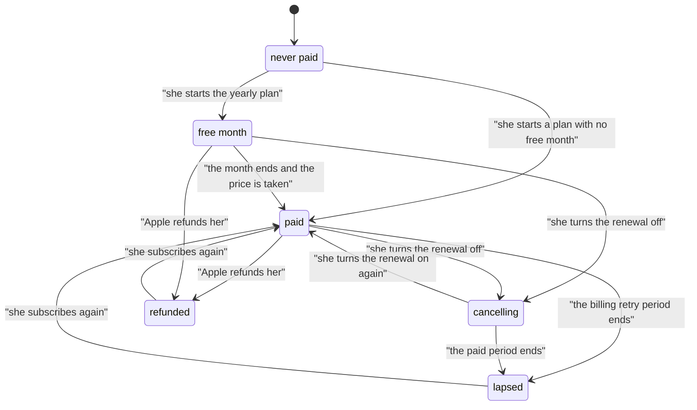
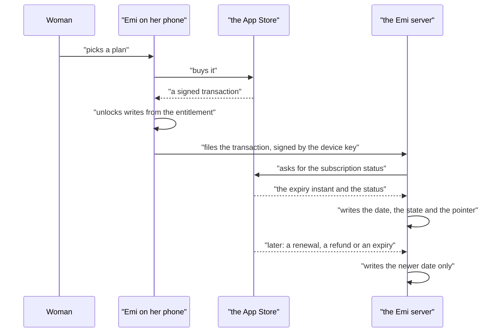

# Payments in the App Store: three plans, one free month, and one date the server trusts

She pays Emi inside the application, through the App Store. This document designs that route.

Three sentences hold the design up.

The App Store owns the purchase. StoreKit answers on her phone, with no network and no account, so
the write gate always has an answer.

The server keeps the date, and only the date. It learns the date from Apple, never from the phone,
and a reader of that record learns that an account is paid until an instant.

One read answers both routes. A payment in the App Store and a payment on myemi.app write
different records, and the question "paid until when" has one answer whichever one paid.

This document writes no product code. It answers
https://github.com/atlantic-blue/emi/issues/427 and the six steps of feature 7, which are
https://github.com/atlantic-blue/emi/issues/43 to
https://github.com/atlantic-blue/emi/issues/48.

## How to read this document

Status: designed

Every section carries one status line, the same as `docs/architecture.md`, `docs/privacy.md`,
`docs/design/accounts.md` and `docs/design/payments.md`. `Status: built` means the code is in this
repository now. `Status: designed` means this document describes it and nobody wrote it yet.

No section says built. Nothing here exists.

Every fact about Apple carries the page it comes from and the words of that page. Where I did not
read a value, the section says so.

## What is true today

Status: designed

The application holds the purchase library of section 10, and it reads the plan list of the three
products from the store. It reads what she holds at launch, works out one of the six states of
section 5, and keeps that answer on the phone. A write of a record she entered reads that answer
and is refused in the lapsed state and in the refunded state. It holds no paywall and no prompt,
so nothing on any screen says why a write was refused. Every subscription transaction the store
names is filed with the server, signed by her device key. One line of the tour says "One month
free, then 39 euros a year", in English, Russian and Spanish. That line is the only thing in the
product about money.

The route on myemi.app is built. It sells one yearly plan through Stripe, and
`docs/design/payments.md` designs it. The first sentence of that document said the store route was
built into the application, and this pull request corrects it. Decision 11 is the sentence it now
carries.

## The decisions this design starts from

Status: designed

The operator made each one on 22 November 2026. Do not argue with them here.

1. Three plans. A yearly plan at 39 euros a year. A monthly plan at 5 euros a month. A Black Friday
   yearly plan at half the yearly price.
2. In the application she pays through the App Store. On myemi.app she pays through Stripe, and the
   site sells the yearly plan only.
3. The payment is part of the first run.
4. A person who has not paid reads a prompt to subscribe.
5. This document says what the word free means in Emi, in every state.

The operator answered the six open questions of this design on 23 November 2026. Each answer is a
decision now.

6. Black Friday is half price on every renewal, for ever, and it carries no free month. This year it
   runs until 1 December 2026 at 00:00 Central European Time. On myemi.app it is built and merged.
   In the App Store a price that never goes back up is a separate product, and section 3 is that
   product.
7. The free month belongs to the yearly plan alone. The monthly plan and the Black Friday product
   carry no offer of any kind.
8. The paywall comes after the questions of the first run.
9. She cannot close the paywall. Emi has no free content, so a person who has not paid reaches
   nothing but the sign in and the paywall, and for a lapse or a refund the export and the delete
   beside them. That holds on the first run and on every later opening, and it replaces the earlier
   answer that https://github.com/atlantic-blue/emi/issues/622 would settle what she may do.
10. Emi is for iPhone only, for now, and Google Play is out of scope. The application sells through
    the App Store alone. It carries no link to myemi.app and never names it as a way to pay, because
    guideline 3.1.1(a) forbids that outside the United States. A woman who paid on myemi.app unlocks
    the application when she signs in, which guideline 3.1.3(b) allows.
11. The first line of `docs/design/payments.md` now reads: "Emi has three plans in the app, sold
    through the App Store, and one yearly plan on myemi.app, sold through Stripe."
12. Telegram Stars is a route of the website, and it is built. One payment of 2250 Stars buys 365
    days, taken in the Emi bot, and `docs/design/payments.md` carries it again. It sells nothing
    inside the application, so the wording gate still refuses the word Stars on a screen of the
    application. Signing in with Telegram is a different thing and it stays.

Four earlier decisions still hold, from `docs/contracts.md` and `docs/features.md`. There is no free
tier, because a free tier is paid for with her data. Reading, exporting and deleting stay open for
ever. A lapse stops new writes and nothing else. The value added tax sits inside the price she
reads.

## Goals

Status: designed

A woman buys Emi in the application, in two taps, and starts writing the same second.

The server holds one instant for each account, and nothing about her card, her country or her
Apple Account.

A refund, a lapse and a renewal reach the server without her opening the application.

A woman who paid on myemi.app opens the application and writes, with no second payment.

The whole route is proved by tests that run in the pipeline, with one exception named in the path:
the sandbox purchase itself needs a device.

## Non goals

Status: designed

Google Play, by decision 10. Emi is for iPhone only for now. The contracts name both stores, and
nothing here refuses Android later: the server fields already carry which store paid.

A third party subscription service. A service such as RevenueCat would hold every purchase of every
woman on Emi. That is a second party reading the one thing Emi promises to hold alone. Apple's own
server library does the same work, and Emi pays no percentage for it.

A price in any currency but the euro.

Family Sharing. Apple can share a subscription with five family members. Emi records are one
person's, so this design leaves the setting off and says so in the path.

A promotional offer for a woman who is cancelling. It is the right tool and it needs a signing key
and a server route of its own. It is named in the last section and it is not in this path.

## 1. The products

Status: designed

One subscription group holds every plan. App Store Connect says a subscription group is "A set of
subscription products with varying levels and durations. You can have up to 100 subscriptions per
group. Users can subscribe to one subscription product per group at a time."
(https://developer.apple.com/help/app-store-connect/manage-subscriptions/offer-auto-renewable-subscriptions/)

The group holds the plans at one level. The same page says a level is "A ranking system of
subscriptions within a subscription group that determines the upgrade, downgrade, and crossgrade
path available to subscribers. Levels make it possible to offer varying access (basic, premium) of
the same service."

Emi sells one product and two durations. There is no basic version and no premium version, so every
plan sits at level 1.

The group name is `Emi`. The identifiers are built on the bundle identifier, because an App Store
product identifier is unique across every application on the store.

**The yearly plan.** Identifier `blue.atlantic.emi.yearly`. Period one year. Price 39 euros.
Offer: one month free, as an introductory offer. Sold in the application, and the same plan is sold
on myemi.app through Stripe.

**The monthly plan.** Identifier `blue.atlantic.emi.monthly`. Period one month. Price 5 euros. No
offer, so no free month, by decision 7. Sold in the application only.

**The Black Friday product.** Identifier `blue.atlantic.emi.yearly.halfprice`. Period one year.
Price 19.99 euros, which is the price point nearest to half of 39 euros. No offer, so no free month.
Sold in the application from the next Black Friday, and sold on myemi.app today. Section 3 is the
whole of it.

## 2. How she moves between the yearly plan and the monthly plan

Status: designed

Two plans at one level, with different durations, make every move a crossgrade. App Store Connect
says a crossgrade is "When someone switches between subscriptions that you've ranked at the same
level. If the subscriptions are different durations, the crossgrade goes into effect on the
customer's next renewal date."
(https://developer.apple.com/help/app-store-connect/reference/in-app-purchases-and-subscriptions/auto-renewable-subscription-information/)

So a woman on the monthly plan who picks the yearly plan keeps her month, and the yearly price is
taken on the day the month ends. A woman on the yearly plan who picks the monthly plan keeps her
year, and the monthly price starts when the year ends. Nothing is refunded and nothing is taken
twice.

That answer is better for her than the alternative. Ranking the yearly plan above the monthly plan
would make the move an upgrade. The same page says an upgrade refunds the prorated payment and
charges the new price at once. A woman two days into a month would get a few cents back and a
39 euro charge she did not expect. So the levels stay equal, and the design accepts that she waits
for the renewal date.

The App Store draws the move. She presses Change plan in Settings, which opens the system sheet for
the subscription, and the application reads the result from the transaction listener. The
application does not build its own plan switch.

Apple tells the server about the move with a `DID_CHANGE_RENEWAL_PREF` notification. Section 7
reads it.

## 3. The Black Friday product

Status: designed

Half price on every renewal, for ever, with no free month. Decision 6 settles that, and it settles
the shape with it. A price that never goes back up is a product and not an offer.

Apple has four offer mechanisms and none of them can hold a price for ever. An introductory offer,
a promotional offer, an offer code and a win back offer each discount a bounded number of periods.
After that the subscription renews at the price of the product she bought. So half price on every
renewal cannot be an offer of any kind, and the design is a product of its own.

Two of those mechanisms are closed to a new buyer as well, and the reasons are worth keeping for the
next time somebody reaches for one.

**A win back offer reaches nobody yet.** App Store Connect says "Customers are only eligible for
win-back offers for their most recently lapsed subscription product within each group", and the
minimum paid duration starts at one month with at least one month since the subscription ended.
(https://developer.apple.com/help/app-store-connect/manage-subscriptions/set-up-win-back-offers/)
Emi has no subscriber at all, so nobody can be eligible for a year.

**A promotional offer reaches no new buyer.** App Store Connect says a promotional offer gives "a
discounted price for a specific duration for existing and previously subscribed customers".
(https://developer.apple.com/help/app-store-connect/manage-subscriptions/set-up-promotional-offers-for-auto-renewable-subscriptions/)
A woman buying Emi for the first time is neither. It also needs the server to sign each offer:
Apple lists "Promotional offer signatures" among the features that need a signed JSON Web Signature
from your own server.
(https://developer.apple.com/documentation/storekit/generating-jws-to-sign-app-store-requests)

**The product.** Identifier `blue.atlantic.emi.yearly.halfprice`. Period one year. Price
19.99 euros, with the value added tax inside it. No introductory offer and no other offer. Level 1,
beside the yearly plan and the monthly plan, so a move between them is the crossgrade of section 2.

**The amount is a price point and not half of 39 euros.** Half of 39 euros is 19.50 euros, the euro
price list does not hold it, and the operator picked 19.99 euros from the two nearest points of
section 4. So the application states the amount on its own, and no rule in it divides the yearly
price. myemi.app keeps 19.50 euros, because Stripe takes any amount.

**The free month is not on it, and that is a rule as well as a decision.** App Store Connect says
"New and returning customers are only eligible to use one introductory offer per subscription
group."
(https://developer.apple.com/help/app-store-connect/manage-subscriptions/set-up-introductory-offers-for-auto-renewable-subscriptions/)
The yearly plan carries the free month as its introductory offer, and this product carries none. So
a woman who buys at half price is charged 19.99 euros the moment she presses, with no month in front
of it. The same quoted rule says she gets no free month later either, because a woman already
subscribed in the group is neither a new nor a returning customer. I read that and did not test it.

**The product stays on sale for ever, and the window lives in the application.** This is the trap of
the whole section. Taking a subscription off sale does not only stop new buyers. It stops the
renewals of the women who already bought it. Apple gives that reason as "The product wasn't
available for purchase at the time of renewal"
(https://developer.apple.com/documentation/appstoreservernotifications/expirationintent) and sends
an `EXPIRED` notification whose subtype is `PRODUCT_NOT_FOR_SALE`.
(https://developer.apple.com/documentation/appstoreservernotifications/notificationtype) So the
operator never removes this product once a woman holds it. The window is what the paywall offers,
and the paywall reads an instant the application holds, the way the site holds the end of this
year's offer.

**The application cannot sell it before 1 December 2026.** The application holds one instant, the
end of 1 December 2026 in London, and step 2 writes it. The application has no purchase code and no
App Review pass, and it has not shipped. So this product is for the next Black Friday, and the dates
of that one are the operator's to set.

**On myemi.app it is built and merged.** The site sells 19.50 euros a year, every year, with the tax
inside the amount and no free month. The site closes its own offer at 00:00 Central European Time on
1 December 2026, which is 25 hours before the instant the application holds. The two windows are
separate, and the operator sets the dates of the next Black Friday for both. The two pull requests
are https://github.com/atlantic-blue/emi/pull/617 and
https://github.com/atlantic-blue/emi/pull/623. The site holds two amounts and refuses a third, so
the App Store product is held to 19.99 euros by the same kind of rule, in step 15 of the path.

## 4. Whether the prices are valid App Store price points

Status: designed

I did not read the euro price list. It lives behind All Prices and Currencies in App Store Connect,
and this session cannot sign in there. So this section gives the rule Apple published, and the
operator confirms the three numbers in the console before anybody creates a product.

A price is picked from a list and not typed. App Store Connect says "Auto-renewable subscriptions
can be priced by country or region, with up to 800 price points in each available currency."
(https://developer.apple.com/help/app-store-connect/reference/pricing-and-availability/in-app-purchase-and-subscriptions-pricing-and-availability/)

Apple's pricing talk gives the spacing, for the United States storefront: "10 cents price steps are
supported until $10 and 50 cents price steps are supported until $50."
(https://developer.apple.com/videos/play/tech-talks/110364/)

The same talk gives the endings: "In terms of conventions, you have the choice between four
conventions. You can opt to use .99 endings, like 9.99, or to incorporate different price endings,
like whole numbers or endings in .90 or .95 that could be useful for annual plans or discounts, for
example."

So whole numbers are a convention Apple supports, and a .99 ending is one as well. On that rule
39.00 euros, 5.00 euros and 19.99 euros are each expected to be available. I have not seen the euro
list, so expected is the strongest word this section may use.

All three are product prices now, because decision 6 made the half price a product. So each one is
read from the same list, and none of them is an offer amount that a different list could govern.

One of them was absent. 19.50 euros is not a price point in the German storefront, the nearest two
are 19.49 and 19.99, and the operator chose 19.99 euros on 24 November 2026. The other two stand. If
either is refused in the console, the nearest values on the published steps are these. For
39.00 euros: 38.50 or 39.50, or 38.99 or 39.99 on the .99 convention. For 5.00 euros: 4.90 or 5.10,
or 4.99. The operator picks, and one module holds every price, so a change costs one line in the
console and one line in that module.

One fact changes what she reads. The same talk says "Prices advertised to customers in all countries
except the U.S. and Canada include taxes". So 39 euros in a euro storefront is 39 euros with the tax
inside it. That is the promise the tour already makes, and the rule the Stripe price follows.

One fact the operator must act on. The talk says "Prices are globally equalized before tax, which
means customers in each country pay approximately the same amount as your base price, but with local
taxes added on top." Euro countries do not share one tax rate. So Apple can show a different euro
number in Ireland than in Germany unless each euro storefront is pinned to 39.00. Emi promises one
price, so the operator pins every euro storefront by hand, and accepts that Emi earns a little less
where the tax is higher.

## 5. What free means in Emi

Status: designed

There is no free tier. The only free thing is the first month of the yearly plan, and that month
lives inside a subscription. Apple has no way to give a month away outside one. So a woman who
starts the free month starts a subscription, and she stops it by turning the renewal off before the
month ends. The monthly plan and the Black Friday product charge her the moment she presses, by
decision 7.

Six states. Each one says what she may read, write and export.

**Never paid.** She finishes the first run, so her three answers and her name are written. Then the
paywall, and she cannot close it, by decision 9. She reaches no other screen and writes nothing
else. The first run is the one write this state allows. Her answers are what draws the ring at all,
so refusing them would leave her with a product that shows nothing.

Deleting everything stays open from the paywall, because her answers are already written and a wall
with no way out would hold them. Decision 9 answers the rest of this state: she reaches the sign in
and the paywall and nothing else, and the paywall gets no close control.

**Free month.** Everything. This is the paid state with no money taken. It ends on the instant Apple
reports, and the application reads that instant and not a count of days.

**Paid.** Everything.

**Cancelling.** Everything, until the period she paid for ends. The renewal is off and the date is
unchanged, so nothing on any screen changes except the line in Settings that says when it stops.

**Lapsed.** The paywall holds her, by decision 9. She exports every day she ever wrote and she
deletes everything, both from that screen. No new write, and no edit of an old day.

**Refunded.** The same as lapsed, from the instant the refund lands rather than from the end of the
period. Her records stay exactly as they are. Apple is clear that the entitlement goes at once:
"Products that the App Store has refunded or revoked don't appear in the current entitlements."
(https://developer.apple.com/documentation/storekit/transaction/currententitlements)

Two states behave as paid and are not in the list, because she cannot tell them apart from paid.
A billing grace period and a billing retry both keep her writing while Apple tries her card again.
The App Store Server api reports them as status 4 and status 3, beside 1 for active, 2 for expired
and 5 for revoked. (https://developer.apple.com/documentation/appstoreserverapi/status) The write
gate treats 1, 3 and 4 as paid. That is a decision this design makes rather than one it found. A
woman whose card expired on holiday keeps her diary while Apple sorts it out.

Contracts PAY-4 and WIRE-5 are the floor under every row above. Exporting and deleting never stop,
in any state, for ever, and the paywall carries a link to each one.

Decision 9 narrows what reading means in the two states that stop paying. Emi has no free content,
so a woman the phone reads as lapsed or refunded is held on the paywall and opens no day and no
history from it. Her days are still hers: the export hands her every one of them, and the delete
takes them off the phone and off the server. PAY-4 in `docs/contracts.md` still reads as though she
opens a day, and the operator decides whether that contract now says what this section says.

## 6. Where the prompt appears, and what it says

Status: designed

Four places, and no more. A prompt in a fifth place reads as nagging.

**The paywall in the first run.** Once, at the end of the first run, after the questions and the
sign in, by decision 8. Her answers are written before either one, so she has something to come back
to. It carries the brand argument, the plans and every line App Review asks for. Section 11 lists it
as a board.

It has no close control, by decision 9, and that is the one thing that makes it different from the
three prompts below. A woman inside Emi reads a prompt she can dismiss. A woman who has never paid
reads a wall.

**Where the write was refused.** She taps to log a day and nothing is written. A sheet rises. The
title says what happened and the line says what it costs. Title: Emi needs a subscription. Line:
"Everything you wrote stays, and new entries start again when you subscribe." Actions: See the
plans, Not now.

**The line in Settings.** One row that reads the state and the date. A woman who lapsed reads the
same prompt as the sheet. A woman who never paid never reaches Settings, because the paywall holds
her.

**The home screen, after a lapse.** One line under the ring, not a banner over it. The ring still
draws every day she ever wrote.

Three rules hold every one of them.

The words never name a price outside the App Store. Decision 10 and section 9 say why.

The words never claim a day is anything. The claims gate reads every screen already.

The words never count down. No "3 days left", no red, no badge. A date is a fact and a countdown is
pressure, and a product that sells on trust cannot push.

## 7. The data model, at field level

Status: designed

Nothing new is added to the table. The account item already holds four fields for this, named in
`docs/design/data-model.md`, and feature 7 is the feature that writes them.

The item is `ACC#<accountId>` and `META`, which her device key makes when the phone registers under
contract WIRE-1. It exists with no sign in of any kind.

**`subscribedUntil`** is a string, an instant. It is the `expiresDate` of the transaction, read from
Apple and never from the phone. It is the one field every reader wants.

**`subscriptionStore`** is a string. It is `apple` for this route, and the field exists so Google
can write `google` later without a second shape.

**`subscriptionTransaction`** is a string. It is the `originalTransactionId` of her subscription,
which is the one identifier that survives every renewal. The server needs it to ask Apple anything
later.

**`subscriptionCheckedAt`** is a string, an instant. It is when the server last asked Apple. A read
older than the window in section 8 asks again.

Three fields are new, and each one answers a failure this design found.

**`subscriptionState`** is a string. It is `active`, `cancelling`, `lapsed` or `refunded`, which are
the four words the Stripe record already uses. Without it the account page cannot tell a woman who
stopped the renewal from a woman who is paying, because both have a date in the future.

**`subscriptionEventAt`** is a number, the seconds of the Apple event that last wrote these fields.
Every write happens only when its own value is newer. Apple retries a notification "five times, at
1, 12, 24, 48, and 72 hours after the previous attempt"
(https://developer.apple.com/documentation/appstoreservernotifications/responding-to-app-store-server-notifications),
so a retried expiry can arrive three days after the renewal that followed it. Without this field
that retry locks a paying woman out of her own diary.

**`subscriptionPlan`** is a string, the product identifier. The plan row in Settings reads it, and
the configuration test reads that it is one of the identifiers in section 1.

One more item exists, in a partition of its own.

**The pointer.** `pk` is `STORE#` and the digest of the original transaction identifier. `sk` is
`META`. It holds one attribute, `accountId`. It is written once, conditional on not existing
already.

It earns its place twice. A notification about a refund or a lapse arrives with no application
running. It names a transaction and never an account. Without the pointer the server has nowhere to
write. And a conditional write on it is what makes one purchase pay for one vault.
A second account filing the same original transaction is refused. That is the rule
`docs/design/accounts.md` already states as "One receipt pays for one vault".

The cost is honest and worth naming. The pointer is the one record in the payment path that holds an
account identifier. So it sits in its own partition, and the role that writes it reaches that prefix
and nothing else. It holds no date and no price. A delete of her account removes it with everything
else. A reader who holds that partition learns that some account bought something, and cannot read
one day of anybody's history.

**How this joins the payment on myemi.app.** It already does. Contract PAY-8 says the entitlement
read walks the identity items of the account, reads the `PAY#` item each one names, keeps the
furthest `paidUntil`, and "It keeps the account item's own `subscribedUntil` as well, so a payment in
a store and a payment on the site answer through one route". This design is the half that makes
`subscribedUntil` real. The furthest date wins, and the caller is told one instant and nothing about
which route paid.

One case needs a screen and not a mechanism. A woman can pay on the site and in the application, and
Apple refunds neither. So the paywall reads the server before it sells, and a woman who is already
paid reads a line that says so instead of the plan rows. Section 11 lists it as board 5.

## 8. How the server checks a purchase, and how it learns what happens next

Status: designed

Contract PAY-3 says the phone saying it paid is not evidence. Apple is asked, every time.

The App Store Server api is the way to ask. Apple describes it as "a REST API that you call from
your server to request and provide information about your customers' In-App Purchases", and says
"Calls to the API require JSON Web Tokens (JWTs) for authorization".
(https://developer.apple.com/documentation/appstoreserverapi) The signing key is an Apple In-App
Purchase key, held in the parameter store beside the Stripe key, and read at run time.

Three endpoints do the work, each quoted from its own page.

`GET https://api.storekit.apple.com/inApps/v1/subscriptions/{anyTransactionId}` gets "the statuses
for all of a customer's auto-renewable subscriptions in your app".
(https://developer.apple.com/documentation/appstoreserverapi/get-all-subscription-statuses)

`GET https://api.storekit.apple.com/inApps/v1/transactions/{transactionId}` gets "information about
a single transaction for your app".
(https://developer.apple.com/documentation/appstoreserverapi/get-transaction-info)

`GET https://api.storekit.apple.com/inApps/v2/refund/lookup/{anyTransactionId}` gets "a paginated
list of all of a customer's refunded in-app purchases for your app".
(https://developer.apple.com/documentation/appstoreserverapi/get-refund-history)

The sandbox is a different host, `https://api.storekit-sandbox.apple.com/`, and Apple warns that
"/inApps in the path is case-sensitive". The environment of a transaction is in its own payload, so
the server reads it rather than guessing.

**The filing.** One route takes the transaction identifier from the application. It is signed by her
device key under contract AUTH-1, so the server knows the account without a sign in and without a
token. The server asks Apple, reads the expiry instant and the status, and writes the fields of
section 7. It never trusts a date the phone sent.

**The renewal.** Apple sends `DID_RENEW` for every successful renewal. The application also files
again on its next launch, because the entitlement it reads is the new transaction. Either one is
enough, and the newer event wins.

**The refund.** Apple sends `REFUND` for "a transaction for a consumable In-App Purchase, a
non-consumable In-App Purchase, an auto-renewable subscription, or a non-renewing subscription", and
the transaction then carries a `revocationDate`, which Apple defines as "The UNIX time, in
milliseconds, that the App Store refunded the transaction or revoked it from Family Sharing".
(https://developer.apple.com/documentation/appstoreservernotifications/jwstransactiondecodedpayload)
The server writes `refunded` and sets the date to that instant. `REFUND_REVERSED` undoes it, and
Apple says that when it arrives the application "needs to reinstate" what it took away.

**The lapse.** `EXPIRED` ends it. Apple names its reasons in the subtype: `VOLUNTARY` when she
turned the renewal off, and `BILLING_RETRY` when the retry period ran out. It also says
`PRICE_INCREASE` when she did not agree to a new price, and `PRODUCT_NOT_FOR_SALE` when the plan was
gone at renewal time.
`DID_FAIL_TO_RENEW` comes first and keeps her writing, and `GRACE_PERIOD_EXPIRED` closes the grace
period. `DID_CHANGE_RENEWAL_STATUS` is the one that makes the state `cancelling`, because its
subtype says whether she turned the renewal off or on.
(https://developer.apple.com/documentation/appstoreservernotifications/notificationtype)

**The endpoint.** One route, version 2, with no authorizer, because Apple signs the body rather than
carrying a token. The signature is verified first, against Apple's root certificates, with Apple's
own server library. A body that does not verify writes nothing and is answered with a refusal. Apple
asks for "an HTTP status code of 200-206 if the post was successful" and "HTTP 50x or 40x to have
the App Store retry".
(https://developer.apple.com/documentation/appstoreservernotifications/app-store-server-notifications-v2)
Apple also says that if the server filters by address, "add the IP address subnet 17.0.0.0/8".
(https://developer.apple.com/documentation/appstoreservernotifications/enabling-app-store-server-notifications)

**When a notification is missed.** Apple keeps them: the notification history endpoint returns the
ones it tried to send "in the past 180 days in the production environment, and the past 30 days in
the sandbox environment", at
`POST https://api.storekit.apple.com/inApps/v1/notifications/history`.
(https://developer.apple.com/documentation/appstoreserverapi/get-notification-history) So an outage
is recoverable and needs no replay of our own.

**The second safety net.** Any read whose `subscriptionCheckedAt` is older than six hours asks Apple
again before answering. Six hours is a guess, and the measurement that replaces it is the count of
reads per account per day once the product has users. Apple rate limits each endpoint per
application and answers HTTP 429 with a `Retry-After` header, so the window exists to stay well
under it. (https://developer.apple.com/documentation/appstoreserverapi/identifying-rate-limits)

**Whether the application needs a sign in before a purchase.** It does not, and it must not.

Three reasons, in order. The App Store ties the purchase to her Apple Account, so StoreKit answers
on her phone with no account of ours and no network. Her vault account already exists, because her
device key made it when the phone registered, so the filing has an account to write to. And the
first run is the one thing in Emi that asks her for something. A sign in in front of a purchase adds
a step to the moment she is most likely to leave.

What she gives up by not signing in is portability. The year lives on her Apple Account, so a new
iPhone finds it with nothing to press, and the website does not. A sign in is what carries the year
to myemi.app and, later, to Android. So the plan row in Settings offers it, with that reason in one
line, and nothing refuses her for saying no.

The application sets `appAccountToken` when it buys. Apple describes it as "A UUID that associates
the transaction with a customer on your service", and returns it in the transaction.
(https://developer.apple.com/documentation/appstoreservernotifications/appaccounttoken) Her account
identifier is sixteen bytes of a digest, written in Crockford base 32. A universally unique
identifier is sixteen bytes too. So the same bytes are written in the other alphabet, and the token
names the account with nothing added. It holds nothing about her, because it is derived from a value her
own phone chose at random. It earns its place in one case: she buys, the network drops before the
filing, and she never opens Emi again. Then the first notification still names her account.

I did not run this. The page I read does not say whether StoreKit accepts a universally unique
identifier that is not version 4. So the step that builds it proves it on a device. The pointer item
carries the design if it does not.

## 9. What App Review requires

Status: designed

**The paywall must carry four things.** Apple's subscription page lists them: "Subscription name and
duration, and the content or services provided during the subscription period", "Full renewal price,
shown clearly and prominently, and localized in available currencies", "A way for current
subscribers to sign in or restore purchases", and "your app and App Store metadata must include
links to your Terms of Use and Privacy Policy".
(https://developer.apple.com/app-store/subscriptions/) The same page says that for a free trial you
must "clearly indicate how long the free trial lasts and the price billed once the free trial is
over".

Guideline 3.1.2(c) adds the reason: "Before asking a customer to subscribe, you should clearly
describe what the user will get for the price."
(https://developer.apple.com/app-store/review/guidelines/)

**Restore Purchases must exist.** Apple says "Include some mechanism in your app, such as a Restore
Purchases button, to let users restore their Apple In-App Purchases", and that it must be called
"only in response to an explicit user action, like tapping or clicking a button".
(https://developer.apple.com/documentation/storekit/appstore/sync\(\)) The same page says the
ordinary path needs none of it, because "When users reinstall your app or download it on a new
device, the app automatically has all transactions available to it upon initial launch". So the row
exists for the rare case, and the launch read is what actually unlocks her.

**The subscription must work on all her devices.** Guideline 3.1.2(a) says "the subscription period
must last at least seven days and be available across all of the user's devices". StoreKit gives
that for free through her Apple Account, and the design adds nothing for it.

**The application may not name the price on the website.** Guideline 3.1.1(a) says: "In all other
storefronts, except for the United States storefront, where this prohibition does not apply, apps
and their metadata may not include buttons, external links, or other calls to action that direct
customers to purchasing mechanisms other than in-app purchase." The rule names buttons, links and
calls to action, and does not name a bare sentence about a price. Emi is stricter than the rule
anyway, by decision 10. No screen names the price on myemi.app and no screen names the address of
the site. The link entitlement is not applied for. `docs/design/payments.md` decided that first,
and the operator agreed it again on 23 November 2026.

**Unlocking what she bought elsewhere is allowed.** Guideline 3.1.3(b) says "Apps that operate
across multiple platforms may allow users to access content, subscriptions, or features they have
acquired in your app on other platforms or your web site, including consumable items in
multi-platform games, provided those items are also available as in-app purchases within the app."
The yearly plan is sold in both places, so the condition holds. The two prices need not match.

**One gate enforces it.** The wording gate reads every screen and the store listing today. It gains
the host of the website, the word Stars, and any amount of money that is not one of the three
product prices. A run holds the rule, not a memory.

The word Stars stays on that list because the website sells one year in Stars, and nothing inside
the application sells in Stars. The website privacy policy still names it, and a screen that
learned the word from there would be a screen naming a way to pay that Apple does not allow it to
name.

## 10. Which library the application uses

Status: built

`expo-iap`, pinned at version 6.5.1. The application is on Expo 57 and React Native 0.86, and it is
already built with a development client. This library is the one in that ecosystem with a current
release. It speaks StoreKit 2, which is what the signed transaction and the server library
both need.

The cost is a native module. The application needs a new binary before any of this runs, and nothing
about a purchase can be proved in a simulator alone. The path names the one step that needs a
device.

`apps/mobile/src/services/store/theStoreOnThisPhone.ts` is the one file that names the library.
Everything above it takes a port, so a test reads the plans with no store and no phone.

The alternative was a third party subscription service, and the non goals say why it is refused.

## 11. The screens the operator must draw

Status: designed

A session cannot open the design canvas, so nothing here is drawn and no step below builds a screen
that has no board. The one approved board for payment is the checkout page of the website, which is
a different surface and a different route.

Each entry names the words and the states that board must carry.

**1. The paywall of the first run.** The plan rows, the yearly one first. Each row carries the plan
name, the period and the full renewal price. The yearly row carries the free month line, which says
how long it lasts and what is taken when it ends. The monthly row carries no free month, by
decision 7. The argument says there is no free version, because a free version is paid for with her
data. A Restore purchases control. Links to the terms and to the privacy page. No close control, by
decision 9.

**2. The prompt where a write was refused.** A sheet. Title, one line, two actions. The words are in
section 6.

**3. The plan list in Settings.** The current plan, the renewal date, and the state in words for all
six states of section 5. Rows for Change plan, Restore purchases and Manage in the App Store. A row
that offers a sign in, with the one line about carrying the year to another place.

**4. The home screen after a lapse.** One line under the ring, with the ring still drawing every day
she wrote.

**5. The paywall for a woman who already paid on the website.** No plan rows. One line that says she
is paid until a date, and a way back.

**6. The refusal screens.** A purchase she cancelled, a purchase the store refused, a store that
cannot be reached, and a purchase already filed against another account. One title, one line and one
action each.

**7. The Black Friday row on the paywall.** One extra row for the product of section 3, at
19.99 euros a year, every year, with no free month. It shows only while the window is open.

**8. The paywall after a lapse.** The same screen as board 1, drawn for a woman who paid before.
The free month is gone from the yearly row, from the button and from the renewal line, because
Apple gives that offer once. Two links are added, one to her export and one to her delete, so a
woman who is held here still reaches her own records. Approved on 2026-11-25 and committed as
`docs/design/prototype/paywallLapsed.dc.html`.

One board that the first draft of this design asked for is no longer needed now. A screen for a
woman who has never paid waits for
https://github.com/atlantic-blue/emi/issues/622, because she cannot close the paywall and reaches no
screen behind it.

## 12. The path

Status: designed

Each step is one pull request with one intention, and ships its tests in the same change. No
infrastructure is applied from a machine. Each step names what it changes, what proves it, and what
it waits for.

Steps 1 and 2 need no board, so they can start at once. Every decision this path waited on is
answered, apart from the dates of the next Black Friday in step 17.

**1. The contracts and the features.**
Changes: PAY-1 names the three products, their prices, their periods, the one group, the equal
levels, and the free month on the yearly plan alone. PAY-5 and PAY-8 gain the store half. A new contract names the pointer item and
the one purchase one vault rule. The data model document gains the three new account fields.
Proves it: the documents gate holds the contracts and the features to each other, so a contract in
one and not the other fails the run.
Waits for: nothing.

**2. The product configuration, and a test that reads it.**
Changes: one module names the group, the three product identifiers, the periods, the prices, the
free month on the yearly plan alone, and the instant the Black Friday window closes. Nothing else in
the application may write a price.
Proves it: a test asserts every value. A wrong price, a wrong period or a missing product fails it.
A test asserts 19.99 euros on the Black Friday product as a value of its own, because that amount is
a price point rather than half of the yearly price. A test asserts that the monthly product and the
Black Friday product carry no offer. A mutation of each value is watched going red.
Waits for: step 1. The operator made the three products in App Store Connect on 24 November 2026.

**3. The purchase library, and a binary that starts.**
Changes: the library is added. One module reads the plan list of the three products from the store,
and nothing on screen reads it yet. A configuration file holds the same three products for the
simulator, so a plan list answers there with no sandbox account.
Proves it: tests of the module against a stand in for the library, and a test that the autolinking
of Expo names the native module for an Apple build. The packaged application starting and reading
the plan list in a sandbox account needs a device, and that half is the operator's to run.
Waits for: step 2.

**4. The entitlement, read on launch.**
Changes: the application reads every transaction she holds at launch, and works out one of the six
states of section 5 from them. It watches the store for the transactions nobody presses for: a
renewal, a purchase on another device, a refund. The answer is held in one row on the phone, so a
store that cannot be reached keeps the last known answer instead of locking her out. Nothing on
screen reads it yet.
Proves it: a test with the store unreachable asserts the last known answer stands. A test of a fresh
install with the store reporting ownership asserts she is not asked to pay again. A refunded
transaction is asserted absent. One test per state, and a mutation that drops the held answer is
watched going red.
Waits for: step 3. The sandbox purchase that moves her between these states needs a device, and that
half is the operator's to run.

**5. The write gate on the phone.**
Changes: a write is refused in the lapsed and refunded states, and allowed in the free month, the
paid state and the cancelling state. Reading, exporting and deleting are untouched in every state.
A write is allowed in the never paid state and where no answer is worked out yet, because no
paywall exists to hold her and a refusal would lock every woman on a build out of her own diary.
The gate is one check, and the linter holds the write statements of the day log to the one module
that asks it. The first run writes her answers under a transaction of its own and asks nothing,
which is the one write the never paid state allows.
Proves it: one case per state, driven through the screen and asserted on what she is left with. A
mutation that gates a read is watched failing, and so is a mutation that takes the gate off one
write path.
Waits for: step 4.

**6. The prompt where the write was refused.**
Changes: the sheet of section 6 rises when a write is refused, with its words in three languages.
Proves it: a test taps to log a day in the lapsed state, reads the sheet, presses Not now, and
asserts the day screen is still there and nothing was written. The claims gate reads the new words.
Waits for: step 5, and board 2.

**7. The paywall.**
Changes: the screen of board 1, with the plan rows, the free month line on the yearly row only, the
full renewal price, Restore purchases and the two links. It carries no close control.
Proves it: a test asserts every line App Review asks for is present, in all three languages. A test
asserts the monthly row promises no free month. A test asserts there is no way out of the screen
except a purchase or a restore. A test buys through a double and asserts the application is left in
the paid state with the ring drawn. A test of a cancelled purchase asserts she is left on the
paywall.
Waits for: step 4, and boards 1 and 6.

**8. The paywall in the first run, and on every later opening.**
Changes: the questions, then the sign in, then the paywall. Her answers are written before the sign
in, so a woman who closes Emi on either screen comes back to a product that knows her. The sign in
is the screen Settings already reaches, with no way past it and no way back, and a woman who
already signed in goes straight to the paywall. On every later opening a woman the phone reads as
never paid, lapsed, refunded or unknown goes the same way, which includes every woman on a build
today. The free month, the paid state and the cancelling state pass straight through, everywhere.
A woman who paid before reads the second board: no free month, because Apple gives it once, and two
links to her own records. A purchase or a restore lands her where the first run used to land.
Proves it: a test walks the first run and asserts the order, with her answers in the database before
the sign in. A test opens Emi as a woman who finished the first run and never paid, and asserts the
sign in and then the paywall. One case per state asserts who passes and who is held. A test in the
lapsed state asserts no free month is promised, then opens the export and the delete from the
paywall and asserts each one finishes and comes back. The mutation that lets a woman who never paid
through is watched going red.
Waits for: step 7, board 1, and the second board.

**9. The filing route on the server.**
Changes: one route takes a transaction identifier, signed by her device key. It asks Apple, then
writes the date, the state, the plan, the store, the checked instant and the pointer.
Proves it: a test asserts Apple is called before anything is written. A test asserts a date sent by
the phone is ignored. A test asserts a transaction from the sandbox is not checked against
production. A test asserts a second account filing the same original transaction is refused.
Waits for: step 1, and the Apple In-App Purchase key in the parameter store.

**10. The write gate on the server.**
Changes: a put of a record is refused when the account is not paid, with the status the application
reads as pay rather than as an error. A pull, an export and a delete work in every state, which
closes WIRE-5.
Proves it: a test sets the date in the past, then pulls, exports and deletes, and asserts all three
work. A put is asserted refused. A mutation that gates the pull is watched failing.
Waits for: steps 9 and 19. The server holds no date until the phone files, so a gate that lands
first refuses a woman who paid.

**11. The notification endpoint.**
Changes: one route, version 2. The signature is verified first. The types of section 8 write the
date and the state, and every write is conditional on a newer event instant.
Proves it: a body with a wrong signature writes nothing. A retried expiry that arrives after a
renewal leaves the newer date in place, and the mutation that removes the condition is watched going
red. One test per type.
Waits for: step 9.

**12. The read that joins both routes.**
Changes: the entitlement read of PAY-8 keeps the account item's own date beside the furthest date of
the payment items.
The paywall reads it before it sells, and a woman who is already paid reads the
line of board 5 instead of the plan rows.
Proves it: an account paid only in the App Store reads its date. An account paid only on the site
reads its date. An account paid in both reads the furthest one, and nothing in the answer says which
route paid. A test puts a date in the future on the server and asserts the paywall sells nothing.
Waits for: step 9, and board 5.

**13. The plan list in Settings.**
Changes: the screen of board 3, with the state in words, Change plan, Restore purchases, Manage in
the App Store, and the sign in row.
Proves it: a test per state asserts the words. A test presses Restore purchases and asserts the
system call happens once and only on the press. A test asserts Change plan opens the system sheet
and that the application builds no plan switch of its own.
Waits for: step 4, and board 3.

**14. The lapse, end to end.**
Changes: the home screen line of board 4, and nothing else.
Proves it: a test in the lapsed state opens the history, exports a file and deletes everything, and
asserts each one finishes. A test asserts the ring still draws her days.
Waits for: step 5, and board 4.

**15. The wording gate gains the new words.**
Changes: the gate refuses the host of the website, the word Stars, and any amount of money that is
not one of the three product prices. The Black Friday amount is held to 19.99 euros, the way the
site holds its own two amounts.
Proves it: a screen carrying each refused word fails the gate, one case each. A fourth amount fails
it. An amount that is not one of the three fails it.
Waits for: step 2.

**16. The tour line, and every other price in the product.**
Changes: the one line of the tour, the readme and the features document say what the three products
say. The free month belongs to the yearly plan in every one of them.
Proves it: a test reads the price out of the configuration of step 2 rather than out of a string, so
the line cannot drift from the product again.
Waits for: step 2.

**17. The Black Friday product, and the window the paywall holds.**
Changes: the paywall draws the row of board 7 while the window is open, and drops it when the
instant of step 2 passes. The product itself is never taken off sale.
Proves it: a test one second before the instant draws the row, and a test one second after it does
not. A test asserts the price is read from the store rather than written in the application. A test
asserts the row promises no free month.
Waits for: step 7, board 7, and the dates of the next Black Friday from the operator. The
application cannot sell this product before 1 December 2026, so nothing here is urgent.

**18. The store listing and the App Review material.**
Changes: the listing, the screenshots and the privacy answers carry the subscription.
Proves it: the wording gate reads the listing. The operator reads the screenshots.
Waits for: steps 7 and 13.

**19. The phone files each purchase with the server.**
Changes: the application files every subscription transaction it learns of with the route of step 9,
signed by her device key. A purchase, a renewal, a restore and a transaction from another device
each reach that route once. The identifier is written to the setting table as pending before the
call, so a phone that stops files it on the next launch. A refusal that names the transaction clears
the pending identifier and keeps its reason. Nothing new appears on screen, and the answer moves
nothing the phone thinks she holds, because the phone reads that from the store.
Proves it: a test files a purchase through a double of the library and a double of the network, and
asserts one signed call that carries the identifier and nothing else. A test with the network down
asserts the identifier is still pending, and that the next launch files it. A test asserts a second
notice of one transaction files nothing new. The mutation that clears the pending identifier before
the call answers is watched going red.
Waits for: steps 4 and 9.

## How sure I am

Status: designed

The whole design: 85 per cent. The answers of 23 November 2026 closed every open end the first
draft carried.

The products, the group and the move between plans: 90 per cent. Every rule is quoted from App Store
Connect, and the operator made the group and the three products on 24 November 2026. What lowers it
is that no purchase has gone through them.

The Black Friday product: 85 per cent. A separate product is the only thing Apple has that holds a
price for ever, and the reason each offer mechanism cannot is quoted. The expiry reason that makes
taking a product off sale dangerous is Apple's own words too. What lowers it is two things I read
and did not test. Whether a woman already subscribed in the group is refused the free month on a
later move, and whether App Store Connect lets a product sit on sale with no offer at all for as
long as this design needs.

The prices: 80 per cent. I did not read the euro price list, because that needs App Store Connect,
and the spacing rule I quote is for the United States storefront. What raises it is that the operator
set all three prices in the console on 24 November 2026. 19.50 euros is not a price point there, and
19.99 euros is the one the operator chose in its place. The site charges 19.50 euros through Stripe,
and that proves nothing about the App Store, because the two take their prices from different lists.

The states and what free means: 85 per cent. The states come from Apple's own status values and
notification types. What lowers it is the decision to treat a billing retry as paid, which is a
product choice this design made rather than found.

The server half: 80 per cent. Every endpoint, every notification type and the retry schedule are
quoted from Apple's pages. What lowers it is the six hour window, which is a guess, and that no
notification has ever reached this server.

The join with the payment on myemi.app: 75 per cent. Contract PAY-8 already designed it and this
design only fills the store half. What lowers it is the woman who pays twice, which has a screen and
no mechanism.

The sign in: 85 per cent. It rests on her vault account existing with no sign in, which contract
WIRE-1 and `docs/design/accounts.md` both say. What lowers it is that the hard sign in gate of that
document is designed and not built. If it lands first, the order of the first run changes.

The App Review rules: 75 per cent. The four paywall lines, the restore rule and the three guidelines
are quoted. What lowers it is that no reviewer has read this build, and a gate only catches the words
we thought of.

The path: 85 per cent. Six of its nineteen steps wait on a board, and a step with no board is a
step that invents a screen. One step waits on dates the operator sets for the next Black Friday, and
no other step waits on an answer.

## Questions for the operator

Status: designed

None. Six questions were open and the operator answered them all, five on 23 November 2026 and the
sixth the same day. Each one is a decision above.

## What this design does not answer

Status: designed

A promotional offer for a woman who is cancelling. It needs a signing key, a server route and a
screen, and it is the right tool for that moment.

Family Sharing, which stays off until somebody decides what a shared record would mean.

A refund of a payment in the App Store that Emi starts. Apple refunds, not Emi, and Emi only reads
the result.

A pre-order, which https://github.com/atlantic-blue/emi/issues/490 holds.

What the store listing says about the three plans.
