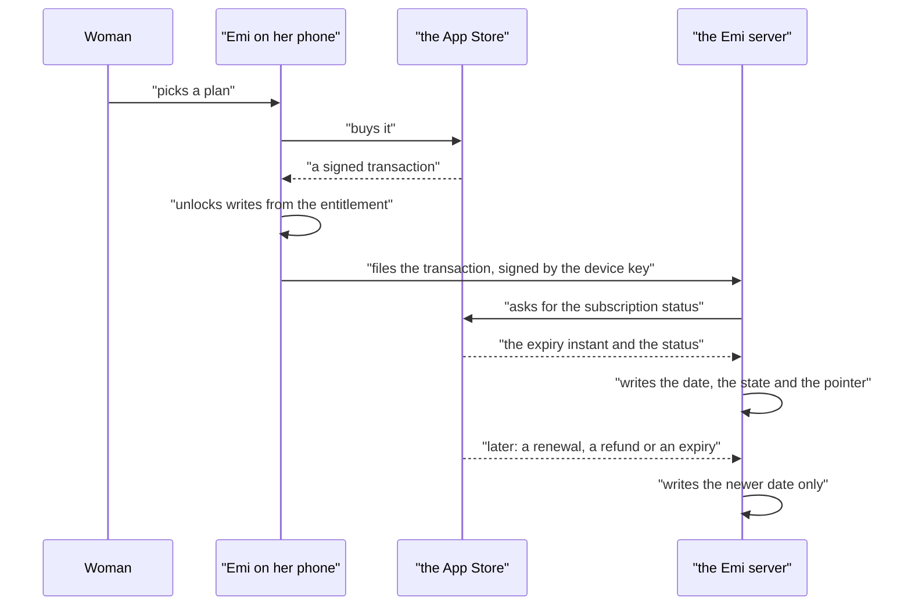

# Payments in the App Store: three plans, one free month, and one date the server trusts

She pays Emi inside the application, through the App Store. This document designs that route.

Three sentences hold the design up.

The App Store owns the purchase. StoreKit answers on her phone, with no network and no account, so
the write gate always has an answer.

The server keeps the date, and only the date. It learns the date from Apple, never from the phone,
and a reader of that record learns that an account is paid until an instant.

One read answers both routes. A payment in the App Store and a payment on myemi.app write
different records, and the question "paid until when" has one answer whichever one paid.

This document writes no product code. It answers
https://github.com/atlantic-blue/emi/issues/427 and the six steps of feature 7, which are
https://github.com/atlantic-blue/emi/issues/43 to
https://github.com/atlantic-blue/emi/issues/48.

## How to read this document

Status: designed

Every section carries one status line, the same as `docs/architecture.md`, `docs/privacy.md`,
`docs/design/accounts.md` and `docs/design/payments.md`. `Status: built` means the code is in this
repository now. `Status: designed` means this document describes it and nobody wrote it yet.

No section says built. Nothing here exists.

Every fact about Apple carries the page it comes from and the words of that page. Where I did not
read a value, the section says so.

## What is true today

Status: designed

The application holds no purchase library, no StoreKit code and no entitlement read. One line of
the tour says "One month free, then 39 euros a year", in English, Russian and Spanish. That line is
the only thing in the product about money.

The route on myemi.app is built. It sells one yearly plan through Stripe, and
`docs/design/payments.md` designs it. The first sentence of that document said the store route was
built into the application. This pull request corrects that sentence.

## The decisions this design starts from

Status: designed

The operator made each one on 22 November 2026. Do not argue with them here.

1. Three plans. A yearly plan at 39 euros a year. A monthly plan at 5 euros a month. A Black Friday
   yearly plan at half the yearly price.
2. In the application she pays through the App Store. On myemi.app she pays through Stripe, and the
   site sells the yearly plan only.
3. The payment is part of the first run.
4. A person who has not paid reads a prompt to subscribe.
5. This document says what the word free means in Emi, in every state.

Four earlier decisions still hold, from `docs/contracts.md` and `docs/features.md`. There is no free
tier, because a free tier is paid for with her data. Reading, exporting and deleting stay open for
ever. A lapse stops new writes and nothing else. The value added tax sits inside the price she
reads.

## Goals

Status: designed

A woman buys Emi in the application, in two taps, and starts writing the same second.

The server holds one instant for each account, and nothing about her card, her country or her
Apple Account.

A refund, a lapse and a renewal reach the server without her opening the application.

A woman who paid on myemi.app opens the application and writes, with no second payment.

The whole route is proved by tests that run in the pipeline, with one exception named in the path:
the sandbox purchase itself needs a device.

## Non goals

Status: designed

Google Play. The contracts name both stores, and this design builds Apple only. Nothing here
refuses Android later, and the server fields already carry which store paid.

A third party subscription service. A service such as RevenueCat would hold every purchase of every
woman on Emi. That is a second party reading the one thing Emi promises to hold alone. Apple's own
server library does the same work, and Emi pays no percentage for it.

A price in any currency but the euro.

Family Sharing. Apple can share a subscription with five family members. Emi records are one
person's, so this design leaves the setting off and says so in the path.

A promotional offer for a woman who is cancelling. It is the right tool and it needs a signing key
and a server route of its own. It is named in the last section and it is not in this path.

## 1. The products

Status: designed

One subscription group holds every plan. App Store Connect says a subscription group is "A set of
subscription products with varying levels and durations. You can have up to 100 subscriptions per
group. Users can subscribe to one subscription product per group at a time."
(https://developer.apple.com/help/app-store-connect/manage-subscriptions/offer-auto-renewable-subscriptions/)

The group holds the plans at one level. The same page says a level is "A ranking system of
subscriptions within a subscription group that determines the upgrade, downgrade, and crossgrade
path available to subscribers. Levels make it possible to offer varying access (basic, premium) of
the same service."

Emi sells one product and two durations. There is no basic version and no premium version, so every
plan sits at level 1.

The group name is `Emi`. The identifiers are built on the bundle identifier, because an App Store
product identifier is unique across every application on the store.

**The yearly plan.** Identifier `blue.atlantic.emi.yearly`. Period one year. Price 39 euros.
Offer: one month free, as an introductory offer. Sold in the application, and the same plan is sold
on myemi.app through Stripe.

**The monthly plan.** Identifier `blue.atlantic.emi.monthly`. Period one month. Price 5 euros.
Offer: question 2 of the last section decides whether it carries the free month. Sold in the
application only.

**The Black Friday yearly plan.** Period one year. Price 19.50 euros, which is half of 39 euros.
Offer: section 3 names the five ways Apple can carry this price, and the identifier depends on
which one the operator picks. Sold in the application, and question 1 asks whether the site sells
it too.

## 2. How she moves between the yearly plan and the monthly plan

Status: designed

Two plans at one level, with different durations, make every move a crossgrade. App Store Connect
says a crossgrade is "When someone switches between subscriptions that you've ranked at the same
level. If the subscriptions are different durations, the crossgrade goes into effect on the
customer's next renewal date."
(https://developer.apple.com/help/app-store-connect/reference/in-app-purchases-and-subscriptions/auto-renewable-subscription-information/)

So a woman on the monthly plan who picks the yearly plan keeps her month, and the yearly price is
taken on the day the month ends. A woman on the yearly plan who picks the monthly plan keeps her
year, and the monthly price starts when the year ends. Nothing is refunded and nothing is taken
twice.

That answer is better for her than the alternative. Ranking the yearly plan above the monthly plan
would make the move an upgrade. The same page says an upgrade refunds the prorated payment and
charges the new price at once. A woman two days into a month would get a few cents back and a
39 euro charge she did not expect. So the levels stay equal, and the design accepts that she waits
for the renewal date.

The App Store draws the move. She presses Change plan in Settings, which opens the system sheet for
the subscription, and the application reads the result from the transaction listener. The
application does not build its own plan switch.

Apple tells the server about the move with a `DID_CHANGE_RENEWAL_PREF` notification. Section 7
reads it.

## 3. The Black Friday price

Status: designed

Apple has five ways to carry a discounted price. Four of them are refused here, for reasons that
are each one sentence of Apple's own documentation. The fifth splits into two, and the choice
between them is a product decision, not a technical one.

One rule decides most of this. App Store Connect says "New and returning customers are only
eligible to use one introductory offer per subscription group."
(https://developer.apple.com/help/app-store-connect/manage-subscriptions/set-up-introductory-offers-for-auto-renewable-subscriptions/)

So the free month and a half price first year cannot both be introductory offers for the same
woman. She gets one of them.

**A win back offer is impossible.** App Store Connect says "Customers are only eligible for win-back
offers for their most recently lapsed subscription product within each group", and the minimum paid
duration starts at one month with at least one month since the subscription ended.
(https://developer.apple.com/help/app-store-connect/manage-subscriptions/set-up-win-back-offers/)
Emi has no subscriber at all. Nobody can be eligible for a year.

**A promotional offer is impossible for a new buyer.** App Store Connect says a promotional offer
gives "a discounted price for a specific duration for existing and previously subscribed
customers".
(https://developer.apple.com/help/app-store-connect/manage-subscriptions/set-up-promotional-offers-for-auto-renewable-subscriptions/)
A woman buying Emi for the first time is neither. It also needs the server to sign each offer:
Apple lists "Promotional offer signatures" among the features that need a signed JSON Web
Signature from your own server.
(https://developer.apple.com/documentation/storekit/generating-jws-to-sign-app-store-requests)
Keep it for a woman who is cancelling, later.

**A separate product at 19.50 euros is a permanent price, not a first year price.** A product's
price is the renewal price for ever. A woman who buys it renews at 19.50 euros next November, and
the only way to stop that is to raise her price, which needs her consent. It also uses her one
introductory offer if it carries the free month. Choose this only if the operator means a founder
price that never goes up.

Two candidates remain.

**Candidate A: a dated introductory offer on the yearly plan.** The offer type is pay up front, the
duration is one year, and the price is 19.50 euros. App Store Connect says "Choose the start and end
dates for your introductory offer", so the window is set in the console and needs no code. She taps
once and reads the price on the paywall.

The cost is the free month. During the window the yearly plan's introductory offer is the half price
year, so a new woman gets no free month on that plan. The same page says "You can have one current
and one future introductory offer per storefront", and "If you create new offers that have
overlapping dates, the latest action overwrites existing introductory offers", and "Once you create
an introductory offer, you won't be able to edit it". So the operator sets the free month as the
current offer, schedules the half price year as the future offer, and after the window creates the
free month again. That is three deliberate acts in the console, in order, per storefront.

**Candidate B: an offer code for new subscribers.** App Store Connect lets a code reach "New
subscribers: Customers who have never subscribed to any subscription product within the group", and
it answers the stacking question directly: "Yes. Eligible customers will redeem your app's
introductory offer first, then automatically renew to the offer they redeemed with the code."
(https://developer.apple.com/help/app-store-connect/manage-subscriptions/set-up-subscription-offer-codes/)

So candidate B is the only one that keeps both. She gets the free month, then the first year at
19.50 euros, then 39 euros a year.

The cost is a code. She types it, or she follows a redemption link, and a code is a thing to lose.
The application can open the system redemption sheet, so she does not leave Emi. A custom code such
as `BLACKFRIDAY` works for up to 25,000 redemptions at a time, and an application may create codes
for up to one million redemptions per quarter.

The recommendation is candidate B. The free month is the argument the tour already makes, and losing
it for the busiest week of the year costs more than one extra tap. The operator decides, in
question 1.

**What is possible by Friday 27 November 2026.** Nothing of this route is possible in the
application by then. There is no purchase library, no product in App Store Connect, no server route
and no App Review pass, and the application has not shipped. The route on myemi.app is built, so a
Black Friday price there is possible, and it needs a new Stripe price object and a change to the
checkout page. Question 1 asks whether the operator wants that.

## 4. Whether the prices are valid App Store price points

Status: designed

I did not read the euro price list. It lives behind All Prices and Currencies in App Store Connect,
and this session cannot sign in there. So this section gives the rule Apple published, and the
operator confirms the three numbers in the console before anybody creates a product.

A price is picked from a list and not typed. App Store Connect says "Auto-renewable subscriptions
can be priced by country or region, with up to 800 price points in each available currency."
(https://developer.apple.com/help/app-store-connect/reference/pricing-and-availability/in-app-purchase-and-subscriptions-pricing-and-availability/)

Apple's pricing talk gives the spacing, for the United States storefront: "10 cents price steps are
supported until $10 and 50 cents price steps are supported until $50."
(https://developer.apple.com/videos/play/tech-talks/110364/)

The same talk gives the endings: "In terms of conventions, you have the choice between four
conventions. You can opt to use .99 endings, like 9.99, or to incorporate different price endings,
like whole numbers or endings in .90 or .95 that could be useful for annual plans or discounts, for
example."

So whole numbers are a convention Apple supports, and a 50 cent ending below 50 euros sits on a
supported step. On that rule 39.00 euros, 5.00 euros and 19.50 euros are each expected to be
available. I have not seen the euro list, so expected is the strongest word this section may use.

If one of them is absent, the nearest values on the published steps are these. For 39.00 euros:
38.50 or 39.50, or 38.99 or 39.99 on the .99 convention. For 5.00 euros: 4.90 or 5.10, or 4.99. For
19.50 euros: 19.00 or 20.00, or 19.49 or 19.99. The operator picks, and no code holds a price, so a
change costs one line in the console and one line in the configuration test.

One fact changes what she reads. The same talk says "Prices advertised to customers in all countries
except the U.S. and Canada include taxes". So 39 euros in a euro storefront is 39 euros with the tax
inside it. That is the promise the tour already makes, and the rule the Stripe price follows.

One fact the operator must act on. The talk says "Prices are globally equalized before tax, which
means customers in each country pay approximately the same amount as your base price, but with local
taxes added on top." Euro countries do not share one tax rate. So Apple can show a different euro
number in Ireland than in Germany unless each euro storefront is pinned to 39.00. Emi promises one
price, so the operator pins every euro storefront by hand, and accepts that Emi earns a little less
where the tax is higher.

## 5. What free means in Emi

Status: designed

There is no free tier. The only free thing is the first month, and that month lives inside a
subscription. Apple has no way to give a month away outside one. So a woman who starts the free
month starts a subscription, and she stops it by turning the renewal off before the month ends.

Six states. Each one says what she may read, write and export.

**Never paid.** She finishes the first run, so her three answers and her name are written. Nothing
else is. She reads her own answers, exports them and deletes everything. She cannot log a day, edit
a day or write anything new. The first run is the one write this state allows. Her answers are
what draws the ring at all, so refusing them would leave her with a product that shows nothing.

**Free month.** Everything. This is the paid state with no money taken. It ends on the instant Apple
reports, and the application reads that instant and not a count of days.

**Paid.** Everything.

**Cancelling.** Everything, until the period she paid for ends. The renewal is off and the date is
unchanged, so nothing on any screen changes except the line in Settings that says when it stops.

**Lapsed.** She reads every day she ever wrote, exports all of it, and deletes everything. No new
write, and no edit of an old day. A prompt to subscribe sits where the write was refused.

**Refunded.** The same as lapsed, from the instant the refund lands rather than from the end of the
period. Her records stay exactly as they are. Apple is clear that the entitlement goes at once:
"Products that the App Store has refunded or revoked don't appear in the current entitlements."
(https://developer.apple.com/documentation/storekit/transaction/currententitlements)

Two states behave as paid and are not in the list, because she cannot tell them apart from paid.
A billing grace period and a billing retry both keep her writing while Apple tries her card again.
The App Store Server api reports them as status 4 and status 3, beside 1 for active, 2 for expired
and 5 for revoked. (https://developer.apple.com/documentation/appstoreserverapi/status) The write
gate treats 1, 3 and 4 as paid. That is a decision this design makes rather than one it found. A
woman whose card expired on holiday keeps her diary while Apple sorts it out.

Contracts PAY-4 and WIRE-5 are the floor under every row above. Reading, exporting and deleting
never stop, in any state, for ever.

## 6. Where the prompt appears, and what it says

Status: designed

Four places, and no more. A prompt in a fifth place reads as nagging.

**The paywall in the first run.** Once, as part of the first run. Question 3 asks whether it sits
between the tour and the questions or after them. It carries the brand argument, the two plans and
every line App Review asks for. Section 9 lists it as a board.

**Where the write was refused.** She taps to log a day and nothing is written. A sheet rises. The
title says what happened and the line says what it costs. Title: Emi needs a subscription. Line:
"Everything you wrote stays, and new entries start again when you subscribe." Actions: See the
plans, Not now.

**The line in Settings.** One row that reads the state and the date. A woman who never paid reads
the plans. A woman who lapsed reads the same prompt as the sheet.

**The home screen, after a lapse.** One line under the ring, not a banner over it. The ring still
draws every day she ever wrote.

Three rules hold every one of them.

The words never name a price outside the App Store. Section 8 says why.

The words never claim a day is anything. The claims gate reads every screen already.

The words never count down. No "3 days left", no red, no badge. A date is a fact and a countdown is
pressure, and a product that sells on trust cannot push.

## 7. The data model, at field level

Status: designed

Nothing new is added to the table. The account item already holds four fields for this, named in
`docs/design/data-model.md`, and feature 7 is the feature that writes them.

The item is `ACC#<accountId>` and `META`, which her device key makes when the phone registers under
contract WIRE-1. It exists with no sign in of any kind.

**`subscribedUntil`** is a string, an instant. It is the `expiresDate` of the transaction, read from
Apple and never from the phone. It is the one field every reader wants.

**`subscriptionStore`** is a string. It is `apple` for this route, and the field exists so Google
can write `google` later without a second shape.

**`subscriptionTransaction`** is a string. It is the `originalTransactionId` of her subscription,
which is the one identifier that survives every renewal. The server needs it to ask Apple anything
later.

**`subscriptionCheckedAt`** is a string, an instant. It is when the server last asked Apple. A read
older than the window in section 8 asks again.

Three fields are new, and each one answers a failure this design found.

**`subscriptionState`** is a string. It is `active`, `cancelling`, `lapsed` or `refunded`, which are
the four words the Stripe record already uses. Without it the account page cannot tell a woman who
stopped the renewal from a woman who is paying, because both have a date in the future.

**`subscriptionEventAt`** is a number, the seconds of the Apple event that last wrote these fields.
Every write happens only when its own value is newer. Apple retries a notification "five times, at
1, 12, 24, 48, and 72 hours after the previous attempt"
(https://developer.apple.com/documentation/appstoreservernotifications/responding-to-app-store-server-notifications),
so a retried expiry can arrive three days after the renewal that followed it. Without this field
that retry locks a paying woman out of her own diary.

**`subscriptionPlan`** is a string, the product identifier. The plan row in Settings reads it, and
the configuration test reads that it is one of the identifiers in section 1.

One more item exists, in a partition of its own.

**The pointer.** `pk` is `STORE#` and the digest of the original transaction identifier. `sk` is
`META`. It holds one attribute, `accountId`. It is written once, conditional on not existing
already.

It earns its place twice. A notification about a refund or a lapse arrives with no application
running. It names a transaction and never an account. Without the pointer the server has nowhere to
write. And a conditional write on it is what makes one purchase pay for one vault.
A second account filing the same original transaction is refused. That is the rule
`docs/design/accounts.md` already states as "One receipt pays for one vault".

The cost is honest and worth naming. The pointer is the one record in the payment path that holds an
account identifier. So it sits in its own partition, and the role that writes it reaches that prefix
and nothing else. It holds no date and no price. A delete of her account removes it with everything
else. A reader who holds that partition learns that some account bought something, and cannot read
one day of anybody's history.

**How this joins the payment on myemi.app.** It already does. Contract PAY-8 says the entitlement
read walks the identity items of the account, reads the `PAY#` item each one names, keeps the
furthest `paidUntil`, and "It keeps the account item's own `subscribedUntil` as well, so a payment in
a store and a payment on the site answer through one route". This design is the half that makes
`subscribedUntil` real. The furthest date wins, and the caller is told one instant and nothing about
which route paid.

One case needs a screen and not a mechanism. A woman can pay on the site and in the application, and
Apple refunds neither. So the paywall reads the server before it sells, and a woman who is already
paid reads a line that says so instead of two plan rows. Section 9 lists that board.

## 8. How the server checks a purchase, and how it learns what happens next

Status: designed

Contract PAY-3 says the phone saying it paid is not evidence. Apple is asked, every time.

The App Store Server api is the way to ask. Apple describes it as "a REST API that you call from
your server to request and provide information about your customers' In-App Purchases", and says
"Calls to the API require JSON Web Tokens (JWTs) for authorization".
(https://developer.apple.com/documentation/appstoreserverapi) The signing key is an Apple In-App
Purchase key, held in the parameter store beside the Stripe key, and read at run time.

Three endpoints do the work, each quoted from its own page.

`GET https://api.storekit.apple.com/inApps/v1/subscriptions/{anyTransactionId}` gets "the statuses
for all of a customer's auto-renewable subscriptions in your app".
(https://developer.apple.com/documentation/appstoreserverapi/get-all-subscription-statuses)

`GET https://api.storekit.apple.com/inApps/v1/transactions/{transactionId}` gets "information about
a single transaction for your app".
(https://developer.apple.com/documentation/appstoreserverapi/get-transaction-info)

`GET https://api.storekit.apple.com/inApps/v2/refund/lookup/{anyTransactionId}` gets "a paginated
list of all of a customer's refunded in-app purchases for your app".
(https://developer.apple.com/documentation/appstoreserverapi/get-refund-history)

The sandbox is a different host, `https://api.storekit-sandbox.apple.com/`, and Apple warns that
"/inApps in the path is case-sensitive". The environment of a transaction is in its own payload, so
the server reads it rather than guessing.

**The filing.** One route takes the transaction identifier from the application. It is signed by her
device key under contract AUTH-1, so the server knows the account without a sign in and without a
token. The server asks Apple, reads the expiry instant and the status, and writes the fields of
section 7. It never trusts a date the phone sent.

**The renewal.** Apple sends `DID_RENEW` for every successful renewal. The application also files
again on its next launch, because the entitlement it reads is the new transaction. Either one is
enough, and the newer event wins.

**The refund.** Apple sends `REFUND` for "a transaction for a consumable In-App Purchase, a
non-consumable In-App Purchase, an auto-renewable subscription, or a non-renewing subscription", and
the transaction then carries a `revocationDate`, which Apple defines as "The UNIX time, in
milliseconds, that the App Store refunded the transaction or revoked it from Family Sharing".
(https://developer.apple.com/documentation/appstoreservernotifications/jwstransactiondecodedpayload)
The server writes `refunded` and sets the date to that instant. `REFUND_REVERSED` undoes it, and
Apple says that when it arrives the application "needs to reinstate" what it took away.

**The lapse.** `EXPIRED` ends it. Apple names its reasons in the subtype: `VOLUNTARY` when she
turned the renewal off, and `BILLING_RETRY` when the retry period ran out. It also says
`PRICE_INCREASE` when she did not agree to a new price, and `PRODUCT_NOT_FOR_SALE` when the plan was
gone at renewal time.
`DID_FAIL_TO_RENEW` comes first and keeps her writing, and `GRACE_PERIOD_EXPIRED` closes the grace
period. `DID_CHANGE_RENEWAL_STATUS` is the one that makes the state `cancelling`, because its
subtype says whether she turned the renewal off or on.
(https://developer.apple.com/documentation/appstoreservernotifications/notificationtype)

**The endpoint.** One route, version 2, with no authorizer, because Apple signs the body rather than
carrying a token. The signature is verified first, against Apple's root certificates, with Apple's
own server library. A body that does not verify writes nothing and is answered with a refusal. Apple
asks for "an HTTP status code of 200-206 if the post was successful" and "HTTP 50x or 40x to have
the App Store retry".
(https://developer.apple.com/documentation/appstoreservernotifications/app-store-server-notifications-v2)
Apple also says that if the server filters by address, "add the IP address subnet 17.0.0.0/8".
(https://developer.apple.com/documentation/appstoreservernotifications/enabling-app-store-server-notifications)

**When a notification is missed.** Apple keeps them: the notification history endpoint returns the
ones it tried to send "in the past 180 days in the production environment, and the past 30 days in
the sandbox environment", at
`POST https://api.storekit.apple.com/inApps/v1/notifications/history`.
(https://developer.apple.com/documentation/appstoreserverapi/get-notification-history) So an outage
is recoverable and needs no replay of our own.

**The second safety net.** Any read whose `subscriptionCheckedAt` is older than six hours asks Apple
again before answering. Six hours is a guess, and the measurement that replaces it is the count of
reads per account per day once the product has users. Apple rate limits each endpoint per
application and answers HTTP 429 with a `Retry-After` header, so the window exists to stay well
under it. (https://developer.apple.com/documentation/appstoreserverapi/identifying-rate-limits)

**Whether the application needs a sign in before a purchase.** It does not, and it must not.

Three reasons, in order. The App Store ties the purchase to her Apple Account, so StoreKit answers
on her phone with no account of ours and no network. Her vault account already exists, because her
device key made it when the phone registered, so the filing has an account to write to. And the
first run is the one thing in Emi that asks her for something. A sign in in front of a purchase adds
a step to the moment she is most likely to leave.

What she gives up by not signing in is portability. The year lives on her Apple Account, so a new
iPhone finds it with nothing to press, and the website does not. A sign in is what carries the year
to myemi.app and, later, to Android. So the plan row in Settings offers it, with that reason in one
line, and nothing refuses her for saying no.

The application sets `appAccountToken` when it buys. Apple describes it as "A UUID that associates
the transaction with a customer on your service", and returns it in the transaction.
(https://developer.apple.com/documentation/appstoreservernotifications/appaccounttoken) Her account
identifier is sixteen bytes of a digest, written in Crockford base 32. A universally unique
identifier is sixteen bytes too. So the same bytes are written in the other alphabet, and the token
names the account with nothing added. It holds nothing about her, because it is derived from a value her
own phone chose at random. It earns its place in one case: she buys, the network drops before the
filing, and she never opens Emi again. Then the first notification still names her account.

I did not run this. The page I read does not say whether StoreKit accepts a universally unique
identifier that is not version 4. So the step that builds it proves it on a device. The pointer item
carries the design if it does not.

## 9. What App Review requires

Status: designed

**The paywall must carry four things.** Apple's subscription page lists them: "Subscription name and
duration, and the content or services provided during the subscription period", "Full renewal price,
shown clearly and prominently, and localized in available currencies", "A way for current
subscribers to sign in or restore purchases", and "your app and App Store metadata must include
links to your Terms of Use and Privacy Policy".
(https://developer.apple.com/app-store/subscriptions/) The same page says that for a free trial you
must "clearly indicate how long the free trial lasts and the price billed once the free trial is
over".

Guideline 3.1.2(c) adds the reason: "Before asking a customer to subscribe, you should clearly
describe what the user will get for the price."
(https://developer.apple.com/app-store/review/guidelines/)

**Restore Purchases must exist.** Apple says "Include some mechanism in your app, such as a Restore
Purchases button, to let users restore their Apple In-App Purchases", and that it must be called
"only in response to an explicit user action, like tapping or clicking a button".
(https://developer.apple.com/documentation/storekit/appstore/sync\(\)) The same page says the
ordinary path needs none of it, because "When users reinstall your app or download it on a new
device, the app automatically has all transactions available to it upon initial launch". So the row
exists for the rare case, and the launch read is what actually unlocks her.

**The subscription must work on all her devices.** Guideline 3.1.2(a) says "the subscription period
must last at least seven days and be available across all of the user's devices". StoreKit gives
that for free through her Apple Account, and the design adds nothing for it.

**The application may not name the price on the website.** Guideline 3.1.1(a) says: "In all other
storefronts, except for the United States storefront, where this prohibition does not apply, apps
and their metadata may not include buttons, external links, or other calls to action that direct
customers to purchasing mechanisms other than in-app purchase." The rule names buttons, links and
calls to action, and does not name a bare sentence about a price. Emi is stricter than the rule
anyway. No screen names the price on myemi.app, the price in Stars or the address of the site. The
link entitlement is not applied for. `docs/design/payments.md` already decided that, and this
design keeps it.

**Unlocking what she bought elsewhere is allowed.** Guideline 3.1.3(b) says "Apps that operate
across multiple platforms may allow users to access content, subscriptions, or features they have
acquired in your app on other platforms or your web site, including consumable items in
multi-platform games, provided those items are also available as in-app purchases within the app."
The yearly plan is sold in both places, so the condition holds. The two prices need not match.

**One gate enforces it.** The wording gate reads every screen and the store listing today. It gains
the host of the website, the word Stars, and any amount of money that is not a plan price in section

1. A run holds the rule, not a memory.

## 10. Which library the application uses

Status: designed

`expo-iap`, at version 6.5.1 today. The application is on Expo 57 and React Native 0.86, and it is
already built with a development client. This library is the one in that ecosystem with a current
release. It speaks StoreKit 2, which is what the signed transaction and the server library
both need.

The cost is a native module. The application needs a new binary before any of this runs, and nothing
about a purchase can be proved in a simulator alone. The path names the one step that needs a
device.

The alternative was a third party subscription service, and the non goals say why it is refused.

## 11. The screens the operator must draw

Status: designed

A session cannot open the design canvas, so nothing here is drawn and no step below builds a screen
that has no board. The one approved board for payment is the checkout page of the website, which is
a different surface and a different route.

Each entry names the words and the states that board must carry.

**1. The paywall of the first run.** Two plan rows, the yearly one first. Each row carries the plan
name, the period and the full renewal price. The free month line says how long it lasts and what is
taken when it ends. The argument says there is no free version, because a free version is paid for
with her data. A Restore purchases control. Links to the terms and to the privacy page. States: the
plain state, the Black Friday state if the operator picks candidate A, and the state where the
monthly plan carries no free month.

**2. Whether the paywall can be closed.** The same board, in two versions, because question 4
decides it. One has a close control and one does not. If it closes, draw where it goes.

**3. The prompt where a write was refused.** A sheet. Title, one line, two actions. The words are in
section 6.

**4. The plan list in Settings.** The current plan, the renewal date, and the state in words for all
six states of section 5. Rows for Change plan, Restore purchases and Manage in the App Store. A row
that offers a sign in, with the one line about carrying the year to another place.

**5. The home screen after a lapse.** One line under the ring, with the ring still drawing every day
she wrote.

**6. The paywall for a woman who already paid on the website.** No plan rows. One line that says she
is paid until a date, and a way back.

**7. The refusal screens.** A purchase she cancelled, a purchase the store refused, a store that
cannot be reached, and a purchase already filed against another account. One title, one line and one
action each.

**8. The Black Friday paywall.** Only if the operator picks an offer. Candidate A changes the price
on the yearly row. Candidate B adds a code field or a redemption control.

## 12. The path

Status: designed

Each step is one pull request with one intention, and ships its tests in the same change. No
infrastructure is applied from a machine. Each step names what it changes, what proves it, and what
it waits for.

Steps 1 and 2 need no board and no decision, so they can start at once.

**1. The contracts and the features.**
Changes: PAY-1 names three plans, their prices, their periods, the one group, the equal levels and
the free month rule. PAY-5 and PAY-8 gain the store half. A new contract names the pointer item and
the one purchase one vault rule. The data model document gains the three new account fields.
Proves it: the documents gate holds the contracts and the features to each other, so a contract in
one and not the other fails the run.
Waits for: nothing.

**2. The product configuration, and a test that reads it.**
Changes: one module names the group, the plan identifiers, the periods, the prices and the offer of
each plan. Nothing else in the application may write a price.
Proves it: a test asserts every value. A wrong price, a wrong period or a missing plan fails it. A
mutation of each value is watched going red.
Waits for: step 1. The products exist in App Store Connect first, and the operator makes them.

**3. The purchase library, and a binary that starts.**
Changes: the library is added and the application is built with it.
Proves it: the packaged application starts and reads the plan list from the store in a sandbox
account. This is the one step that needs a device, and it is the operator's to run or to approve.
Waits for: step 2.

**4. The entitlement, read on launch.**
Changes: the application reads the current entitlements at launch and listens for transactions that
happen elsewhere. The answer is held, so a store that cannot be reached keeps the last known answer
instead of locking her out.
Proves it: a test with the store unreachable asserts the last known answer stands. A test of a fresh
install with the store reporting ownership asserts she is not asked to pay again. A refunded
transaction is asserted absent.
Waits for: step 3.

**5. The write gate on the phone.**
Changes: a write is refused in the never paid, lapsed and refunded states, and allowed in the other
three. Reading, exporting and deleting are untouched in every state.
Proves it: one case per state, driven through the screen and asserted on what she is left with. A
mutation that gates a read is watched failing.
Waits for: step 4.

**6. The prompt where the write was refused.**
Changes: the sheet of section 6 rises when a write is refused, with its words in three languages.
Proves it: a test taps to log a day in the lapsed state, reads the sheet, presses Not now, and
asserts the day screen is still there and nothing was written. The claims gate reads the new words.
Waits for: step 5, and board 3.

**7. The paywall.**
Changes: the screen of board 1, with the two plan rows, the free month line, the full renewal price,
Restore purchases and the two links.
Proves it: a test asserts every line App Review asks for is present, in all three languages. A test
buys through a double and asserts the application is left in the paid state with the ring drawn. A
test of a cancelled purchase asserts she is left where she was.
Waits for: step 4, and boards 1 and 7.

**8. The paywall in the first run.**
Changes: the paywall takes its place on the first run path.
Proves it: a test walks the whole first run and asserts the order, and asserts the state she is left
in at the end of each branch. The pictures of the first run are generated again.
Waits for: step 7, and questions 3 and 4.

**9. The filing route on the server.**
Changes: one route takes a transaction identifier, signed by her device key. It asks Apple, then
writes the date, the state, the plan, the store, the checked instant and the pointer.
Proves it: a test asserts Apple is called before anything is written. A test asserts a date sent by
the phone is ignored. A test asserts a transaction from the sandbox is not checked against
production. A test asserts a second account filing the same original transaction is refused.
Waits for: step 1, and the Apple In-App Purchase key in the parameter store.

**10. The write gate on the server.**
Changes: a put of a record is refused when the account is not paid, with the status the application
reads as pay rather than as an error. A pull, an export and a delete work in every state, which
closes WIRE-5.
Proves it: a test sets the date in the past, then pulls, exports and deletes, and asserts all three
work. A put is asserted refused. A mutation that gates the pull is watched failing.
Waits for: step 9.

**11. The notification endpoint.**
Changes: one route, version 2. The signature is verified first. The types of section 8 write the
date and the state, and every write is conditional on a newer event instant.
Proves it: a body with a wrong signature writes nothing. A retried expiry that arrives after a
renewal leaves the newer date in place, and the mutation that removes the condition is watched going
red. One test per type.
Waits for: step 9.

**12. The read that joins both routes.**
Changes: the entitlement read of PAY-8 keeps the account item's own date beside the furthest date of
the payment items.
Proves it: an account paid only in the App Store reads its date. An account paid only on the site
reads its date. An account paid in both reads the furthest one, and nothing in the answer says which
route paid.
Waits for: step 9.

**13. The plan list in Settings.**
Changes: the screen of board 4, with the state in words, Change plan, Restore purchases, Manage in
the App Store, and the sign in row.
Proves it: a test per state asserts the words. A test presses Restore purchases and asserts the
system call happens once and only on the press. A test asserts Change plan opens the system sheet
and that the application builds no plan switch of its own.
Waits for: step 4, and board 4.

**14. The lapse, end to end.**
Changes: the home screen line of board 5, and nothing else.
Proves it: a test in the lapsed state opens the history, exports a file and deletes everything, and
asserts each one finishes. A test asserts the ring still draws her days.
Waits for: step 5, and board 5.

**15. The wording gate gains the new words.**
Changes: the gate refuses the host of the website, the word Stars, and any amount of money that is
not a plan price.
Proves it: a screen carrying each refused word fails the gate, one case each.
Waits for: step 2.

**16. The tour line, and every other price in the product.**
Changes: the one line of the tour, the readme and the features document say what the three plans
say.
Proves it: a test reads the price out of the configuration of step 2 rather than out of a string, so
the line cannot drift from the product again.
Waits for: step 2, and question 2.

**17. The Black Friday offer.**
Changes: whichever candidate the operator picked. Candidate A needs the price on the yearly row and
nothing else. Candidate B needs the redemption control and the code.
Proves it: a test asserts the offer price is read from the store and not written in the application.
A test asserts the free month line is correct for the candidate chosen.
Waits for: step 7, and question 1.

**18. The store listing and the App Review material.**
Changes: the listing, the screenshots and the privacy answers carry the subscription.
Proves it: the wording gate reads the listing. The operator reads the screenshots.
Waits for: steps 7 and 13.

## How sure I am

Status: designed

The whole design: 80 per cent.

The products, the group and the move between plans: 90 per cent. Every rule is quoted from App Store
Connect. What lowers it is that nobody has made the group, and a console refuses things a page does
not mention.

The Black Friday offer: 85 per cent. The one introductory offer per group rule, the one current and
one future rule, and the stacking answer for an offer code are each Apple's own words. What lowers it
is that I have not redeemed a code against a group that also carries an introductory offer, so the
order Apple describes is read and not seen.

The prices: 60 per cent, and this is the weakest section. I did not read the euro price list,
because that needs App Store Connect. The spacing rule I quote is for the United States storefront.
The operator confirms three numbers before anybody creates a product.

The states and what free means: 85 per cent. The states come from Apple's own status values and
notification types. What lowers it is the decision to treat a billing retry as paid, which is a
product choice this design made rather than found.

The server half: 80 per cent. Every endpoint, every notification type and the retry schedule are
quoted from Apple's pages. What lowers it is the six hour window, which is a guess, and that no
notification has ever reached this server.

The join with the payment on myemi.app: 75 per cent. Contract PAY-8 already designed it and this
design only fills the store half. What lowers it is the woman who pays twice, which has a screen and
no mechanism.

The sign in question: 85 per cent. It rests on her vault account existing with no sign in, which
contract WIRE-1 and `docs/design/accounts.md` both say. What lowers it is that the hard sign in gate
of that document is designed and not built, and if it lands first the order of the first run changes.

The App Review rules: 75 per cent. The four paywall lines, the restore rule and the three guidelines
are quoted. What lowers it is that no reviewer has read this build, and a gate only catches the words
we thought of.

The path: 80 per cent. Six of its eighteen steps wait on a board or a decision, and a step with no
board is a step that invents a screen.

## Questions for the operator

Status: designed

Nothing of the path past step 2 should start before these are answered.

**1. The Black Friday plan.** Does the half price apply to the first year only, or to every renewal?
Section 3 recommends candidate B, an offer code, because it keeps the free month. Candidate A, a
dated introductory offer, is one tap and costs the free month. Which one? Which dates? Is it sold on
myemi.app too, given that the site sells the yearly plan only? Black Friday 2026 is Friday
27 November. Nothing of the store route can be live by then. The application has no purchase code,
no products in the console and no App Review pass. Only the site can carry a Black
Friday price this year.

**2. The free month.** Does it start every plan, or the yearly plan only? A woman gets one
introductory offer per group for ever, so she can have it once whichever plan she picks. A free month
on a 5 euro plan gives away 5 euros and invites a month of free use each time she resubscribes. And
the trial length itself is still not fixed: one month is the proposal, and this design uses one
month because contract PAY-1 says so.

**3. Where the paywall sits.** Between the tour and the questions, or after them?
`docs/design/onboarding.md` says this is an order only the operator can choose. After them means her
answers are written before she is asked for money, and she has something to come back to. Between
them means she is asked before she has given anything.

**4. Whether she can close the paywall.** If she can, she lands in the never paid state of section 5:
she reads her own answers, exports them, deletes everything, and writes nothing. That is a real
screen and it needs board 2. If she cannot, the first run ends at a wall, and a woman who will not
pay has given Emi her answers and gets nothing back.

**5. Google Play.** In scope now, or later? The contracts name both stores. This design builds Apple
only, and the fields already carry which store paid.

**6. The yearly price on the site.** The first line of `docs/design/payments.md` says Emi has one
price. There are three plans now. That document is otherwise untouched by this pull request, and the
sentence needs the operator.

## What this design does not answer

Status: designed

A promotional offer for a woman who is cancelling. It needs a signing key, a server route and a
screen, and it is the right tool for that moment.

Family Sharing, which stays off until somebody decides what a shared record would mean.

A refund of a payment in the App Store that Emi starts. Apple refunds, not Emi, and Emi only reads
the result.

A pre-order, which https://github.com/atlantic-blue/emi/issues/490 holds.

What the store listing says about the three plans.
