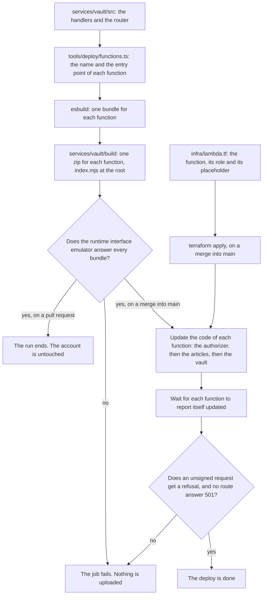

# The deployed functions: one bundle for each function, and no window where a route lets anybody through

The vault service is written and nothing in the account runs it. The api answers from placeholders
that `infra/lambda.tf` holds inline. A route that exists says 501 or refuses, and `services/vault`
reaches nobody.

This document designs the packaging. It answers six questions.

- How does each handler become a bundle?
- Which tool builds it?
- Where does the pipeline build it?
- How does Terraform receive it?
- How does the placeholder go away?
- What proves that a bundle loads?

Every section carries one status line, the same as `architecture.md` and `accounts.md`. `Status:
built` means the code is in this repository now. `Status: designed` means this document describes it
and nobody wrote it yet.

## What is built today, and what runs in the account

Status: built

`infra/lambda.tf` declares three functions, not two: `emi-vault`, `emi-authorizer` and
`emi-articles`. All three carry a placeholder. The vault placeholder and the article placeholder
answer 501. The authorizer placeholder answers `isAuthorized: false` for every request.

The placeholders work, and that is measured rather than assumed. `infra/README.md` records the
reading of 2026-09-18. `POST /v1/accounts` answered 501, so that route reaches its function. `GET
/v1/records` and `DELETE /v1/account` both answered 401, so the authorizer runs and refuses.

`services/vault` holds the registration, the request signature, the authorizer, the two record
endpoints, the delete and the article catalogue. Each one is a factory. It takes a store and gives
back a function of one event. Nothing binds one to a client of the account. Nothing routes a path to
one. No step of any path packages them.

Two roles exist and nothing assumes them. `emi-sign-in-telegram` and `emi-sign-in-challenge` are the
roles of the Telegram sign in. The grants landed on their own, before the functions that need them.

Two lines in the documents are stale, because the count moved from two functions to three.
`infra/README.md` says "Two functions" under what it builds. `architecture.md` says "the two
placeholders the Terraform carries". The path below corrects each one, inside the pull request that
already changes that file.

## What this design decides

Status: designed

One bundle for each function, and not one bundle for all of them. Seven functions once the Telegram
sign in lands, so seven bundles.

esbuild builds each one. It is pinned in the root manifest, it targets Node 22, and it writes
`index.mjs` at the root of the zip in module format.

The pipeline builds the bundles and uploads them. Terraform never receives a bundle. It keeps the
placeholder it holds inline, and it stops reading the deployed code as drift.

The authorizer is uploaded before the other two. Registration stands behind no authorizer, so a real
vault function makes registration live at once.

The Lambda runtime interface emulator proves each bundle. It runs inside the official base image for
Node 22, and it resolves the handler the way the platform resolves it.

The deploy order inside one run is fixed. The gates, the apply, the build, the load check, the
upload, and one live read that requires a refusal.

## One bundle for each function

Status: designed

One shared bundle is cheaper. One build, one zip, one upload, and a `handler` value of
`index.authorizer` or `index.vault` to pick the export. The cost is what each function then loads.

The article function stands behind no authorizer. Its role cannot reach the vault table. A shared
bundle still puts the code that reads her partition inside it. The three pool triggers hold no
parameter at all, and a shared bundle puts the Telegram exchange beside them.

None of that is a hole, because the role refuses the call. It costs a sentence this repository can
say today: the function with no authorizer in front of it holds no code that reads her records. The
privacy claim here is read by people who check it.

So each function gets its own bundle, and the rule becomes a test. esbuild writes a metafile that
names every module a bundle carries. A test reads that metafile and asserts three things. The
article bundle carries no module of the vault store. No trigger bundle carries a parameter store
client. The authorizer bundle carries no module that writes a record.

The seven functions, each with the entry point that becomes its bundle:

- `emi-authorizer`, from `services/vault/src/functions/authorizer.ts`
- `emi-vault`, from `services/vault/src/functions/vault.ts`
- `emi-articles`, from `services/vault/src/functions/articles.ts`
- `emi-sign-in-telegram`, from `services/vault/src/functions/signInWithTelegram.ts`
- `emi-sign-in-challenge-define`, from `services/vault/src/functions/defineAuthChallenge.ts`
- `emi-sign-in-challenge-create`, from `services/vault/src/functions/createAuthChallenge.ts`
- `emi-sign-in-challenge-verify`, from `services/vault/src/functions/verifyAuthChallengeResponse.ts`

The pool names a separate function for each of its three triggers. So the challenge is three
functions and one role, and `infra/lambda.tf` already grants that role their three log groups.

This decision costs seven builds and seven uploads on each merge. Nothing here has measured how long
that takes. The first pull request below reports the figure.

## The entry point, and the client the port needed

Status: designed

An entry point is a thin file and it holds no branch. It reads its environment. It builds the
clients. It binds them to the factory the service already exports. It exports `handler`. Nothing
untested lives there, because there is nothing in it to test.

An entry point is not exported from `src/index.ts`. A test that imported the package would then
build a client of the account. The reference page of the package would also carry a handler that
nobody imports. The walk in `services/vault/tests/blind.test.ts` gains each entry point as a root of
its own instead.

The dispatch is not in the entry point either. `services/vault/src/router.ts` reads the method and
the path and picks one of the four signed handlers. It answers 404 for a path no route names. That
module carries its own test, and the vault entry point calls it.

One thing is missing from the service today. `DynamoDbTable` is a port of five operations, and
nothing implements it against the real table. `services/vault/src/store/dynamoTable.ts` is that
implementation. It is a pass through. The port already takes the request shapes DynamoDB takes, so
the adapter adds no behaviour and can hide no difference.

Three clients of the Amazon Web Services software development kit are needed. Each one is imported
from its own package, so a bundle carries only the service it calls. Every function needs the
DynamoDB client. The sign in function alone needs the parameter store client and the Amazon Cognito
client.

The bundle carries those clients rather than reading them from the runtime. The version is then in
`package-lock.json`. The tests run against the same version the function runs. A runtime that
changes what it bundles cannot change what Emi does. The cost is the size of the zip, which the
first pull request measures.

One other route was weighed and refused. The adapter could speak the json protocol of DynamoDB over
https with a signer of its own, and add no dependency at all. Request signing is then a thing
somebody has to prove, and this repository has no reason to prove it.

## The tool, the runtime and the shape of the zip

Status: designed

esbuild, pinned by exact version in the root manifest, as every other tool here is pinned. Version
0.28.2 is in `package-lock.json` already, as a dependency of `@opennextjs/aws`, which builds the
website function. So the lock file gains a direct entry rather than a new package.

One command for each entry point: bundle, platform node, target node22, format esm, out file
`index.mjs`, and a metafile beside it. `infra/lambda.tf` already sets the runtime to `nodejs22.x` on
arm64. `.nvmrc` pins the Node the pipeline builds with.

No minifying, so a line in the log names a real function. No source map, because nothing reads one
in the console.

Two rules about the shape of the zip, and each one is a test.

`index.mjs` sits at the root. The archive is made from inside the directory the build wrote. The
runtime loads the handler from the root of what it is given, and it finds nothing under a folder
name. The website deploy carries that same comment, for that same reason. The `handler` of each
function stays `index.handler`, which `infra/lambda.tf` already sets, so Terraform needs no change
for the name.

The zip holds no file ending in `.node`. A native binary is the one thing that makes the architecture
of a bundle matter. The load check below runs on the architecture of the pipeline runner, and not on
arm64.

The build writes into `services/vault/build`, beside the service, the way `infra/build` sits beside
the Terraform. That directory is ignored by git and removed by the clean target of the `Makefile`.

The build is `tools/deploy/buildTheFunctions.ts`. Node type stripping runs it, with no build step of
its own, the same as every script under `tools/`. The list of functions is a separate module,
`tools/deploy/functions.ts`. It exports the name, the entry point and the Terraform resource of each
function. The pipeline, the load check and the infrastructure test all import that list. None of
them reads it out of a script with a pattern.

## Where the pipeline builds it, and how Terraform receives it

Status: designed

Terraform receives nothing. That is the decision, and the repository already made it once for the
website.

`infra/lambda.tf` keeps creating each function from the placeholder it holds inline. Each function
gains `lifecycle { ignore_changes = [filename, source_code_hash] }`. A function created from nothing
then refuses every request, until the pipeline uploads to it. A function the pipeline uploaded to
keeps the code it was given.
Without that line Terraform reads the real bundle as drift. The next apply puts the placeholder back,
which is the sentence the website module already carries.

The alternative is Terraform taking the zip as a file. It fails on the first pull request. The plan
job builds no bundle, so a plan that needed one refuses every pull request. The apply role also
becomes the thing that builds code.

A `functions` job in `.github/workflows/deploy.yml` does the work. It is shaped like the `website`
job beside it, and it needs `check` and `apply`. It builds on both events and ships on a merge alone,
so a pull request proves the bundles and changes nothing. It reads the apply role from the repository
variable. It skips every step that reaches the account while that variable is empty. The path filters
gain `services/vault/**`, `packages/crypto/**`, `packages/tokens/**` and `tools/deploy/**`.

## The placeholder goes away with no window where a route lets anybody through

Status: designed

Four things could open a route. Each one gets a rule, and each rule is a case in
`tools/pipeline/infrastructure.test.ts`.

A route with no authorizer. Two routes are meant to carry none. The registration carries none,
because the account does not exist yet. The article read carries none, because a request says which
phase is read and never who is reading it. Every other route carries the authorizer.

The rule reads the routes out of `infra/api.tf` and names those two. A third route with
`authorization_type = "NONE"` then fails here, rather than in the account.

A cached authorizer answer. `authorizer_result_ttl_in_seconds` is zero and may not be raised,
because a cached answer is a replayed signature that passes. That rule is already a case.

An authorizer that says yes when it should say no. That is the contract of the service, and
`services/vault/tests/auth.test.ts` already holds it.

An upload that lands in the wrong order. Registration stands behind no authorizer. So a woman can
register an account the moment the vault bundle is live. A placeholder authorizer would then refuse
every later request of hers, until the second upload finished. So the order is the authorizer, then
the articles, then the vault, with a wait after each one.

Neither order opens a route, and that is worth saying plainly. A placeholder authorizer refuses every
request, so a real vault bundle behind it serves nobody. A placeholder vault answers 501, so a real
authorizer in front of it reaches nothing that writes. The order above is about a product that works
halfway. It is not about a route that opens.

A bundle that fails to load answers no request at all. The route it sits on then serves nobody, and
the deploy reads that from the live api rather than from a document. The last step of the run sends
one unsigned request to each authorized route and requires a refusal. It sends one request with no
body to the registration and requires something other than 501. It presents no signature and no
Telegram code, so it writes nothing and it reads nobody. A deploy that cannot get a refusal fails.

## The test that proves a bundle loads the way the platform loads it

Status: designed

An import in node proves that the file parses. It says nothing about whether the platform can find
the handler. That is the fault that costs a deploy. A runtime resolves an entry point its own way,
and a handler it cannot resolve fails on the first real invocation.

The repository already holds the weaker version of this check, and it says so in its own words.
`infrastructure/modules/nextjs-site/tests/runArtifact.ts` imports the placeholder through the module
loader, in a child process of node. It is honest about what it covers. It is not enough here.

So `tools/deploy/loadEachBundle.ts` runs the real thing. For each bundle it unpacks the zip. It
starts the official base image for Node 22, with that directory at `/var/task`, and the handler named
the way the function names it. It posts one event to
`http://localhost:9000/2015-03-31/functions/function/invocations` and reads the answer.

The base images for Lambda carry the runtime interface emulator, and the emulator is what listens on
that address. The project that publishes the emulator says so in its own readme. Read on 8 November
2026 at https://github.com/aws/aws-lambda-runtime-interface-emulator.

Each bundle is handed an event it can answer without the account. The authorizer is handed a request
with no signature header, and the answer must be a refusal. The vault is handed a path no route
names, and the answer must be 404. Each trigger is handed an event of a kind it does not recognise,
and the answer must be the event unmodified.

Three things make the check refuse, rather than report a pass it did not earn. A run that built no
bundle fails, because a loop over an empty list reports success just the same. A run that cannot
start the image fails and says Docker is missing, rather than skipping. A bundle whose answer is
wrong fails with the body the emulator returned. The job prints the version of Docker first, so the
log carries that evidence.

It runs twice, on purpose. `npm run check:bundles` is a step of the `check` job. It also goes into
the `check` target of the `Makefile`, in the same place in the order, because
`tools/pipeline/makefile.test.ts` refuses a pipeline command that one of the two files does not
hold.

A pull request that breaks a bundle then goes red with no reach into the cloud. The `functions` job
of the deploy runs the same check on the bundles it is about to upload. So the artifact that is
proved is the artifact that ships.

One thing it does not prove: the architecture. The image is pulled for the architecture of the
pipeline runner, which is not arm64, and the functions are arm64. The rule that no bundle holds a
file ending in `.node` is what makes that gap harmless. A bundle of plain JavaScript loads the same
either way. A runner of the same architecture would close the gap, and nothing here has measured
whether this repository can use one.

## The deploy order

Status: designed

Inside one run, on a merge into `main`:

1. The format check and the validate, which is the `check` job today.
2. `terraform apply`, so a new function exists before any code is put on it.
3. The build, which writes one zip for each function in the list.
4. The load check, on those zips.
5. The upload, one function at a time, in the order the section above gives, waiting after each one.
6. One live read, which requires a refusal on each authorized route and no 501 anywhere.

On a pull request the run stops after the load check. Nothing it does reaches the account.

Across the pull requests, the build and its proof land first, and they deploy nothing. Then Terraform
stops owning the code and the pipeline starts uploading. That is the merge that makes the api real.
The four functions of the Telegram sign in come last. Their handlers belong to the path in
`accounts.md`, and they have nothing to run on until the packaging exists.

## The path

Status: designed

Three pull requests, in this order, each one its own intention. Each one names five things. What it
depends on, the files it touches, the behaviour it changes, what proves it, and why the promise of
the product still holds.

**The bundle, and the proof that it loads.**

Depends on: nothing.
Files: `services/vault/src/functions/`, `services/vault/src/router.ts`,
`services/vault/src/store/dynamoTable.ts`, `tools/deploy/functions.ts`,
`tools/deploy/buildTheFunctions.ts`, `tools/deploy/loadEachBundle.ts`, `package.json`,
`.gitignore`, `Makefile`, `.github/workflows/ci.yml`, `services/vault/tests/router.test.ts`,
`services/vault/tests/dynamoTable.test.ts`, `tools/deploy/bundles.test.ts`.
Behaviour: `npm run build:functions` writes one zip for each of the three functions that exist
today, and each zip holds `index.mjs` at its root. `npm run check:bundles` loads each one through
the runtime interface emulator. The router picks one of four handlers, and answers 404 for anything
else. The adapter implements the five operations of the port against the real table. Nothing is
deployed, and no Terraform changes.
Proof: the load check, which is the point of this piece. A mutation that renames the exported handler
to `main` is watched failing, and then passing again once the name is put back. A second mutation
empties the list of functions, and the check fails on the empty run rather than passing. The router
cases drive each route and the unknown path. The adapter cases drive the five operations against the
table double the service tests already use. The metafile cases assert that the article bundle carries
no module of the vault store. The size of each zip is read and recorded in the result.
The promise: a bundle holds the service and no key. An entry point reads a table name from its
environment, and nothing in it can open an envelope. The existing case that walks the service from
its entry point now walks each new entry point as well.

**Terraform stops owning the code, and the pipeline uploads it.**

Depends on: the bundle, and the proof that it loads.
Files: `infra/lambda.tf`, `.github/workflows/deploy.yml`, `infra/README.md`,
`docs/architecture.md`, `tools/pipeline/infrastructure.test.ts`.
Behaviour: each of the three functions gains `ignore_changes` on its file name and its code hash, so
an apply never puts the placeholder back. A `functions` job builds on both events and ships on a
merge. It skips every step that reaches the account while the apply role variable is empty. It
uploads the authorizer, then the articles, then the vault, and waits after each one. Its last step
reads the live api and requires a refusal. The readme says three functions rather than two, and says
that the deployed code is the bundle. The architecture document loses the line about two
placeholders.
Proof: the infrastructure test. Each function carries `ignore_changes` on both fields. Every function
in the list has a Terraform resource, and every resource has an entry in the list. So the drift that
left three functions unpackaged cannot happen again. The `functions` job ships on a push to `main`
alone. Every step of it that reaches the account carries the guard the plan and apply jobs carry.
Every route of `infra/api.tf` but the registration and the article read carries the authorizer. A
mutation that removes `ignore_changes` from the vault function is watched failing. A mutation that
drops the authorizer from the pull route is watched failing too.
The promise: the api answers her phone, and it still refuses an unsigned request. The deploy reads
that refusal on every merge. So the day it stops being true is the day the deploy fails.

**The four functions of the Telegram sign in.**

Depends on: the two pieces above. It also depends on the pieces of the path in `accounts.md` that
write the sign in handler and the three triggers.
Files: `infra/lambda.tf`, `infra/api.tf`, `services/vault/src/functions/`,
`tools/deploy/functions.ts`, `tools/pipeline/infrastructure.test.ts`, `infra/README.md`.
Behaviour: four function resources and four log groups, on the two roles that already exist. The
sign in function takes `emi-sign-in-telegram`, and the three triggers share `emi-sign-in-challenge`.
That role gains the one grant `infra/README.md` says is deliberately absent: the Amazon Cognito call
that creates a pool user. `infra/api.tf` gains one integration, the route `POST
/v1/sign-in/telegram` with no authorizer, and the policy that lets the api invoke that function.
Each function reads the table name from its environment. The sign in function also reads the pool,
the client, the return address and the name of each parameter. It reads a name rather than
building one, so a test can point it somewhere else. The list of functions gains four entries, so
the build and the upload cover them with no further change.
One merge, and not two. `infra/README.md` says a grant ships alone and first, because a policy that
has not spread can fail the apply that needs it. Nothing calls the new grant during the apply. The
first call happens when a woman signs in. So one merge costs at most one refused sign in, in the
minute after it.
Proof: the infrastructure test reads that each of the four functions names the role meant for it. It
reads that the sign in function is the only one whose role reads a parameter. The load check covers
the four new bundles, and each one answers an event it can answer with no account. The metafile cases
assert that no trigger bundle carries a parameter store client. A mutation that points a trigger at
the sign in role is watched failing.
The promise: the pool calls a function of Emi that holds no secret. One function reads the client
secret and the salt. It answers with a user name and a one time value, and with no part of the
identity token.

What these three do not touch: the pool itself. `infra/cognito.tf` names the three triggers and adds
the custom flow to each client, and the path in `accounts.md` owns that piece. The invoke policy that
lets the pool call a trigger belongs there too, because it names the pool.

## What this design does not answer

Status: designed

The size of each bundle. Nothing here has built one, so the first pull request measures it and
records the figure.

Whether the software development kit sheds the commands a function does not call. esbuild removes an
export that nothing imports. Whether the client packages are written so that this happens has not
been measured. It changes the size of the zip and nothing else, because the role is what refuses a
call.

Whether a pipeline runner of the same architecture as the functions is available to this repository.
The load check does not depend on one.

Whether a dependency of the bundle reaches for `require`. An esbuild bundle in module format needs a
small banner to answer that. The load check is what finds it, so nothing here guesses at it.

The first invocation in the account. No test here can make one. This design asks for that reading to
be recorded in `infra/README.md`, the way the reading of 2026-09-18 is recorded.

## How sure I am

Status: designed

High on the shape, because the repository already runs it. The website builds its own function in the
pipeline. It keeps a placeholder in Terraform, ignores the code as drift, uploads on a merge, and
then reads the live host. This design is that pattern, with one bundle for each function instead of
one for the site.

High on the refusal. The authorizer placeholder answers `isAuthorized: false`. The measured reading
of 2026-09-18 shows a 401 on both authorized routes. The result cache is zero. Nothing about the
packaging changes any of that.

Lower on the load check, and that is the part worth reading twice. The base image carries the runtime
interface emulator. That is read from the project that publishes the emulator, and it is not measured
here. If the image does not carry it, the emulator is fetched and mounted instead, which the same
project documents. Either way the check starts a container, so it needs Docker on the runner.

Lowest on the dependency. Nothing in this repository has imported the software development kit yet.
So the first pull request is the first time a bundle of this service is built at all. Three things
there are unmeasured: the size, the `require` banner and the shape of the adapter. Each one has a
line above saying who measures it.
