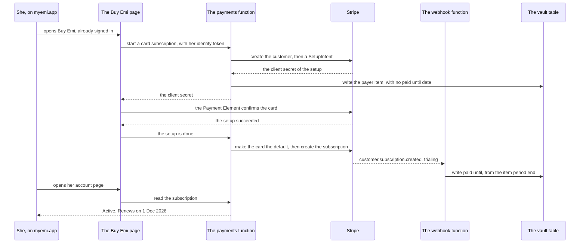
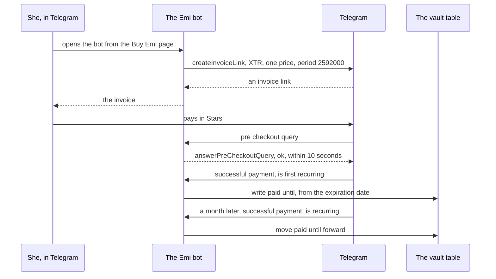

# Payments: a card on myemi.app, and Telegram Stars in the Emi bot

Emi has one price and three ways to pay it. The store route is built into the application and
contracts PAY-1 to PAY-4 already describe it. This document designs the other two: a card on our
own page, and Telegram Stars in the Emi bot.

Two sentences hold the design up.

A payment says one thing about one sign in: this way in is paid until this date. It never says
whose records those are, and nothing it writes can reach a record.

The account is the join. She signs in first, pays second, and the payment lands against the sign in
she used. A woman who pays one way and signs in another way is the hard case, and section 3 is
about that moment.

This document writes no product code. It answers
https://github.com/atlantic-blue/emi/issues/435 and the plan in
https://github.com/atlantic-blue/emi/issues/427.

## How to read this document

Status: designed

Every section carries one status line, the same as `docs/architecture.md`, `docs/privacy.md` and
`docs/design/accounts.md`. `Status: built` means the code is in this repository now. `Status:
designed` means this document describes it and nobody wrote it yet.

No section says built. Nothing here exists.

## The decisions this design starts from

Status: designed

The operator made each one. Do not argue with them here.

1. Two routes in this round. A card on myemi.app through Stripe, and Telegram Stars through the
   Emi bot.
2. The card form is on our own page, with the Stripe Payment Element. It is not Stripe's hosted
   Checkout page. Change card, receipts and cancel are on our account page too.
3. The price is 29.99 pounds a month, every month, after one free month. The operator set this on
   31 October 2026. Issues 427 and 435 still say a year. That is out of date.
4. Atlantic Blue Solutions Limited is the seller of record. It handles value added tax itself. The
   operator set this on 4 November 2026.
5. The account is required to pay. She signs in on myemi.app first. Sign in with Apple, Google,
   Telegram and a code sent to her address all work there today, through one Amazon Cognito user
   pool in eu-central-1.
6. On 13 November 2026 the operator removed the recovery code. Emi keeps each account's vault key
   in the cloud. `docs/design/accounts.md` carries that change. This document does not repeat it.

Two approved boards carry the screens.

`docs/design/website/checkout/boards/Checkout.dc.html` is the page she buys on. It shows a plan
card, a choice between Card and Telegram Stars, a space for the card form, and one button.

`docs/design/website/sign-in/boards/Profile.dc.html` is her account. Its subscription card reads
"Emi, monthly", the price, the renewal date, "Active", "Paid with Card, on this site", and three
rows: Receipts, Change card and Cancel renewal.

## What I read, and when

Status: designed

I read each source on 13 November 2026. Each line names the one fact I took from it.

Stripe, build a subscriptions integration with Elements and the Subscriptions api:
https://docs.stripe.com/billing/subscriptions/build-subscriptions?payment-ui=elements&api-integration=paymentintents
The subscription is created with `payment_behavior=default_incomplete`. The page says to expand
`latest_invoice.confirmation_secret` and to read
`subscription.latest_invoice.confirmation_secret.client_secret`. It names `invoice.paid`,
`invoice.payment_failed`, `customer.subscription.created`, `customer.subscription.updated` and
`customer.subscription.deleted` as the events to read.

Stripe, free trial periods: https://docs.stripe.com/billing/subscriptions/trials/free-trials
`trial_period_days` is an integer and the trial must be 730 days or less. The page marks this
parameter legacy and recommends the Trial Offer api for a new integration.

Stripe, trial offers: https://docs.stripe.com/billing/subscriptions/trials
A trial offer needs api version `2026-09-30.endive` or later, `billing_mode` set to `flexible`, and
two price objects. It names `customer.subscription.trial_will_end` and says it is sent three days
before the trial ends by default.

Stripe, subscriptions with no initial payment:
https://docs.stripe.com/billing/subscriptions/deferred-payment
Stripe makes a SetupIntent for a subscription that needs no first payment. The page says
`pending_setup_intent` is null when no authentication and no authorization are needed. So that
field cannot be the only way the card is collected.

Stripe, update a subscription: https://docs.stripe.com/api/subscriptions/update
`cancel_at_period_end` is a boolean and it is still a parameter. `default_payment_method` is a
string. The example answer carries `items.data[0].current_period_end` and no period at the top of
the subscription.

Stripe, the period fields moved:
https://docs.stripe.com/changelog/basil/2025-03-31/deprecate-subscription-current-period-start-and-end
`current_period_start` and `current_period_end` left the subscription and went to each subscription
item.

Telegram, payments for digital goods: https://core.telegram.org/bots/payments-stars
It says: "Remember to specify `XTR` in the `currency` field, since all sales of digital goods and
services are carried out exclusively in Telegram Stars." It says the bot must answer a pre checkout
query within 10 seconds or the transaction is cancelled. It names `refundStarPayment` as the way to
refund.

Telegram, the Bot api reference: https://core.telegram.org/bots/api
`createInvoiceLink` takes `subscription_period`, and the reference says: "Currently, it must always
be 2592000 (30 days) if specified", and "Subscription price must no exceed 10000 Telegram Stars".
`prices` "Must contain exactly one item for payments in Telegram Stars". `SuccessfulPayment`
carries `is_recurring`, `is_first_recurring`, `subscription_expiration_date` and
`telegram_payment_charge_id`. `editUserStarSubscription` cancels or re-enables the extension of a
Stars subscription.

Telegram, bot star subscriptions: https://core.telegram.org/api/subscriptions
It says the only allowed period is 30 days. A woman cancels her own subscription from her Telegram
client. The page names no trial and no discount.

Apple, App Review Guidelines: https://developer.apple.com/app-store/review/guidelines/
Guideline 3.1.1 says: "In all other storefronts, except for the United States storefront, where
this prohibition does not apply, apps and their metadata may not include buttons, external links,
or other calls to action that direct customers to purchasing mechanisms other than in-app
purchase." Guideline 3.1.3(b) allows an application to give access to content bought on a web site,
"provided those items are also available as in-app purchases within the app".

Amazon, fine grained access control in DynamoDB:
https://docs.aws.amazon.com/amazondynamodb/latest/developerguide/specifying-conditions.html
For a string partition key, `dynamodb:LeadingKeys` takes `StringEquals`, "or `StringLike` for a
prefix match". A `ForAllValues` condition is true when the key is absent from the request, so a
`Null` condition must sit beside it.

---

## 1. The entitlement record

Status: designed

### The one question it answers

The application and the site ask one question of it. Is this account paid until a date?

The answer is one instant and nothing else. A screen turns that instant into words. No caller reads
a card, a price, a country or a payment method from this record, because none of those is in it.

### Where it lives, and why not a new table

It lives in the table that exists, `emi-vault`. It is a partition of its own, `PAY#` and a payer
digest. It is not under `ACC#`.

Three reasons, in order.

The table bills on demand and costs nothing while nobody reads it. A second table adds a deploy, a
backup setting and a second role for no gain.

Its own partition means the item never sits beside a record. A record lives under `ACC#` and
`REC#`. Nothing in the entitlement partition can be reached by a query of an account partition, and
nothing in an account partition is reached by a query of this one.

A partition of its own makes the limit checkable. The webhook role is allowed `PAY#` partitions
only, with a `dynamodb:LeadingKeys` condition that uses `StringLike` and the prefix, and a `Null`
condition beside it so a scan is refused. The function that writes a payment therefore cannot read
one day of anybody's history, and a test reads that policy rather than trusting the code.

### The item, at field level

`pk` is a string. It is `PAY#` and the payer digest, which is 26 characters of Crockford base 32.

`sk` is the string `META`.

`paidUntil` is a string, an instant. It is absent until the first payment or the first free month
lands. It is the one field every reader wants.

`route` is a string. It is `card` or `stars`. It is what the account page says she paid with.

`state` is a string. It is `active`, `cancelling`, `lapsed` or `refunded`. `cancelling` means she
stopped the renewal and the month she paid for still runs.

`payerRef` is a string, the Stripe customer identifier. It is absent on the Stars route.

`subscriptionRef` is a string, the Stripe subscription identifier. It is absent on the Stars route.

`chargeRef` is a string, the Telegram payment charge identifier of the last payment. It is absent
on the card route. Section 4 says what it is for.

`eventAt` is a number, the seconds of the event that last wrote this item. Every write is
conditional on a newer `eventAt`, because Stripe does not promise an order of delivery. Without it,
a late `customer.subscription.updated` can put an old date back over a new one.

`firstSeenAt` and `updatedAt` are strings, instants.

The item holds no name, no address, no card number, no country, no Telegram user identifier, no
account identifier and no record identifier. A reader who holds the table learns that a digest paid
until a date. The digest names no person and opens nothing.

### How a phone gets from an account to a payment

The account item keeps `subscribedUntil` for the store route. Contracts PAY-2 and PAY-3 do not
change.

The link between an account and a payment is one new attribute on an item that already exists. The
identity item `ACC#<accountId>` and `IDY#<identityDigest>` gains `payerDigest`, a string. The link
endpoint of `docs/design/accounts.md` writes it from the same token it already reads. The delete
already walks these items, so a delete removes the link with everything else.

The read is then a query and a few gets. The service queries the account partition for `IDY#`
items, collects each `payerDigest`, reads each `PAY#` item, and answers the furthest `paidUntil` it
finds, or the account item's own `subscribedUntil` when that is further. The identity count is
capped, so the number of reads is capped with it.

A delete removes the `PAY#` item with everything else. Contract KEEP-3 says any server item that
remains is an error, and this is a server item. The books are not lost. Stripe holds every invoice
and Telegram holds every Stars transaction, and those are the records the seller keeps.

One consequence follows, and it is question 7 of section 10. A woman who deletes her account inside
a month she paid for, and then signs in again, reads no date. The next renewal writes one, because
Stripe and Telegram both keep charging until somebody stops them.

---

## 2. Which identity owns a payment

Status: designed

### The payer digest

A web payment is made by a user of the pool. A Stars payment is made by a Telegram user, and no
user of the pool has to exist yet, because the board tells her to pay in the bot first and sign in
afterwards.

So the key cannot be the pool subject. The pool makes a subject when it makes a user, and the bot
cannot make one.

The key is the pool user name, which both sides can work out alone.

The site reads it from the identity token, in the `cognito:username` claim. The bot works it out
from the Telegram subject. `services/vault/src/telegram/userName.ts` already builds that name
today: it is `tg_` and 26 characters of the keyed hash of the subject under the salt in the
parameter store. The bot reads the same salt and gets the same name, whether or not the pool holds
a user by it.

The payer digest is then 26 characters of Crockford base 32, cut from the first 16 bytes of the
SHA-256 of the pool identifier, a newline, and the pool user name. The helper that makes an account
identifier makes this one, the same as the identity digest, the transaction digest and the answer
digest. One shape, one implementation.

The raw user name is written nowhere. A reader who already knows which Telegram account to test for
still needs the salt, and the salt is a secure string nobody has ever read.

### She pays with Stars and signs in with Apple

This case is a refusal, and it must read as one.

Each way she signs in is its own user of the pool, so each one has its own payer digest. A Stars
payment names the Telegram digest. Sign in with Apple names the Apple digest. Her account holds one
link for each way she has linked, and the entitlement read walks those links. The Apple way finds
no payment, because none was made against it.

So she sees no subscription, and the money is not lost. The fix is to sign in with Telegram, on the
site or on the phone, which the board already tells her to do: "Then log in with Telegram on your
iPhone, and Emi unlocks by itself."

Linking a second way in to one account is https://github.com/atlantic-blue/emi/issues/558. It is
not built. Until it is, one account reaches one payment through the one way in that paid.

The line she reads on the account page, when she is signed in a way that paid for nothing, is in
section 7.

---

## 3. The card route

Status: designed

### The objects in Stripe

One product, Emi. One price of 2999 in `gbp`, recurring every month. One customer for each payer
digest. One subscription for each customer.

The payer digest goes into the `metadata` of the customer and of the subscription. That is the
reverse index. A webhook carries a customer identifier, and the metadata on it names the digest, so
no second item and no second query is needed to find out who paid.

The digest is the only thing of ours that reaches Stripe. Stripe holds her card and the address her
bank needs. Emi holds neither.

### The first payment, with a free month

The free month means the first invoice is zero, so there is no payment to confirm. Stripe makes a
SetupIntent in that case, but the deferred payment page says `pending_setup_intent` is null when
nothing needs authentication. A flow that waits for that field therefore works on some cards and
not on others.

So the card is collected first, and the subscription is made second. The order is always the same
and there is always one thing to confirm.

1. The site asks the payments function to start. The request carries her identity token.
2. The function makes the customer, or reads the one the item already names.
3. The function makes a SetupIntent for that customer, with `usage` set to `off_session`.
4. The function writes the `PAY#` item with `payerRef` and no `paidUntil`.
5. The site mounts the Payment Element on the client secret of that SetupIntent, and calls
   `stripe.confirmSetup`. Strong Customer Authentication happens here if her bank asks for it.
6. The site tells the function the setup is done. The function sets the payment method as
   `invoice_settings.default_payment_method` on the customer.
7. The function creates the subscription with the price, `trial_period_days` set to 30,
   `payment_settings[save_default_payment_method]` set to `on_subscription`, and
   `trial_settings[end_behavior][missing_payment_method]` set to `cancel`.
8. The webhook writes `paidUntil` when the event arrives.

Stripe marks `trial_period_days` legacy and recommends the Trial Offer api instead. The legacy
parameter is taken here because it needs one price object and one integer. A trial offer needs two
price objects, the `flexible` billing mode and api version `2026-09-30.endive` or later. If Stripe
withdraws the parameter, the change is one function and one line.

If the operator decides the free month does not apply on the web, the shape changes by one step.
The subscription is then created with `payment_behavior=default_incomplete`, the function expands
`latest_invoice.confirmation_secret`, and the site calls `stripe.confirmPayment` on that client
secret rather than `stripe.confirmSetup`. Question 3 of section 10 is that decision.

### The events the service reads, and what each one writes

The webhook is one route with no authorizer. Stripe signs every delivery, and the function verifies
the `Stripe-Signature` header against the signing secret before it reads one field of the body. A
body that fails that check is answered 400 and written nowhere.

Five events are read. Everything else is answered 200 and dropped, because an endpoint that fails
on an event it does not know turns every new Stripe feature into an outage.

`customer.subscription.created` writes `subscriptionRef`, `route` as `card`, `state` as `active`,
and `paidUntil` from `items.data[0].current_period_end`. For a subscription in its free month, that
instant is the end of the free month.

`customer.subscription.updated` writes `paidUntil` from the same place, and `state` as `cancelling`
when `cancel_at_period_end` is true. It is the event that moves the date forward each month.

`invoice.paid` writes `paidUntil` from the subscription item period of the invoice line, and
`state` as `active`. It is the event the Stripe guide names for giving access, and it is read as
well as the subscription events because a payment that succeeds after a failed one arrives here
first.

`invoice.payment_failed` writes nothing to `paidUntil`. It leaves the date where it is and sets
`state` to `lapsed` only when the date has already passed. A failed payment on day one of a retry
is not a lapse, and a woman whose bank blocked one attempt keeps writing to her own history until
the date she paid for runs out.

`customer.subscription.deleted` sets `state` to `lapsed`. It leaves `paidUntil` where it is, so the
month she paid for still works.

Two traps, named because each one fails at run time and not at compile time.

The period moved. `current_period_end` is not on the subscription any more. It is on each
subscription item. Code that reads the old place reads undefined, writes nothing, and the account
page then says she never paid.

Delivery has no order. A retry of an older event can arrive after a newer one. The conditional
write on `eventAt` is what stops it, and the test for it feeds two events in the wrong order and
reads the item afterwards.

### Change card, receipts and cancel

All three are on our account page. None of them opens Stripe's own portal, because the board draws
three rows and no fourth destination.

Change card makes a second SetupIntent for the same customer, mounts the Payment Element again, and
on success sets the new payment method as the default on the customer and on the subscription. The
old payment method is detached afterwards, so a card she replaced is not left on file.

Receipts lists the invoices of the customer and shows the date, the amount and a link for each one.
The link is the hosted invoice page Stripe already serves. Emi builds no invoice of its own and
stores no copy.

Cancel renewal updates the subscription with `cancel_at_period_end` set to true. The month she paid
for runs to its end. The account page then says the date it ends, and offers to turn the renewal
back on, which is the same call with false.

---

## 4. The Telegram Stars route

Status: designed

### The invoice

The bot sells one thing. `createInvoiceLink` is called with `currency` set to `XTR`, exactly one
price component, `subscription_period` set to 2592000, and a `payload` that carries the payer
digest and nothing else.

The reference is strict about three of those. Digital goods are sold in Stars only. `prices` must
hold exactly one item for a Stars payment. The period must always be 2592000 seconds, which is 30
days.

The payload is at most 128 bytes and the digest is 26 characters, so the whole payer digest fits
and is read straight back on the payment.

### The payment, and each renewal

A pre checkout query must be answered within 10 seconds or Telegram cancels the transaction. The
bot answers it before it writes anything, because the write is not what the clock is waiting for.

The payment itself arrives as a message carrying `successful_payment`. The bot reads four fields.
`invoice_payload` gives the payer digest. `subscription_expiration_date` gives the instant that
becomes `paidUntil`. `is_first_recurring` says this is the first month. `telegram_payment_charge_id`
becomes `chargeRef`.

A renewal is the same message with `is_recurring` true and `is_first_recurring` absent. It carries
a new expiration date and a new charge identifier, so the write is the same write.

The bot writes `route` as `stars` and `state` as `active`. It writes no Telegram user identifier at
all.

### How she cancels, and what a refund costs

She cancels in Telegram. That is where Telegram puts the control, and a Stars subscription is
listed in her own client beside every other one. The account page sends her there and does not
pretend to do it itself.

The bot can also cancel the extension with `editUserStarSubscription`, passing `is_canceled` as
true. That call needs her Telegram user identifier and the charge identifier. The bot has her
identifier only inside a chat she wrote in, and the charge identifier is on the item. So the bot
offers cancel as a command in the chat, where both values are in hand, and the table never holds
the identifier.

A refund is `refundStarPayment`, with the same two values, and the same rule: the operator answers
it in the chat she asked in. The entitlement item then moves to `refunded` and `paidUntil` is set
to the instant of the refund.

### What Stars cannot do

Each one is a fact with a source, not an opinion.

There is no free trial. `createInvoiceLink` has no trial parameter, the period must always be
2592000 seconds, and the first payment happens when she confirms. The Telegram page on bot star
subscriptions names no trial and no discount. So a free month on this route must come from Emi
itself, written as a `paidUntil` before any payment. That is question 3 of section 10.

There is no price above 10000 Stars. The reference says "Subscription price must no exceed 10000
Telegram Stars".

There is no period but a month. 30 days is the only value the reference allows today.

The money does not arrive as money. Issue 427 records the terms: each payment is held for up to 21
days, the smallest withdrawal is 1000 Stars, and the payout comes through Fragment as Toncoin,
which then has to be sold. None of that is in this repository and none of it is a code decision. It
is the reason question 1 of section 10 is a question and not a number.

---

## 5. Where each secret lives

Status: designed

Three values are secret. Each one lives in the parameter store in eu-central-1, as a secure string,
written by hand by the operator. No value is in this repository, in a manifest, in a variable of
the pipeline or in a comment.

`/emi/payments/stripe/secret-key` is the Stripe secret key. The payments function and the webhook
function read it.

`/emi/payments/stripe/webhook-secret` is the signing secret of the webhook endpoint. The webhook
function reads it, and refuses a body it cannot verify.

`/emi/accounts/telegram/bot-token` is the bot token. The Telegram sign in names this parameter and
reads nothing from it. The bot function reads it. It is the one credential that can act as the bot,
so no other function is given it.

The publishable key of Stripe is not a secret and sits in the site, which is how Stripe ships it.

Each function reads its own parameter and no other. The role names the parameter by its whole path,
the same way the Telegram sign in names its three.

### The trap in the deploy log

A Lambda update prints the whole configuration of the function, and that carries every environment
variable. This repository is public, so its pipeline log is readable by anybody.

The deploy workflow already answers this. It asks for one field of the answer and prints nothing
else. Any step added for these functions does the same.

The stronger rule is the one above it. A secret is read from the parameter store at run time and is
never an environment variable, so a log that printed the whole configuration would still carry no
key. The environment holds the name of a parameter, which is public by design.

---

## 6. What the application reads, and the App Store rule

Status: designed

The application asks the api one question on launch and reads one instant back. It never learns
which route paid. Card, Stars and the store all answer the same shape, so no screen of the
application can name a route it is not allowed to name.

Guideline 3.1.1 says, for every storefront but the United States one, that an application and its
metadata "may not include buttons, external links, or other calls to action that direct customers
to purchasing mechanisms other than in-app purchase".

So the application names no price of the website, no price in Stars, and no address of myemi.app on
any screen that sells anything. It carries no button to the site and no button to the bot. The
words that tell a woman these routes exist live outside the application: the website, the Emi
Community, and a message the operator sends.

Guideline 3.1.3(b) is what makes the unlock allowed. An application that works across platforms may
let her reach what she bought on a web site, "provided those items are also available as in-app
purchases within the app". Contract PAY-1 puts the same subscription in both stores, so the
condition holds.

One test can fail on this. The existing wording gate reads every screen of the application and the
store listing. It gains the website host, the word Stars and any amount of money outside the one
price, as wording the application may not carry. That gate runs on every pull request, so the rule
is enforced by a run and not by a memory.

---

## 7. Every refusal she can meet

Status: designed

One screen, one title, the actions, and at most one line. The line is the whole explanation.

**Her bank refused the card.** Title: Payment refused. Actions: Try again, Use another card. Line:
"Your bank refused this card. Nothing was taken."

**Her bank wants to check it is her.** The Payment Element asks on its own and most women see only
that. When the check does not finish, title: Your bank stopped the check. Action: Try again. Line:
"The check did not finish, so the card is not saved yet."

**The payment went through and the page does not know yet.** Title: Thank you. Action: Refresh.
Line: "Your payment is taken. Your account updates in a moment."

**She paid in Stars and she is signed in another way.** Title: No subscription here. Action: Sign
in with Telegram. Line: "A payment in Stars shows up when you sign in with Telegram."

**A Stars payment is refunded.** Title: Refunded. Action: Buy Emi. Line: "Your Stars are back.
Everything you wrote stays, and new entries stop."

**The month ran out.** Title: Emi needs renewing. Action: Buy Emi. Line: "Everything you wrote
stays, and new entries stop until you renew."

The last two say the same thing on purpose, because contract PAY-4 says the same thing in both
cases. Reading, exporting and deleting stay open forever. Only new writes stop.

---

## 8. The boards that are missing

Status: designed

Each one is a question for the operator. None is drawn here, and no step below builds a screen that
has no board.

1. What does she see on the page straight after a card payment? Is it the account page, or a page
   of its own that says thank you?
2. What does a refused card look like on the Buy Emi board? Where does the line sit, and does the
   card form stay open?
3. What does the account page show for a woman who has not paid? The approved board draws an active
   subscription and nothing else.
4. What does the account page show for a woman who paid in Stars? The approved card reads "Paid
   with Card, on this site", and the three rows under it are Receipts, Change card and Cancel
   renewal. None of the three is possible on the Stars route.
5. What does the account page show after she cancels, while the month she paid for still runs?
6. What does the Emi bot say first, and what does the Open the Emi bot button point at?
7. Which page do the two "terms" links on the Buy Emi board point at? Both point at nothing today.

---

## 9. The path

Status: designed

Each step is one pull request with one intention. Each one ships its tests in the same change. No
infrastructure is applied from a machine: every step that adds a resource adds its Terraform, and
the merge deploys it.

Steps 1 to 4 are the shared half. Steps 5 to 9 are the card. Steps 10 to 12 are Stars.

**1. The contracts for the money.**
Files: `docs/contracts.md`, `docs/features.md`.
Behaviour: PAY-5 names the entitlement record and the one question it answers. PAY-6 names the card
route. PAY-7 names the Stars route. PAY-8 names the entitlement read.
Proof: the documents gate holds the two files to each other, so a contract in one and not the other
fails the run.
Depends on: nothing.

**2. The payer digest.**
Files: `packages/crypto/src/`, and the test beside it.
Behaviour: one function turns a pool identifier and a pool user name into 26 characters. It is the
helper that already makes an account identifier.
Proof: the digest of a known pair is a known value, and the same Telegram subject gives the same
digest through the pool user name as through the bot.
Depends on: nothing.

**3. The entitlement store.**
Files: `services/vault/src/payments/`, `infra/dynamodb.tf`, `infra/lambda.tf`.
Behaviour: read and write of the `PAY#` item, with the conditional write on `eventAt`. The role
carries the `LeadingKeys` condition and the `Null` beside it.
Proof: the store runs against a real engine. An older event does not move a newer date. A test
reads the policy document and fails if the condition is absent.
Depends on: step 2.

**4. The entitlement read, for the phone.**
Files: `services/vault/src/handlers/`, `services/vault/src/router.ts`, `infra/api.tf`.
Behaviour: one route behind the signature authorizer answers one instant. It walks the `IDY#` items
of the account and takes the furthest date, including the account item's own.
Proof: an account with a Stars payment and no Telegram link reads no date. The same account with
the link reads the date.
Depends on: step 3, and the link endpoint of `docs/design/accounts.md`.

**5. The Stripe objects, and the start of a subscription.**
Files: `services/vault/src/payments/`, `infra/api.tf`, `infra/lambda.tf`.
Behaviour: one route behind a token authorizer of the pool makes the customer and the SetupIntent,
and writes the item. The secret key is read from the parameter store.
Proof: the calls are made against a double that answers what Stripe answers, and a second test
reads that no environment variable holds a key.
Depends on: step 3.

**6. The Payment Element on the Buy Emi page.**
Files: `apps/website/app/[lang]/checkout/`, `apps/website/components/`, the three word catalogues.
Behaviour: the page of the approved board, with the card form mounted and the Stars choice drawn.
Proof: a test drives the page, confirms the setup through a double, and reads the state the page
leaves her in. The one price gate holds the words.
Depends on: step 5, and board question 2 of section 8.

**7. The webhook.**
Files: `services/vault/src/payments/`, `infra/api.tf`, `infra/lambda.tf`.
Behaviour: the signature is verified first. The five events write what section 3 says they write.
Proof: a body with a wrong signature is refused and writes nothing. Two events in the wrong order
leave the newer date in place. The period is read from the subscription item, and a test with the
field only at the top of the subscription fails.
Depends on: step 5.

**8. The subscription card on the account page.**
Files: `apps/website/app/[lang]/account/`, `apps/website/components/`, the three word catalogues.
Behaviour: the card of the approved board, with the date, the state and the route.
Proof: a test renders each state and reads the words. A woman with no payment sees the board of
question 3.
Depends on: step 7, and board questions 3 and 5 of section 8.

**9. Change card, receipts and cancel.**
Files: `services/vault/src/payments/`, `apps/website/components/`.
Behaviour: the three rows do what section 3 says. Cancel sets `cancel_at_period_end`.
Proof: a cancel leaves the paid date alone and moves the state. A changed card detaches the old one.
Depends on: step 8.

**10. The Emi bot, and the invoice.**
Files: `services/bot/`, `infra/api.tf`, `infra/lambda.tf`.
Behaviour: the bot answers one command with an invoice link. The token is read from the parameter
store.
Proof: the call carries `XTR`, one price and the period 2592000, and the payload carries the digest.
Depends on: step 3, question 1 of section 10, and board question 6 of section 8.

**11. The Stars payment and each renewal.**
Files: `services/bot/`.
Behaviour: the pre checkout query is answered first. A successful payment writes the item. A
renewal moves the date.
Proof: a first payment and a renewal are fed in, and the item is read after each one. An answer to
the pre checkout query that takes longer than the limit fails the test.
Depends on: step 10.

**12. The account page for a Stars payer.**
Files: `apps/website/components/`, the three word catalogues.
Behaviour: the card says Stars, and sends her to Telegram to cancel.
Proof: a test reads that no Change card row and no Cancel renewal row is drawn.
Depends on: step 11, and board question 4 of section 8.

**13. The application reads the entitlement.**
Files: `apps/mobile/src/`.
Behaviour: the launch read of contract PAY-2 asks the api as well as the store, and keeps the
furthest date.
Proof: a test gives the store nothing and the api a date, and the write stays open.
Depends on: step 4.

---

## 10. What the operator must answer before the build

Status: designed

Each one blocks a step. None is mine to decide.

1. **The price in Stars.** 29.99 pounds is about 38 United States dollars. Issue 427 works out that
   about 2300 Stars gives Emi about 30 dollars, and costs her about 32 dollars through Fragment or
   about 46 dollars through Telegram's own purchase. So the two prices cannot both match. Which
   one is held: what she pays, or what Emi receives? The cap is 10000 Stars. Blocks step 10.
2. **The sanctions check.** Issue 427 asks whether a company in the United Kingdom may take a
   payment from a person in Russia. The Stars route exists for that case. Nothing is built until
   the answer is in writing. Blocks steps 10 to 12.
3. **The free month, on each route.** Does it apply on the web? Stripe can give it with one
   parameter. Does it apply in Stars? Telegram cannot give it at all, so Emi would have to write a
   date before any payment, which means a person with many Telegram accounts gets many free months.
   Blocks steps 5 and 10.
4. **Value added tax.** Atlantic Blue Solutions Limited is the seller of record and handles it
   itself. Is 29.99 pounds the price including tax in every country, or is tax added on top? Stripe
   Tax works this out and charges a fee for it. Blocks step 5.
5. **Which Stripe account.** The money belongs to Atlantic Blue Solutions Limited. The account has
   to exist and be verified before any key exists. Blocks step 5.
6. **The terms page.** Both "terms" links on the approved board point at nothing. Which page is it,
   and does it exist? Blocks step 6.
7. **The delete, and a month she paid for.** Contract KEEP-3 removes every server item, so a delete
   removes the payment record as well. She then reads no date until the next renewal writes one. Is
   that right, or should a delete stop the subscription at Stripe and in the bot? Blocks step 3.

---

## How sure I am

Status: designed

The whole design: 80 per cent.

The entitlement record and the payer digest: 90 per cent. The shape follows the four digests this
repository already makes, and the one new attribute sits on an item the delete already walks. What
lowers it is the delete. Contract KEEP-3 decides what the code does, and nobody has decided what
she should be left with, which is question 7 of section 10.

The card route: 85 per cent. Every call and every event name is read from Stripe's current
documentation on 13 November 2026 and cited above. What lowers it is the free month. Stripe marks
the parameter I take legacy, and the recommended replacement needs a newer api version and a second
price object.

The Stars route: 70 per cent. The Bot api is quoted exactly and the limits are its own words. What
lowers it is everything outside the code. The payout terms in issue 427 are from a blog and not
from Telegram. The sanctions answer is not written anywhere. Nobody has asked a woman in Russia
whether she would pay this way.

The App Store rule: 75 per cent. The two guidelines are quoted from Apple's own page. What lowers
it is that no reviewer has read this build, and a wording gate can only catch the words we thought
of.

The path: 80 per cent. The three board questions of section 8 block three steps, and a step with no
board is a step that invents a screen.

## What this design does not answer

Status: designed

The App Store route itself. Contracts PAY-1 to PAY-4 carry it, and it is in milestone 7.

Linking a second way in to one account, which is
https://github.com/atlantic-blue/emi/issues/558.

A refund of a card payment. Stripe can do it and nobody has said when Emi would.

A price in any currency but the pound.

Whether a woman who already pays in a store should be shown a price on the website at all.
