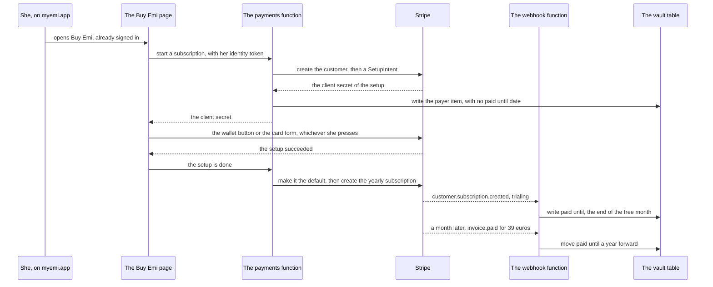

# Payments: a card and a wallet on myemi.app

Emi has three plans in the app, sold through the App Store, and one yearly plan on myemi.app, sold
through Stripe. The store route is not built: contracts PAY-1 to PAY-4 describe it and
`docs/design/app-store-payments.md` designs it. This document designs the route on our own page.

Two sentences hold the design up.

A payment says one thing about one sign in: this way in is paid until this date. It never says
whose records those are, and nothing it writes can reach a record.

The account is the join. She signs in first, pays second, and the payment lands against the sign in
she used. A woman who pays one way and signs in another way is the hard case, and section 2 is
about that moment.

This document writes no product code. It answers
https://github.com/atlantic-blue/emi/issues/435 and the plan in
https://github.com/atlantic-blue/emi/issues/427.

## How to read this document

Status: designed

Every section carries one status line, the same as `docs/architecture.md`, `docs/privacy.md` and
`docs/design/accounts.md`. `Status: built` means the code is in this repository now. `Status:
designed` means this document describes it and nobody wrote it yet.

No section says built. Nothing here exists.

## The decisions this design starts from

Status: designed

The operator made each one. Do not argue with them here.

1. The price is 39 euros a year, with value added tax inside that amount. The first month is free.
   The operator set this on 16 November 2026. It replaces 29.99 pounds a month, which issues 427
   and 435 and the first draft of this document carried.
2. Stripe sells one yearly price in euros, and the tax is inside the amount. So the figure she
   reads is the figure she pays, in every country.
3. Atlantic Blue Solutions Limited is the seller of record and handles the tax itself. The operator
   set that on 4 November 2026.
4. Telegram Stars is dropped. The operator decided that on 23 November 2026, and this document no
   longer designs it. Nothing of it was built. The Stripe route is the only route this document
   carries. Signing in with Telegram is a different thing and it stays, because it is built and
   `docs/design/accounts.md` holds it.
5. She pays with Apple Pay, Google Pay or a card, on our own page. It is not Stripe's hosted
   Checkout page. Change card, receipts and cancel are on our account page too.
6. The account is required to pay. She signs in on myemi.app first. Sign in with Apple, Google,
   Telegram and a code sent to her address all work there today, through one Amazon Cognito user
   pool in eu-central-1.
7. On 13 November 2026 the operator removed the recovery code. Emi keeps each account's vault key
   in the cloud. `docs/design/accounts.md` carries that change. This document does not repeat it.
8. The Stripe account is verified. The operator said so on 16 November 2026. The first price object
   is still made with the tax inside the amount.
9. A delete keeps the payment record and stops the renewal. It sets the Stripe subscription to
   cancel at the end of the period she paid for, and the rest of that year is not refunded. The
   operator decided that on 16 November 2026, and contract KEEP-3 now says it. Section 1 says what
   the record holds afterwards.
10. The terms page has a board named Terms on the canvas, and its own pull request builds the page.
    The two terms links of the checkout point at `/{language}/terms/`.

Two approved boards carry the screens.

`docs/design/website/checkout/boards/Checkout.dc.html` is the page she buys on. The operator
approved this drawing of it on 16 November 2026. It shows a plan card and two choices: "Apple Pay,
Google Pay or card" on this site, and "Telegram Stars" in the Emi bot. The second choice is a row
the drawing still carries and the page does not build, because decision 4 dropped that route.
Section 3 reads the first choice row by row. Its words carry the yearly price.

`docs/design/website/sign-in/boards/Profile.dc.html` is her account. Its subscription card reads
"Emi, yearly", the yearly price, a renewal date, "Active", "Paid with Card, on this site", and
three rows: Receipts, Change card and Cancel renewal. Question 4 of section 7 is that board.

## What I read, and when

Status: designed

I read each source on 13 November 2026, and the four about wallets and tax on 16 November 2026.
Each line names the one fact I took from it.

Stripe, build a subscriptions integration with Elements and the Subscriptions api:
https://docs.stripe.com/billing/subscriptions/build-subscriptions?payment-ui=elements&api-integration=paymentintents
The subscription is created with `payment_behavior=default_incomplete`. The page says to expand
`latest_invoice.confirmation_secret` and to read
`subscription.latest_invoice.confirmation_secret.client_secret`. It names `invoice.paid`,
`invoice.payment_failed`, `customer.subscription.created`, `customer.subscription.updated` and
`customer.subscription.deleted` as the events to read.

Stripe, create a price: https://docs.stripe.com/api/prices/create
`currency` is a three letter code in lower case. `unit_amount` is an integer in the smallest unit
of that currency. `tax_behavior` is one of `inclusive`, `exclusive` or `unspecified`, and the page
says: "Once specified as either `inclusive` or `exclusive`, it cannot be changed."

Stripe, free trial periods: https://docs.stripe.com/billing/subscriptions/trials/free-trials
`trial_period_days` is an integer and the trial must be 730 days or less. The page marks this
parameter legacy and recommends the Trial Offer api for a new integration.

Stripe, trial offers: https://docs.stripe.com/billing/subscriptions/trials
A trial offer needs api version `2026-09-30.endive` or later, `billing_mode` set to `flexible`, and
two price objects. It names `customer.subscription.trial_will_end` and says it is sent three days
before the trial ends by default.

Stripe, subscriptions with no initial payment:
https://docs.stripe.com/billing/subscriptions/deferred-payment
Stripe makes a SetupIntent for a subscription that needs no first payment. The page says
`pending_setup_intent` is null when no authentication and no authorization are needed. So that
field cannot be the only way the card is collected.

Stripe, update a subscription: https://docs.stripe.com/api/subscriptions/update
`cancel_at_period_end` is a boolean and it is still a parameter. `default_payment_method` is a
string. The example answer carries `items.data[0].current_period_end` and no period at the top of
the subscription.

Stripe, the period fields moved:
https://docs.stripe.com/changelog/basil/2025-03-31/deprecate-subscription-current-period-start-and-end
`current_period_start` and `current_period_end` left the subscription and went to each subscription
item.

Stripe, the Payment Element: https://docs.stripe.com/payments/payment-element
It says that when the Payment Element and the Express Checkout Element sit on one page, "wallet
payment methods such as Apple Pay and Google Pay are only displayed in the Express Checkout Element
to avoid duplication."

Stripe, the Express Checkout Element: https://docs.stripe.com/elements/express-checkout-element
It "presents one-click payment methods that are active, supported, and set up", and says "a
customer won't see a Google Pay button if they don't have Google Pay set up". For the case where
nothing is available it says: "If no wallets are available, provide another option for your
customer to pay", and it gives the `availablepaymentmethodschange` event to read that with.

Stripe, an Elements instance without an intent:
https://docs.stripe.com/js/elements_object/create_without_intent
This reference covers the Express Checkout Element. `mode` is required there, and `amount` is
"Required when `mode` is `payment` or `subscription`".

Stripe, Apple Pay on the web: https://docs.stripe.com/apple-pay?platform=web
"If you use Elements or embedded Checkout, you need to register your domain." It says Stripe
handles Apple merchant validation: "Stripe handles Apple merchant validation for you, including
creating an Apple Merchant ID and Certificate Signing Request." It recommends Apple Pay merchant
tokens for a payment the shop starts later, which a renewal is.

Stripe, register domains for payment methods:
https://docs.stripe.com/payments/payment-methods/pmd-registration
A domain is registered with one call to `/v1/payment_method_domains` using the live secret key, or
with one press in the dashboard. Every host is registered on its own, "including registering
top-level domains and subdomains". The page names no file for the site to serve.

Apple, App Review Guidelines: https://developer.apple.com/app-store/review/guidelines/
Guideline 3.1.1 says: "In all other storefronts, except for the United States storefront, where
this prohibition does not apply, apps and their metadata may not include buttons, external links,
or other calls to action that direct customers to purchasing mechanisms other than in-app
purchase." Guideline 3.1.3(b) allows an application to give access to content bought on a web site,
"provided those items are also available as in-app purchases within the app".

Amazon, fine grained access control in DynamoDB:
https://docs.aws.amazon.com/amazondynamodb/latest/developerguide/specifying-conditions.html
For a string partition key, `dynamodb:LeadingKeys` takes `StringEquals`, "or `StringLike` for a
prefix match". A `ForAllValues` condition is true when the key is absent from the request, so a
`Null` condition must sit beside it.

---

## 1. The entitlement record

Status: designed

### The one question it answers

The application and the site ask one question of it. Is this account paid until a date?

The answer is one instant and nothing else. A screen turns that instant into words. No caller reads
a card, a price, a country or a payment method from this record, because none of those is in it.

### Where it lives, and why not a new table

It lives in the table that exists, `emi-vault`. It is a partition of its own, `PAY#` and a payer
digest. It is not under `ACC#`.

Three reasons, in order.

The table bills on demand and costs nothing while nobody reads it. A second table adds a deploy, a
backup setting and a second role for no gain.

Its own partition means the item never sits beside a record. A record lives under `ACC#` and
`REC#`. Nothing in the entitlement partition can be reached by a query of an account partition, and
nothing in an account partition is reached by a query of this one.

A partition of its own makes the limit checkable. The webhook role is allowed `PAY#` partitions
only, with a `dynamodb:LeadingKeys` condition that uses `StringLike` and the prefix, and a `Null`
condition beside it so a scan is refused. The function that writes a payment therefore cannot read
one day of anybody's history, and a test reads that policy rather than trusting the code.

### The item, at field level

`pk` is a string. It is `PAY#` and the payer digest, which is 26 characters of Crockford base 32.

`sk` is the string `META`.

`paidUntil` is a string, an instant. It is absent until the free month or the first payment lands.
It is the one field every reader wants. The free month belongs to the one price of 39 euros a year,
so a subscription bought on an offer is charged at once.

`route` is a string. It is `card`. It is what the account page says she paid with. The built type
also allows `stars`, which no route writes now, and the last section names taking it out.

`state` is a string. It is `active`, `cancelling`, `lapsed` or `refunded`. `cancelling` means she
stopped the renewal and the year she paid for still runs.

`payerRef` is a string, the Stripe customer identifier.

`subscriptionRef` is a string, the Stripe subscription identifier.

`chargeRef` is a string in the built type and nothing writes it. It belonged to the route decision 4
dropped, and the last section names taking it out.

`eventAt` is a number, the seconds of the event that last wrote this item. Every write is
conditional on a newer `eventAt`, because Stripe does not promise an order of delivery. Without it,
a late `customer.subscription.updated` can put an old date back over a new one.

`firstSeenAt` and `updatedAt` are strings, instants.

The item holds no name, no address, no card number, no country, no account identifier and no record
identifier. A reader who holds the table learns that a digest paid
until a date. The digest names no person and opens nothing.

### How a phone gets from an account to a payment

The account item keeps `subscribedUntil` for the store route. Contracts PAY-2 and PAY-3 do not
change.

The link between an account and a payment is one new attribute on an item that already exists. The
identity item `ACC#<accountId>` and `IDY#<identityDigest>` gains `payerDigest`, a string. The link
endpoint of `docs/design/accounts.md` writes it from the same token it already reads. The delete
already walks these items, so a delete removes the link with everything else.

The read is then a query and a few gets. The service queries the account partition for `IDY#`
items, collects each `payerDigest`, reads each `PAY#` item, and answers the furthest `paidUntil` it
finds, or the account item's own `subscribedUntil` when that is further. The identity count is
capped, so the number of reads is capped with it.

### What a delete leaves behind

A delete does not touch the payment. Contract KEEP-3 carries that now: the local database, the
keychain items and her account go, and the payment record stays.

The item holds afterwards exactly what it held before. The payer digest in its key, the paid until
instant, the route, the state, the two references into Stripe, and the three instants. It never held an account identifier or a record identifier, so a delete takes
nothing out of it and leaves nothing of her records in it. A reader who holds the table after a
delete reads that a digest paid until a date.

What the delete does remove is the link. `payerDigest` sits on the `IDY#` item under her account
partition, and that item goes with everything else. So the payment survives and no account points
at it.

### How a new sign in finds the payment again

The payer digest is cut from the pool user name, not from the pool subject. A delete removes her
user from the pool, so a new sign in makes a new subject, and a key built on the subject would be
lost. The user name is the part that comes back, for three of the four ways in.

Sign in with Apple makes a user the pool names `SignInWithApple_` and the subject Apple returns.
Google makes `Google_` and its subject. Telegram makes `tg_` and the keyed hash of its subject,
under a salt the parameter store refuses to overwrite. Each of those three is worked out from the
provider rather than from the pool, so the same person signing in again gets the same user name,
the same payer digest and the same item. The link is written again at the next link, she reads her
date back, and change card, receipts and cancel work again.

The code sent to her address cannot come back. That user name is a random identifier the
application makes, carrying nothing about her, so a second sign in on the same address makes a
different name and a different digest. A payment made that way is then unreachable, and no screen
can find it. She reaches it only if Apple, Google or Telegram is the way that paid.

Her subscription stops at the end of the year she paid for. The delete sets `cancel_at_period_end`
on the subscription, which is the same call the Cancel renewal row makes, so Stripe charges her
nothing more and refunds nothing. The year she bought runs to its end, and then the state moves to
`lapsed` the way any other cancel does.

The delete finds the subscription through the items it already walks. It reads `payerDigest` off
each `IDY#` item before removing it, reads `subscriptionRef` off the `PAY#` item, and makes the
call. So the delete needs the Stripe secret key, which it does not hold today, and step 10 of the
path is that change.

The delete screen says all of this before she presses it. Board question 6 is that screen.

---

## 2. Which identity owns a payment

Status: designed

### The payer digest

A payment on the site is made by a user of the pool. So the key could be the pool subject, and it
is not, for one reason: a delete removes her user from the pool, and a new sign in then makes a new
subject. A key built on the subject would be lost with it.

The key is the pool user name. Three of the four ways in give the same user name back after a
delete, which is what the last part of section 1 is about.

It is read from the identity token, in the `cognito:username` claim. The site reads it to pay, and
the identity token reader of the vault reads it so the link can write it.

The payer digest is then 26 characters of Crockford base 32, cut from the first 16 bytes of the
SHA-256 of the pool identifier, a newline, and the pool user name. The helper that makes an account
identifier makes this one, the same as the identity digest, the transaction digest and the answer
digest. One shape, one implementation.

The raw user name is written nowhere. The user name of a Telegram sign in is a keyed hash of her
Telegram subject, so a reader who already knows which account to test for still needs the salt, and
the salt is a secure string nobody has ever read.

### She pays one way and comes back another way

This case is a refusal, and it must read as one.

Each way she signs in is its own user of the pool, so each one has its own payer digest. A payment
names the digest of the way she was signed in when she paid. Her account holds one link for each way
she has linked, and the entitlement read walks those links. A way she never paid with finds no
payment.

So she sees no subscription, and the money is not lost. The fix is to sign in again the way that
paid, or to link both ways to one account.

Linking a second way in to one account is https://github.com/atlantic-blue/emi/issues/558. It is
not built. Until it is, one account reaches one payment through the one way in that paid.

The line she reads on the account page, when she is signed in a way that paid for nothing, is in
section 6.

---

## 3. The Stripe route, which is built first

Status: designed

### The objects in Stripe

One product, Emi. One price of 3900 in `eur`, recurring every year, with `tax_behavior` set to
`inclusive`. One customer for each payer digest. One subscription for each customer.

`inclusive` is the whole tax decision in one parameter. The 39 euros she reads is the 39 euros she
pays, and the tax sits inside it. Stripe Tax is not used, and `automatic_tax` stays off, because
Atlantic Blue Solutions Limited works the tax out of the amount itself.

One trap, and it is permanent. Stripe says `tax_behavior` "cannot be changed" once it is set. A
price created without it, or created as `exclusive`, is a price that has to be replaced, and every
subscription on it has to be moved. So the first price object of the live account is the one that
matters, and the step that makes it reads this paragraph first.

The payer digest goes into the `metadata` of the customer and of the subscription. That is the
reverse index. A webhook carries a customer identifier, and the metadata on it names the digest, so
no second item and no second query is needed to find out who paid.

The digest is the only thing of ours that reaches Stripe. Stripe holds her card and the address her
bank needs. Emi holds neither.

### What she can pay with, and what the board draws

The board draws the first choice as "Apple Pay, Google Pay or card", on this site. Under it, in
this order: an Apple Pay button, a Google Pay button, a line that reads "or pay by card", the card
form, the terms line, and a button that reads "Pay €39".

That order is two Stripe elements rather than one. The two buttons are the Express Checkout
Element. The card form is the Payment Element. Stripe names that pairing itself: when both sit on
one page, "wallet payment methods such as Apple Pay and Google Pay are only displayed in the
Express Checkout Element to avoid duplication". So each wallet draws once, above the line, and the
card form draws once, below it.

Stripe draws only the wallets the device has. The element "presents one-click payment methods that
are active, supported, and set up", and a woman "won't see a Google Pay button if they don't have
Google Pay set up". So she sees two buttons, or one, or none.

None is a real state, and the page handles it. Stripe gives the `availablepaymentmethodschange`
event for exactly that, and says: "If no wallets are available, provide another option for your
customer to pay." So the buttons and the line that reads "or pay by card" are drawn only once that
event names at least one wallet. A woman on a desktop browser with no wallet set up sees the card
form alone, with no line over nothing.

### What registering myemi.app for Apple Pay needs

Apple Pay on the web needs the domain registered with Stripe. That is one call to
`/v1/payment_method_domains` with the live secret key, or one press on the payment method domains
page of the dashboard. Each host is registered on its own, so a subdomain that draws the button
needs its own registration.

Stripe does the rest. Its page says it handles Apple merchant validation itself, including creating
the Apple Merchant ID and the Certificate Signing Request. So Emi needs no Apple Developer account,
no merchant identifier and no certificate.

Nothing of this enters the repository. The Stripe page for Elements names no file for the site to
serve, no key and no identifier. The registration is one act by a person holding the secret key
that already lives in the parameter store, and the result is a setting inside the Stripe account.

Google Pay needs the same registration and nothing else.

One thing here I inferred rather than read. This page collects a payment method and takes no money,
so both elements run in the setup mode. Stripe's reference for an Elements instance without an
intent covers the Express Checkout Element, and it requires `amount` only when the mode is
`payment` or `subscription`, which leaves `setup` as the third mode. No page I read says in a
sentence that the wallets draw in that mode. So the step that builds this page proves it on a real
device before it writes anything else.

Two more notes, each one a thing that is easy to read the wrong way.

Stripe recommends Apple Pay merchant tokens for a payment the shop starts later, and a yearly
renewal is exactly that. It is a setting of the integration rather than code here, and the step that
builds the page names it.

Stripe limits Apple Pay for a digital subscription sold inside an iOS application. myemi.app is a
web site in a browser and the Emi application sells nothing through this page. The rule that binds
the application is in section 5, not here.

### The first payment, with a free month

The free month means the first invoice is zero, so there is no payment to confirm. Stripe makes a
SetupIntent in that case, but the deferred payment page says `pending_setup_intent` is null when
nothing needs authentication. A flow that waits for that field therefore works on some cards and
not on others.

So the payment method is collected first, and the subscription is made second. The order is always
the same and there is always one thing to confirm.

1. The site asks the payments function to start. The request carries her identity token.
2. The function makes the customer, or reads the one the item already names.
3. The function makes a SetupIntent for that customer, with `usage` set to `off_session`.
4. The function writes the `PAY#` item with `payerRef` and no `paidUntil`.
5. The site mounts both elements on the client secret of that SetupIntent, and calls
   `stripe.confirmSetup`. She presses a wallet button or fills the card form here, and Strong
   Customer Authentication happens here if her bank asks for it.
6. The site tells the function the setup is done. The function sets the payment method as
   `invoice_settings.default_payment_method` on the customer.
7. The function creates the subscription with the yearly price, `trial_period_days` set to 30,
   `payment_settings[save_default_payment_method]` set to `on_subscription`, and
   `trial_settings[end_behavior][missing_payment_method]` set to `cancel`.
8. The webhook writes `paidUntil` when the event arrives.

The dates follow from that. The free month ends 30 days after she pays nothing. Stripe then charges
39 euros and the year runs from that day. So `paidUntil` moves twice: once to the end of the free
month, and once to a year after it.

Stripe marks `trial_period_days` legacy and recommends the Trial Offer api instead. The legacy
parameter is taken here because it needs one price object and one integer. A trial offer needs two
price objects, the `flexible` billing mode and api version `2026-09-30.endive` or later. If Stripe
withdraws the parameter, the change is one function and one line.

If the operator ever drops the free month, the shape changes by one step. The subscription is then
created with `payment_behavior=default_incomplete`, the function expands
`latest_invoice.confirmation_secret`, and the site calls `stripe.confirmPayment` on that client
secret rather than `stripe.confirmSetup`.

### The events the service reads, and what each one writes

The webhook is one route with no authorizer. Stripe signs every delivery, and the function verifies
the `Stripe-Signature` header against the signing secret before it reads one field of the body. A
body that fails that check is answered 400 and written nowhere.

Five events are read. Everything else is answered 200 and dropped, because an endpoint that fails
on an event it does not know turns every new Stripe feature into an outage.

`customer.subscription.created` writes `subscriptionRef`, `route` as `card`, `state` as `active`,
and `paidUntil` from `items.data[0].current_period_end`. For a subscription in its free month, that
instant is the end of the free month.

`customer.subscription.updated` writes `paidUntil` from the same place, and `state` as `cancelling`
when `cancel_at_period_end` is true. It is the event that moves the date forward each year.

`invoice.paid` writes `paidUntil` from the subscription item period of the invoice line, and
`state` as `active`. It is the event the Stripe guide names for giving access, and it is read as
well as the subscription events because a payment that succeeds after a failed one arrives here
first.

`invoice.payment_failed` writes nothing to `paidUntil`. It leaves the date where it is and sets
`state` to `lapsed` only when the date has already passed. A failed payment on day one of a retry
is not a lapse, and a woman whose bank blocked one attempt keeps writing to her own history until
the date she paid for runs out.

`customer.subscription.deleted` sets `state` to `lapsed`. It leaves `paidUntil` where it is, so the
year she paid for still works.

Two traps, named because each one fails at run time and not at compile time.

The period moved. `current_period_end` is not on the subscription any more. It is on each
subscription item. Code that reads the old place reads undefined, writes nothing, and the account
page then says she never paid.

Delivery has no order. A retry of an older event can arrive after a newer one. The conditional
write on `eventAt` is what stops it, and the test for it feeds two events in the wrong order and
reads the item afterwards.

### Change card, receipts and cancel

All three are on our account page. None of them opens Stripe's own portal, because the board draws
three rows and no fourth destination.

Change card makes a second SetupIntent for the same customer, mounts the Payment Element again, and
on success sets the new payment method as the default on the customer and on the subscription. The
old payment method is detached afterwards, so a card she replaced is not left on file. A wallet is
collected the same way, because a wallet is a payment method like any other here.

Receipts lists the invoices of the customer and shows the date, the amount and a link for each one.
The link is the hosted invoice page Stripe already serves. Emi builds no invoice of its own and
stores no copy.

Cancel renewal updates the subscription with `cancel_at_period_end` set to true. The year she paid
for runs to its end. The account page then says the date it ends, and offers to turn the renewal
back on, which is the same call with false.

---

## 4. Where each secret lives

Status: designed

Two values are secret. Each one lives in the parameter store in eu-central-1, as a secure string,
written by hand by the operator. No value is in this repository, in a manifest, in a variable of
the pipeline or in a comment.

`/emi/payments/stripe/secret-key` is the Stripe secret key. The payments function and the webhook
function read it. The domain registration of section 3 uses the same key, by hand, once.

`/emi/payments/stripe/webhook-secret` is the signing secret of the webhook endpoint. The webhook
function reads it, and refuses a body it cannot verify.

The publishable key of Stripe is not a secret and sits in the site, which is how Stripe ships it.

Each function reads its own parameter and no other. The role names the parameter by its whole path,
the same way the sign in names the three it reads.

### The trap in the deploy log

A Lambda update prints the whole configuration of the function, and that carries every environment
variable. This repository is public, so its pipeline log is readable by anybody.

The deploy workflow already answers this. It asks for one field of the answer and prints nothing
else. Any step added for these functions does the same.

The stronger rule is the one above it. A secret is read from the parameter store at run time and is
never an environment variable, so a log that printed the whole configuration would still carry no
key. The environment holds the name of a parameter, which is public by design.

---

## 5. What the application reads, and the App Store rule

Status: designed

The application asks the api one question on launch and reads one instant back. It never learns
which route paid. The wallet, the card and the store all answer the same shape, so no screen of the
application can name a route it is not allowed to name.

Guideline 3.1.1 says, for every storefront but the United States one, that an application and its
metadata "may not include buttons, external links, or other calls to action that direct customers
to purchasing mechanisms other than in-app purchase".

So the application names no price of the website and no address of myemi.app on any screen that
sells anything. It carries no button to the site. The words that tell a woman the route exists live
outside the application: the website, the Emi Community, and a message the operator sends.

Guideline 3.1.3(b) is what makes the unlock allowed. An application that works across platforms may
let her reach what she bought on a web site, "provided those items are also available as in-app
purchases within the app". Contract PAY-1 puts the same subscription in both stores, so the
condition holds. The two prices need not be the same number.

One test can fail on this. The existing wording gate reads every screen of the application and the
store listing. It gains the website host, the word Stars and any amount of money outside the one
price, as wording the application may not carry. That gate runs on every pull request, so the rule
is enforced by a run and not by a memory.

---

## 6. Every refusal she can meet

Status: designed

One screen, one title, the actions, and at most one line. The line is the whole explanation.

**Her bank refused the card.** Title: Payment refused. Actions: Try again, Use another card. Line:
"Your bank refused this card. Nothing was taken."

**Her bank wants to check it is her.** The Payment Element asks on its own and most women see only
that. When the check does not finish, title: Your bank stopped the check. Action: Try again. Line:
"The check did not finish, so the payment is not saved yet."

**Her wallet has no card the shop can charge later.** Title: This wallet will not work here.
Action: Use a card. Line: "Emi charges once a year, and this wallet cannot be charged again."

**The payment went through and the page does not know yet.** Title: Thank you. Action: Refresh.
Line: "Your payment is taken. Your account updates in a moment."

**She paid signed in one way and came back another way.** Title: No subscription here. Action: Sign
in another way. Line: "Your subscription shows up when you sign in the way you paid."

**She deletes her account while the subscription runs.** Title: Your year is already paid.
Actions: Delete everything, Keep my account. Line: "Emi stops the renewal, and the rest of this
year is not refunded."

**Her payment is refunded.** Title: Refunded. Action: Buy Emi. Line: "Your money is back.
Everything you wrote stays, and new entries stop."

**The year ran out.** Title: Emi needs renewing. Action: Buy Emi. Line: "Everything you wrote
stays, and new entries stop until you renew."

The last two say the same thing on purpose, because contract PAY-4 says the same thing in both
cases. Reading, exporting and deleting stay open forever. Only new writes stop.

---

## 7. The boards that are missing

Status: designed

Each one is a question for the operator. None is drawn here, and no step below builds a screen that
has no board.

1. What does she see on the page straight after a payment? Is it the account page, or a page of its
   own that says thank you?
2. What does a refused card look like on the Buy Emi board? Where does the line sit, and does the
   payment form stay open?
3. What does the account page show for a woman who has not paid? The approved board draws an active
   subscription and nothing else.
4. The approved account board names a card rather than a wallet. What does that card read now?
5. What does the account page show after she cancels, while the year she paid for still runs?
6. What does the delete screen say to a woman whose subscription is still running? The delete
   stops the renewal and refunds nothing, so she has to read that before she presses it.
7. The approved checkout board draws a second choice, Telegram Stars in the Emi bot. Decision 4
   dropped that route. Does the drawing lose that row?

---

## 8. The path

Status: designed

Each step is one pull request with one intention. Each one ships its tests in the same change. No
infrastructure is applied from a machine: every step that adds a resource adds its Terraform, and
the merge deploys it.

Steps 1 to 4 are the shared half. Steps 5 to 11 are the Stripe route. There are eleven steps,
because decision 4 dropped the three that sold in Telegram Stars.

**1. The contracts for the money.**
Files: `docs/contracts.md`, `docs/features.md`.
Behaviour: PAY-5 names the entitlement record and the one question it answers. PAY-6 names the
Stripe route. PAY-8 names the entitlement read. PAY-7 named the route decision 4 dropped, and the
last section names taking it out.
Proof: the documents gate holds the two files to each other, so a contract in one and not the other
fails the run.
Depends on: nothing.

**2. The payer digest.**
Files: `packages/crypto/src/`, and the test beside it.
Behaviour: one function turns a pool identifier and a pool user name into 26 characters. It is the
helper that already makes an account identifier.
Proof: the digest of a known pair is a known value, and the same pool user name gives the same
digest every time.
Depends on: nothing.

**3. The entitlement store.**
Files: `services/vault/src/payments/`, `infra/dynamodb.tf`, `infra/lambda.tf`.
Behaviour: read and write of the `PAY#` item, with the conditional write on `eventAt`. The role
carries the `LeadingKeys` condition and the `Null` beside it.
Proof: the store runs against a real engine. An older event does not move a newer date. A test
reads the policy document and fails if the condition is absent.
Depends on: step 2.

**4. The entitlement read, for the phone.**
Files: `services/vault/src/handlers/`, `services/vault/src/router.ts`, `infra/api.tf`.
Behaviour: one route behind the signature authorizer answers one instant. It walks the `IDY#` items
of the account and takes the furthest date, including the account item's own.
Proof: an account whose only payment sits under another way in reads no date. The same account with
that way linked reads the date.
Depends on: step 3, and the link endpoint of `docs/design/accounts.md`.

**5. The Stripe objects, and the start of a subscription.**
Files: `services/vault/src/payments/`, `infra/api.tf`, `infra/lambda.tf`.
Behaviour: one route behind a token authorizer of the pool makes the customer and the SetupIntent,
and writes the item. The secret key is read from the parameter store.
Proof: the calls are made against a double that answers what Stripe answers. A second test reads
that no environment variable holds a key. A third reads that the price is 3900, `eur`, yearly and
`inclusive`.
Depends on: step 3.

**6. The payment form on the Buy Emi page.**
Files: `apps/website/app/[lang]/checkout/`, `apps/website/components/`, the three word catalogues.
Behaviour: the page of the approved board, with the card route alone. The Express Checkout Element
draws the wallets the device has, and the Payment Element draws the card form under the line. The
second choice of the drawing is left out, because decision 4 dropped that route.
Proof: a test drives the page, confirms the setup through a double, and reads the state the page
leaves her in. A second test answers the wallet event with no wallet, and reads that neither button
and no line that reads "or pay by card" is drawn. The one price gate holds the words.
Depends on: step 5, the domain registration of section 3, the page built from the Terms board, and
board question 2.

**7. The webhook.**
Files: `services/vault/src/payments/`, `infra/api.tf`, `infra/lambda.tf`.
Behaviour: the signature is verified first. The five events write what section 3 says they write.
Proof: a body with a wrong signature is refused and writes nothing. Two events in the wrong order
leave the newer date in place. The period is read from the subscription item, and a test with the
field only at the top of the subscription fails.
Depends on: step 5.

**8. The subscription card on the account page.**
Files: `apps/website/app/[lang]/account/`, `apps/website/components/`, the three word catalogues.
Behaviour: the card of the approved board, with the date, the state and the route.
Proof: a test renders each state and reads the words. A woman with no payment sees the board of
question 3.
Depends on: step 7, and board questions 3, 4, 5 and 6.

**9. Change card, receipts and cancel.**
Files: `services/vault/src/payments/`, `apps/website/components/`.
Behaviour: the three rows do what section 3 says. Cancel sets `cancel_at_period_end`.
Proof: a cancel leaves the paid date alone and moves the state. A changed payment method detaches
the old one.
Depends on: step 8, and the Terms board of the website canvas.

**10. The delete stops the renewal.**
Files: `services/vault/src/handlers/deleteAccount.ts`, `services/vault/src/payments/`,
`infra/lambda.tf`.
Behaviour: the delete reads `payerDigest` off each `IDY#` item before removing it, reads
`subscriptionRef` off the `PAY#` item, and sets `cancel_at_period_end` on that subscription. The
payment item is left alone. The role gains the one parameter it needs for the secret key.
Proof: a delete against a double leaves the `PAY#` item in the table and records the cancel call.
A second test reads that the item holds no account identifier afterwards. A mutation that removes
the cancel call is watched failing.
Depends on: step 9.

**11. The application reads the entitlement.**
Files: `apps/mobile/src/`.
Behaviour: the launch read of contract PAY-2 asks the api as well as the store, and keeps the
furthest date.
Proof: a test gives the store nothing and the api a date, and the write stays open.
Depends on: step 4.

---

## 9. What the operator must answer before the build

Status: designed

No question blocks a step.

Three were open and the operator answered them on 16 November 2026. Each one is a decision now, in
"The decisions this design starts from". The Stripe account is verified, so nothing waits on it. The
terms page has a board and its own pull request. A delete does not delete payments.

One more was open and the operator answered it on 23 November 2026, which is decision 4. Telegram
Stars is dropped. The sanctions question of issue 427, which asked whether a company in the United
Kingdom may take a payment from a person in Russia, went with that route and blocks nothing now.

The board questions of section 7 still block three steps.

## How sure I am

Status: designed

The whole design: 85 per cent. Decision 4 took out the route that was least sure of itself.

The entitlement record and the payer digest: 90 per cent. The shape follows the four digests this
repository already makes, and the one new attribute sits on an item the delete already walks. What
lowers it is one way in. A payment made with the code sent to her address cannot be found after a
delete, because that pool user name is random. The design says so and does not fix it.

The Stripe route: 85 per cent. Every call, every parameter and every event name is read from
Stripe's current documentation and cited above. What lowers it is two things. Stripe marks the trial
parameter I take legacy. And `tax_behavior` cannot be changed after the price is made, so a wrong
first press costs a price object and every subscription on it.

The wallets: 70 per cent. The pairing of the two elements, what each one draws, the domain
registration and the merchant validation are quoted from Stripe's own pages. What lowers it is the
setup mode, which I read out of a reference table rather than out of a sentence. Nobody has drawn
Apple Pay on a device against this account, and a wallet that will not take a payment the shop
starts later is a refusal I have written and not seen.

The App Store rule: 75 per cent. The two guidelines are quoted from Apple's own page. What lowers
it is that no reviewer has read this build, and a wording gate can only catch the words we thought
of.

The path: 85 per cent. The board questions of section 7 block three steps, and a step with no board
is a step that invents a screen.

## What this design does not answer

Status: designed

The App Store route itself. Contracts PAY-1 to PAY-4 carry it, and it is in milestone 7.

Linking a second way in to one account, which is
https://github.com/atlantic-blue/emi/issues/558.

A refund of a Stripe payment. Stripe can do it and nobody has said when Emi would.

A price in any currency but the euro.

Whether a woman who already pays in a store should be shown a price on the website at all.

What becomes of what Telegram Stars left behind. Five places still name it, and none of them is in
this document's path, because taking each one out is a change of its own with its own tests.

Contract PAY-7 names the route, in `docs/contracts.md` and in `docs/features.md`.

The built entitlement type allows `stars` as a route and carries `chargeRef`. Nothing writes either
one now.

`docs/design/accounts.md` names Stars in three places, including the words of the sign in screen in
all three languages.

The privacy policy of the website names Telegram Stars as a way to pay, in all three languages.

`docs/design/website/README.md` says the checkout shows a choice between a card and Telegram Stars.
