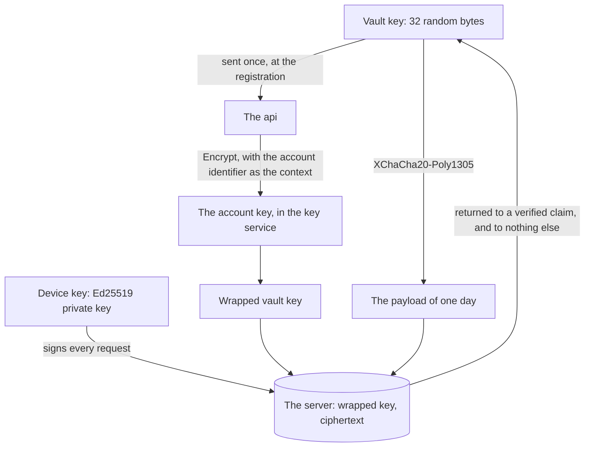

# What the encryption defends, and what it does not

Emi rests on one claim: her days are sealed on her phone, and nobody who takes the database can
read them. Emi itself can, because Emi holds her key in the cloud so that a new phone can find her
history. This repository is public so that a reader can check both halves against the code rather
than believe the marketing.

This document says which keys exist, where each one lives, what one day looks like once it is
encrypted, and the five attacks Emi accepts rather than fixes. The refusals are the part that makes
the rest worth reading.

Emi is not a contraceptive. Emi is not a medical device. Emi makes no claim to prevent or achieve a
pregnancy, and it carries no certification badge that an auditor did not sign.

## How to read this document

Status: built

Every section carries one status line, the same as `architecture.md`. `Status: built` means the
code is in this repository now. `Status: designed` means `.krewe/design.md` describes it and nobody
wrote it yet.

On 2026-10-19 the envelope is `built` and the keys that send a day are `designed`. `packages/crypto`
seals and opens a day, and fixed vectors hold the format still. The application writes every day
through it: `vault.seal` in `apps/mobile/src/features/log/logDay.ts` seals the day before the write,
so the `payload` column of the day log holds the envelope. The vault key lives in this phone's
keychain. No build sets a server address, so there is no account yet. A document that described an
empty package as though it protected somebody would be worse than no document.

The wording rules below are `built`. A test reads every document, every source file and every
string in the application, and fails the pipeline on the forbidden wording.

## The claim, in one line

Status: designed

Emi encrypts each day on the phone, with a key that stays on the phone, and sends only the result.
Emi also keeps a copy of that key in the cloud, wrapped by the Amazon key service, so that a new
phone can read her days after she signs in.

So the claim has two halves and this document gives both. Nothing that leaves the phone can be read
by anybody who takes a copy of the database, because the payload is sealed and the key is not beside
it. Emi can read it, because Emi holds the key and the function that unwraps it.

The operator made that trade on 13 November 2026. What it buys is a woman who changes her phone and
finds her history waiting, with nothing to type and no paper to keep. What it costs is the sentence
above, written here, in the store listing and on the privacy page rather than hidden.

## The keys, and what guards each one

Status: designed

There are four keys. Two live on the phone. One lives in the Amazon key service and never leaves
it. One lives on the server and opens only through the third.

### The vault key

Lives: the keychain on the phone, as `emi.vaultKey.v1`, through expo-secure-store. A copy lives in
the cloud, wrapped by the key service.

Defence: it is 32 random bytes from `expo-crypto`. It encrypts every payload. Without it the
ciphertext is 53 bytes of noise, so a copy of the server database, or of the phone database on its
own, buys nothing. It crosses the wire twice in its life: once when the phone registers it, and
once when a verified claim returns it to a new phone.

### The device key

Lives: the keychain on the phone, as `emi.deviceKey.v1`.

Defence: it is an Ed25519 private key. It signs the method, the path, the instant and the digest of
the body of every request, so a request nobody signed is refused. The server stores the public half
only. A person who steals the public half can prove nothing and read nothing, because this key
never touches a payload.

### The account key in the key service

Lives: the Amazon Web Services Key Management Service, in eu-central-1. It never leaves the service,
and no part of Emi ever holds its bytes.

Defence: one customer managed key wraps the vault key of every account, and the account identifier
travels with each call as the encryption context. The service refuses a decrypt whose context does
not match the one the ciphertext was sealed under. Two roles may call it: the registration function
may encrypt, and the function that answers a verified claim may decrypt. The key policy names those
two and nothing else.

### The wrapped vault key

Lives: the server, in the account item.

Defence: it is the vault key encrypted under the account key, so the table alone holds nothing
usable. A reader who takes the database and not the grants holds bytes that open nowhere. One
function of Emi holds the grant, which is what makes a new phone work, and which is why this
document says Emi can read her days.

## One day, once it is encrypted

Status: built

The plaintext is canonical json. The keys are sorted and there is no whitespace, so the same day
always produces the same bytes.

The envelope is bytes, in this order.

- one byte, the format version, `0x01`
- 24 bytes, a random nonce, fresh for every single write
- the ciphertext, and its 16 byte authentication tag

The cipher is XChaCha20-Poly1305 from `@noble/ciphers`. The envelope costs 41 bytes on top of the
plaintext, whatever the day holds.

One implementation lives in `packages/crypto`. It seals a day and opens it again today. The
application will use it to encrypt and to decrypt. The vault service will import it only to refuse
a malformed envelope, and never to decrypt, because the service has no key. The fixed vectors in
`packages/crypto/tests/vectors.json` hold the format still, so a change to it is caught rather
than shipped.

The day log writes the payload column through the envelope. Every write in
`apps/mobile/src/features/log/logDay.ts` and in the first run calls `vault.seal` first, and
`apps/mobile/src/data/dayLogRepository.ts` refuses a payload that is not an envelope, so no day
reaches the column as plain bytes.

The `day` column beside the payload is a copy of the date, kept in the clear so the application can
query by date. It stays on the phone. It is not part of the envelope that is sent.

## What stays plain on the phone

Status: built

Two values on the phone are readable on purpose, and this section is the list of them. Anything
that can read the database file can read every line below. None of it is sent to the server in the
clear.

A reader of that file learns which days she recorded something on, when each period started, how
long each cycle ran, and how long she bled. That reader learns nothing she wrote on a day. The
flow, the symptoms, the mood and the note are inside the sealed payload, and the payload opens
under the vault key alone.

The two values are the date of a day and the cycle cache. The date is the index a person reads a
day by, and a sealed date would turn one lookup into a walk that opens every row. The cycle cache
is worked out from days that are already sealed, so it states part of those days again in the
clear. The cost of both is written out below rather than left for a reader to assemble.

The sealed profile is not in this list, because it holds no readable field. The setting table is
plain and holds six names. Five are preferences, and none of them is about her body. The sixth
holds the article she was last shown, as its identifier and the instant she read it, and nothing
else. It records no cycle phase. The identifier names a piece of general writing anybody can
fetch, so a reader of the file learns which piece was drawn on this phone and nothing about the
cycle she was in. A launch takes the phase off a phone that still holds the older row, and writes
the file again, so the old copy does not stay in it.

### The date of a day

Lives: the `day` column of `day_log`, as `2026-09-28`, under a unique index.

What a reader learns: which days she recorded something on. Nothing of what she recorded, which
sits sealed in the `payload` column beside it. This column is a copy of a date the payload carries
too, and the copy stays on the phone.

### The times a day was written

Lives: the `created_at`, `updated_at` and `deleted_at` columns of `day_log`, beside `revision`,
`synced_revision` and the row identifier.

What a reader learns: when she first wrote a day down, when she last changed it, how many times
she changed it, and whether the row reached the server. The identifier is a universally unique
identifier of version 7, so its first six bytes are the instant the row was made and say the write
time a second time. None of it says what she wrote.

### The start of a cycle

Lives: the `started_on` column of `cycle`, under a unique index.

What a reader learns: the day each period started. Every row of this table is worked out from the
day log, so the cache states a day she recorded rather than one she was asked for.

### The length of a cycle

Lives: the `length_days` column of `cycle`, with `ended_on` beside it.

What a reader learns: how many days each cycle ran. A cycle that has not ended holds nothing in
either column, so the row she is in says only when it started.

### The length of a period

Lives: the `period_length_days` column of `cycle`.

What a reader learns: how many days she bled in each cycle. It holds nothing while a period is
still running, because the count is written once the period ends.

### Whether a cycle is a forecast

Lives: the `is_predicted` column of `cycle`, as 0 or 1.

What a reader learns: whether a row came from days she recorded or from what Emi expects. The
rebuild writes recorded cycles only, so every row on a phone today holds 0.

## What Emi does not defend against

Status: designed

Five attacks are stated here rather than fixed. Each one is written with what she can do about it.

### Emi itself, and anybody who can compel Emi

Emi holds her vault key, wrapped by the Amazon key service, and one function of Emi may unwrap it.
So Emi can read her days. A court order, a mistake in a policy, or a person inside Amazon with
enough rights each reaches the same key.

Before 13 November 2026 that key was 26 characters on a piece of paper, and nobody at Emi could get
it. The cost of that design was every woman who lost the paper, and the operator judged that cost
higher than this one.

What to do: read this sentence before she trusts the product with anything she could not say out
loud. Emi states it here, on the privacy page and in the store listing, so the choice is made with
the fact rather than against it. Her export is always hers, and her delete takes everything in one
press with no retention period.

### A sign in somebody else completes

Her account opens her days now, so a person who holds her Apple account, her Google account or her
Telegram account can sign in as her on a new phone and read her history. The sign in is the whole
defence, and Emi does not own it.

What to do: turn on the second factor of whichever provider she signs in with. Read the message Emi
sends the moment a new phone binds to her account, which is the one message that tells her this
happened.

### A phone somebody else can unlock

A person holding an unlocked phone reads everything on the screen, because the application has the
key in order to work at all.

What to do: turn the biometric lock on. It is step 5.4 and it is on by default. Emi also hides the
preview while the application is in the background, so a glance at the switcher shows nothing.

### A phone running something hostile

The key sits in the keychain of the phone. Software that already owns the operating system, through
a compromise or a jailbreak, can reach what the operating system will hand it. No application can
defend itself from underneath. Emi does not pretend otherwise.

What to do: keep the operating system current, and do not run Emi on a jailbroken phone.

### What the outside learns without reading a day

The server learns how many records an account holds, and the instant of each write. Padding those
write times would cost battery and buy little. Apple or Google also knows she bought a subscription
to Emi, because the store takes the payment.

What to do: nothing on her side. It is stated here so that a reader can weigh it, rather than find
it later.

## The wording Emi may not use

Status: built

A test reads every tracked document, every source file and the store listing copy, and fails the
pipeline when it finds the wording of a claim Emi cannot support. The list is in
`tools/pipeline/forbiddenClaims.ts` and the test is beside it.

Emi never says a day is safe, because no day is. The fertile window is an estimate of when
ovulation is likely, and it is drawn from her own past cycles.

No auditor has looked at Emi, so no standard is named here and no certification badge appears
anywhere in the product. When one signs something, this section changes and the badge arrives with
it.

One sentence may carry a forbidden word: a sentence that denies the claim. Those sentences are
listed in the same module, so adding one is a deliberate act a reviewer can see in the diff.

The application and the store listing are held to three more words, listed in the same module as
`interfaceOnlyWording`. They are ordinary English, and a document has room to explain what it means
by one. A screen has none, so a woman reads the word on its own and takes it for the claim. That
scan is in `tools/pipeline/interfaceClaims.ts` and its test is
`apps/mobile/tests/copy/claims.test.ts`.
